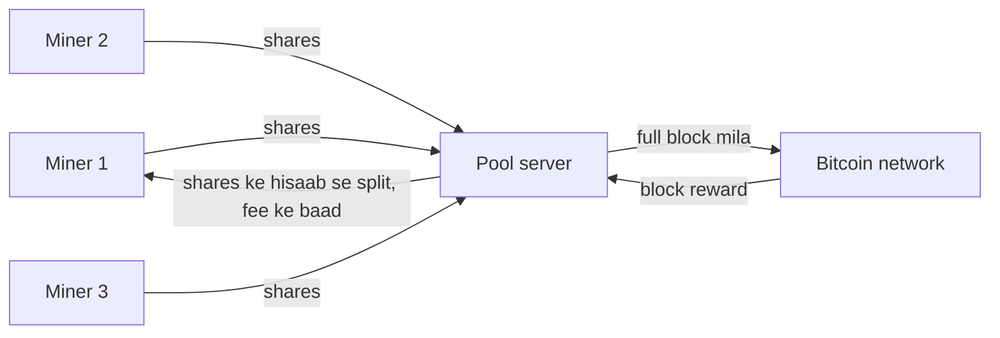
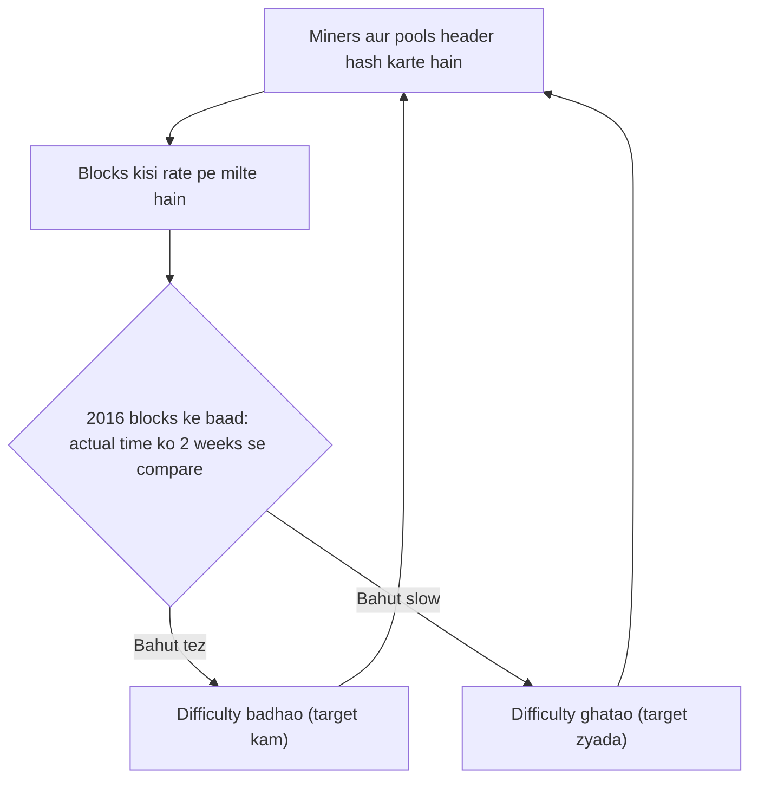

**Ek line mein:** <mark>Mining pool miners ka group hai jo apni computing power jodta hai aur reward ko har ek ke kaam ke hisaab se baantta hai; difficulty batati hai ki valid block dhoondhna kitna mushkil hai</mark>. <Cite id="consensus-mining-btcwiki-pooled" />

<Box kind="key">

**Mining pool aur difficulty ke question mein ye points likho:**

- Mining ek lottery hai; <mark>akela chhota miner ek block ke liye saalon wait kar sakta hai</mark>, pool chhoti lekin steady income deta hai.
- Pool server kaam deta hai; miners <mark>shares</mark> bhejte hain (near-miss hashes jo kaam prove karte hain); reward pool fee ke baad shares ke hisaab se baanta jaata hai.
- Reward methods: <mark>Proportional, PPS (Pay Per Share), PPLNS (Pay Per Last N Shares)</mark>, FPPS.
- Risk: <mark>50% se zyada hash power</mark> wala pool 51% attack try kar sakta hai; centralisation.
- Difficulty: <mark>target se chhota header hash</mark> dhoondhna kitna mushkil hai; target chhota, difficulty zyada.
- <mark>Har 2016 blocks</mark> pe retarget taaki 10 minutes mein ek block aaye; <mark>new difficulty = old x 2016 x 10 min / actual time</mark>; ek step mein 4 guna tak limit.

</Box>

## Core answer (5 marks, yahan ke har question ke liye)

<Box kind="definition">

A **mining pool** is a group of miners who join their computing power and share the block reward in proportion to the work each one contributed. <Cite id="consensus-mining-wiki-pool" />

</Box>

**Pools kyun hain:** aaj ke bade network mein akela miner ek block dhoondhne mein saalon wait kar sakta hai. Pool mein income chhoti lekin steady hoti hai. <Cite id="consensus-mining-btcwiki-pooled" />

**Pool kaise kaam karta hai:**

1. Miners **pool server** se connect hote hain, jo har ko kaam karne ke liye block template deta hai.
2. Miners hash karke **shares** bhejte hain: aise hashes jo full network target miss karte hain lekin aasaan pool target meet karte hain. Shares prove karte hain ki har ne kitna kaam kiya.
3. Koi miner real target meet karne wala hash dhoondhe to pool block submit karta hai aur reward pata hai.
4. Operator fee kaat leta hai aur baaki shares ke hisaab se baant deta hai. <Cite id="bitcoin-mb-ch12-mining" />

**Difficulty short mein:** block tabhi valid hai jab uske header ka hash **target** se chhota ho. Chhota target matlab zyada difficulty. Har 2016 blocks pe network real time ko 2 weeks se compare karke adjust karta hai, taaki lagbhag 10 minutes mein ek block aaye. <Cite id="consensus-mining-btcwiki-difficulty" />

**Conclusion:** <mark>pools mining income steady banate hain, aur difficulty block time ko 10 minutes ke aas paas rakhti hai</mark>. <Cite id="bitcoin-tp-bitcoin-mining" />

## Extended answer (10 marks): ye add karo

### 1. Reward-sharing methods

| Method | Kaise pay karta hai | Pros | Cons |
|---|---|---|---|
| Proportional | Block milne par reward us round ke shares ke hisaab se baanta jaata hai | Simple, fair | Luck pe depend, pool hopping possible |
| PPS (Pay Per Share) | Har share ka fixed payment, turant | Steady income, miner ko luck risk nahi | Operator risk leta hai, isliye zyada fee |
| PPLNS (Pay Per Last N Shares) | Reward sirf current round ke nahi, last N shares mein baanta jaata hai | Pool hopping rokta hai, loyal miners ko reward | Payout luck pe depend |
| FPPS | PPS plus transaction fees ka hissa | Steady, fees shamil | Pool fee zyada |

### 2. Pools ke advantages aur disadvantages

- **Advantages:** steady income, kam variance, chhote miners bhi hissa le sakte hain.
- **Disadvantages:** pool fee, operator pe trust, aur **centralisation**: 50% se zyada hash power wala pool 51% attack try kar sakta hai, isliye miners ko failne ke liye encourage kiya jaata hai. <Cite id="consensus-mining-btcwiki-majority" />

### 3. Difficulty aur retarget rule

- Miner nonce badalkar header ko tab tak hash karta hai jab tak $\text{hash} < \text{target}$.
- $\text{Difficulty} = \text{target}_{max} / \text{target}$. <Cite id="web-bt-1-target" />
- Har 2016 blocks pe retarget:

$$
\text{new difficulty} = \text{old difficulty} \times \frac{2016 \times 10 \text{ min}}{\text{actual time}}
$$

- Blocks zyada tez: difficulty badhti hai. Zyada slow: ghatti hai. Ek change 4 guna tak limited hai.

<Sum>

<Given>

Ek pool ke paas network hash rate ka 1% hai. Average mein har 10 minutes mein ek block aata hai.

</Given>

<Find>

pool kitni baar block dhoondhta hai, aur pool ke 0.1% wale miner ka hissa.

</Find>

<Steps>

1. Pool saare blocks ka $1\%$ dhoondhta hai, yaani $10 \div 0.01 = 1000$ minutes mein ek block. *Reason: har block pe uska chance uske hash power share ke barabar hai.*
2. $1000$ minutes $\approx 16.7$ ghante.
3. Miner ka har pool reward mein hissa $0.1\%$ hai (fee se pehle). *Reason: reward shares ke hisaab se baanta jaata hai.*

</Steps>

<Answer>

Pool lagbhag 17 ghante mein ek block dhoondhta hai; miner ko har pool reward ka 0.1% regularly milta hai.

</Answer>

</Sum>

## Har question mein kaise fit karein

- **"Explain mining pool and its difficulty."** (5 marks) <PYQ id="2023-12-ce/q1c" /> <PYQ id="2025-05-ce/q1e" />: core answer: pool definition, kyun, paanch-step working, pool diagram aur do-line difficulty, phir conclusion.
- **"Mining pool and its methods"** (10 marks) <PYQ id="2024-05-ce/q6d" />: core answer (sirf pool part), section 1 (methods table), section 2 aur worked example.

## Exam tips

- **Pool diagram draw karo:** miners, pool server, network aur wapas aata reward.
- Teen methods <mark>Proportional, PPS, PPLNS</mark> ek-ek line ke saath likho.
- Difficulty part ke liye 2016-block rule aur "aasaan ya mushkil" ki direction likho.

Exam mein English mein likho.
