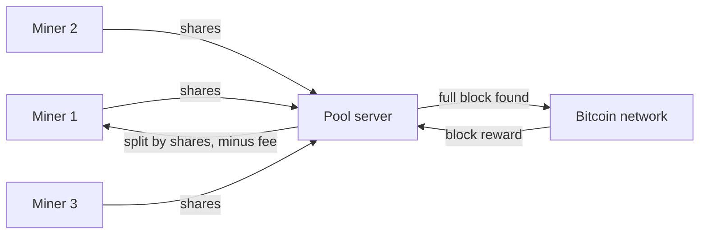
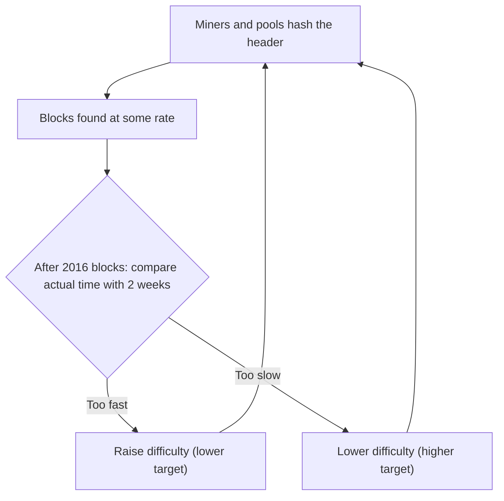

**In one line:** <mark>A mining pool is a group of miners who combine their computing power and share the reward in proportion to the work each did; difficulty tells how hard it is to find a valid block</mark>. <Cite id="consensus-mining-btcwiki-pooled" />

<Box kind="key">

**Key points to write (mining pool and difficulty):**

- Mining is a lottery; <mark>a lone small miner may wait years for one block</mark>, a pool gives small, steady income.
- Pool server gives work; miners send <mark>shares</mark> (near-miss hashes that prove work); reward is split by shares after a pool fee.
- Reward methods: <mark>Proportional, PPS (Pay Per Share), PPLNS (Pay Per Last N Shares)</mark>, FPPS.
- Risk: a pool with <mark>more than 50% of hash power</mark> can attempt a 51% attack; centralisation.
- Difficulty: how hard it is to find <mark>a header hash below the target</mark>; smaller target, harder.
- Retarget <mark>every 2016 blocks</mark> to keep one block per 10 minutes; <mark>new difficulty = old x 2016 x 10 min / actual time</mark>; limited to 4 times per step.

</Box>

## Core answer (5 marks, fits every question here)

<Box kind="definition">

A **mining pool** is a group of miners who join their computing power and share the block reward in proportion to the work each one contributed. <Cite id="consensus-mining-wiki-pool" />

</Box>

**Why pools exist:** with today's huge network a lone miner may wait years to find one block. In a pool the income is small but steady. <Cite id="consensus-mining-btcwiki-pooled" />

**How a pool works:**

1. Miners connect to the **pool server**, which gives each a block template to work on.
2. Miners hash and send **shares**: hashes that miss the full network target but meet an easier pool target. Shares prove how much work each did.
3. If any miner finds a hash that meets the real target, the pool submits the block and receives the reward.
4. The operator deducts a fee and splits the rest by shares. <Cite id="bitcoin-mb-ch12-mining" />

**Difficulty in short:** a block is valid only if the hash of its header is below a **target**. A smaller target means higher difficulty. Every 2016 blocks the network compares the real time taken with 2 weeks and adjusts, so a block comes about every 10 minutes. <Cite id="consensus-mining-btcwiki-difficulty" />

**Conclusion:** <mark>pools make mining income steady, and difficulty keeps block time near 10 minutes</mark>. <Cite id="bitcoin-tp-bitcoin-mining" />

## Extended answer (10 marks): add these

### 1. Reward-sharing methods

| Method | How it pays | Pros | Cons |
|---|---|---|---|
| Proportional | When a block is found, reward is split by shares in that round | Simple, fair | Luck-based, pool hopping possible |
| PPS (Pay Per Share) | Fixed payment for each share, at once | Steady income, no luck risk for miner | Operator takes the risk, so higher fee |
| PPLNS (Pay Per Last N Shares) | Reward split over the last N shares, not only the current round | Discourages pool hopping, rewards loyal miners | Payout depends on luck |
| FPPS | PPS plus a share of transaction fees | Steady, includes fees | Higher pool fee |

### 2. Advantages and disadvantages of pools

- **Advantages:** steady income, low variance, lets small miners take part.
- **Disadvantages:** pool fee, trust in the operator, and **centralisation**: a pool above 50% of hash power could try a 51% attack, so miners are encouraged to spread out. <Cite id="consensus-mining-btcwiki-majority" />

### 3. Difficulty and the retarget rule

- A miner changes the nonce and hashes the header until $\text{hash} < \text{target}$.
- $\text{Difficulty} = \text{target}_{max} / \text{target}$. <Cite id="web-bt-1-target" />
- Retarget every 2016 blocks:

$$
\text{new difficulty} = \text{old difficulty} \times \frac{2016 \times 10 \text{ min}}{\text{actual time}}
$$

- Blocks too fast: difficulty goes up. Too slow: it goes down. One change is limited to a factor of 4.

<Sum>

<Given>

A pool holds 1% of the network hash rate. A block comes every 10 minutes on average.

</Given>

<Find>

how often the pool finds a block, and the share of a miner who has 0.1% of the pool.

</Find>

<Steps>

1. The pool finds $1\%$ of all blocks, so one block per $10 \div 0.01 = 1000$ minutes. *Reason: its chance per block equals its share of hash power.*
2. $1000$ minutes $\approx 16.7$ hours.
3. The miner's share of each pool reward is $0.1\%$ (before the fee). *Reason: rewards are split by shares.*

</Steps>

<Answer>

About one block per 17 hours for the pool; the miner gets 0.1% of every pool reward, regularly.

</Answer>

</Sum>

## Fit it to each question

- **"Explain mining pool and its difficulty."** (5 marks) <PYQ id="2023-12-ce/q1c" /> <PYQ id="2025-05-ce/q1e" />: core answer: pool definition, why, the five-step working, pool diagram and the two-line difficulty, then the conclusion.
- **"Mining pool and its methods"** (10 marks) <PYQ id="2024-05-ce/q6d" />: core answer (pool part only), section 1 (methods table), section 2 and the worked example.

## Exam tips

- **Draw** the pool diagram with miners, pool server, network and the reward flowing back.
- Name the three methods <mark>Proportional, PPS, PPLNS</mark> with one line each.
- For the difficulty part write the 2016-block rule and the "easier or harder" direction.
