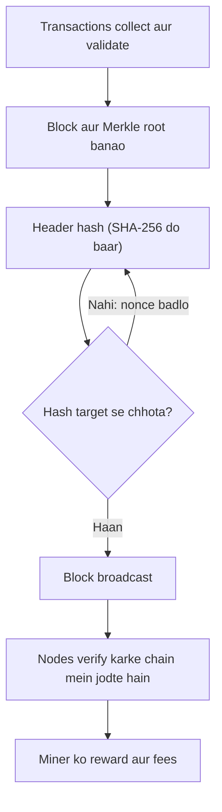
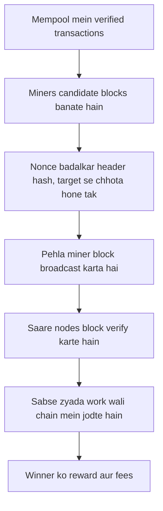

**Ek line mein:** <mark>Mining wo kaam hai jo miners transactions validate karne, unhe block mein pack karne aur proof-of-work puzzle solve karke block jodne ka haq jeetne ke liye karte hain; Bitcoin us chain ko accept karke consensus banata hai jisme sabse zyada accumulated work ho (Nakamoto consensus)</mark>. <Cite id="bitcoin-mb-ch12-mining" />

<Box kind="key">

**Mining process aur Bitcoin consensus ke question mein ye points likho:**

- Steps: <mark>collect, validate, coinbase aur Merkle root ke saath block banao, header hash karo, broadcast, verify, reward</mark>.
- Puzzle: <mark>nonce</mark> badlo jab tak <mark>header ka double SHA-256 target se chhota</mark> na ho.
- Reward = <mark>block subsidy plus transaction fees</mark>; subsidy har 210,000 blocks pe aadhi hoti hai (April 2024 se 3.125 BTC).
- Consensus rule: nodes <mark>sabse zyada accumulated work wali chain (longest chain)</mark> accept karte hain.
- Forks: do blocks ek saath, agla block faisla karta hai, dusra <mark>orphan (stale)</mark> ho jaata hai.
- Security: <mark>6 confirmations</mark>; attacker ko <mark>51% se zyada hash power</mark> chahiye.

</Box>

## Core answer (5 marks, yahan ke har question ke liye)

<Box kind="definition">

**Mining** is the work done by special computers (miners) to check new transactions, pack them into a block and add that block to the blockchain. The first miner to solve a hard puzzle wins the right to add the block and gets a reward. <Cite id="bitcoin-mb-ch12-mining" />

</Box>

**Kyun chahiye:** payments approve karne wala koi central bank nahi. Mining (proof of work) hazaaron ajnabiyon ko ek history pe agree karne deti hai aur naye coins bhi banati hai.

**Mining ke steps (Bitcoin):**

1. Mempool se unconfirmed transactions **collect** karo.
2. Har ek ko **validate** karo: valid signature, coins pehle se spend nahi, sahi format.
3. **Candidate block banao:** coinbase transaction (miner ko reward plus fees) jodo aur Merkle root nikaalo.
4. **Block header banao:** version, previous hash, Merkle root, timestamp, target (nBits), nonce.
5. **Header ko SHA-256 se do baar hash karo.** Result target se chhota na ho to nonce badlo aur phir try karo, ek second mein arabon baar.
6. **Valid hash mil gaya:** block broadcast karo.
7. **Dusre nodes verify** karte hain ek hash se aur apni chain mein jodte hain, phir uske upar mining shuru karte hain.
8. **Reward:** block subsidy plus fees. <Cite id="bitcoin-btcwiki-mining" />

**Consensus ek line mein:** har node khud verify karta hai aur sabse zyada accumulated work wali chain follow karta hai. <Cite id="blockchain-fundamentals-nakamoto" loc="§5" />

**Conclusion:** <mark>mining block banana costly aur check karna sasta banakar Bitcoin ko secure karti hai, aur honest miners ko reward deti hai</mark>. <Cite id="consensus-mining-gfg-pow" />

## Extended answer (10 marks): ye add karo

### 1. Bitcoin consensus (Nakamoto consensus)

1. Har full node har transaction aur block ko rules ke against **khud verify** karta hai.
2. Miners proof of work se compete karte hain; pehla valid block broadcast hota hai.
3. Nodes use us chain mein jodte hain jisme **sabse zyada accumulated work** ho (aam taur pe longest chain). <Cite id="bitcoin-mb-ch12-mining" />
4. Do miners lagbhag ek saath block dhoondhein to chain thodi der ke liye fork hoti hai; agla block ek branch pe aaye to dusra **orphan (stale)** block ho jaata hai aur uske transactions mempool mein wapas aate hain.
5. Jis block ke upar zyada blocks hon use badalna exponentially mushkil hai; lagbhag 6 confirmations final maane jaate hain. <Cite id="consensus-mining-btcwiki-confirmation" />

### 2. Mining ke key facts

- **Difficulty:** har 2016 blocks pe adjust, taaki lagbhag 10 minutes mein ek block aaye. <Cite id="bitcoin-btcwiki-difficulty" />
- **Halving:** subsidy har 210,000 blocks (lagbhag 4 saal) pe aadhi: 6.25 BTC, phir April 2024 se 3.125 BTC. <Cite id="bitcoin-btcwiki-halving" />
- **Pools:** chhote miners kaam aur reward share karne ke liye jud jaate hain.
- **Hardware:** CPU, phir GPU, phir ASIC machines.

### 3. Strengths aur weaknesses

| Strength | Weakness |
|---|---|
| Kisi ke liye bhi open, trust nahi chahiye | Bahut bijli |
| Bade network ke liye bahut secure | Slow: lagbhag 10 minutes per block |
| Simple rule: sabse zyada work jeetta hai | Pools power concentrate karte hain |

### 4. Security

Recent history badalne ke liye attacker ko network ki aadhi se zyada hash power (**51% attack**) chahiye. Tab bhi private keys ke bina coins chori nahi ho sakte. <Cite id="consensus-mining-btcwiki-majority" />

## Har question mein kaise fit karein

- **"Explain the process of mining in detail."** (10 marks) <PYQ id="2023-12/q2b" />: core answer (aath steps aur flow diagram), phir section 2 (difficulty, halving, pools) aur section 3.

## Exam tips

- **Mining loop draw karo** "hash below target?" decision ke saath.
- <mark>"proof of work"</mark>, <mark>"longest chain"</mark> aur <mark>"51% attack"</mark> phrases use karo.
- Consensus question mein har node ke verification aur fork rule pe zor do.

Exam mein English mein likho.
