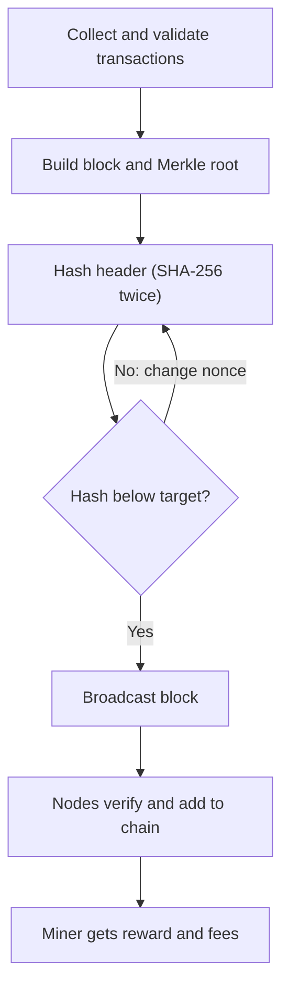
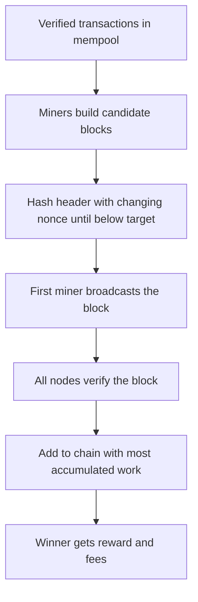

**In one line:** <mark>Mining is the work miners do to validate transactions, pack them into a block and win the right to add it by solving a proof-of-work puzzle; Bitcoin reaches consensus by accepting the chain with the most accumulated work (Nakamoto consensus)</mark>. <Cite id="bitcoin-mb-ch12-mining" />

<Box kind="key">

**Key points to write (mining process and Bitcoin consensus):**

- Steps: <mark>collect, validate, build block with coinbase and Merkle root, hash header, broadcast, verify, reward</mark>.
- Puzzle: change the <mark>nonce</mark> until the <mark>double SHA-256 of the header is below the target</mark>.
- Reward = <mark>block subsidy plus transaction fees</mark>; subsidy halves every 210,000 blocks (3.125 BTC since April 2024).
- Consensus rule: nodes accept the <mark>chain with the most accumulated work (longest chain)</mark>.
- Forks: two blocks at once, the next block decides, the other becomes <mark>orphan (stale)</mark>.
- Security: <mark>6 confirmations</mark>; an attacker needs more than <mark>51% of hash power</mark>.

</Box>

## Core answer (5 marks, fits every question here)

<Box kind="definition">

**Mining** is the work done by special computers (miners) to check new transactions, pack them into a block and add that block to the blockchain. The first miner to solve a hard puzzle wins the right to add the block and gets a reward. <Cite id="bitcoin-mb-ch12-mining" />

</Box>

**Why needed:** no central bank approves payments. Mining (proof of work) lets thousands of strangers agree on one history and also creates new coins.

**Steps of mining (Bitcoin):**

1. **Collect** unconfirmed transactions from the mempool.
2. **Validate** each: valid signature, coins not already spent, correct format.
3. **Build a candidate block:** add a coinbase transaction (reward plus fees to the miner) and compute the Merkle root.
4. **Make the block header:** version, previous hash, Merkle root, timestamp, target (nBits), nonce.
5. **Hash the header twice with SHA-256.** If the result is not below the target, change the nonce and try again, billions of times per second.
6. **Valid hash found:** broadcast the block.
7. **Other nodes verify** it with one hash and add it to their chain, then start mining on top of it.
8. **Reward:** block subsidy plus fees. <Cite id="bitcoin-btcwiki-mining" />

**Consensus in one line:** every node verifies on its own and follows the chain with the most accumulated work. <Cite id="blockchain-fundamentals-nakamoto" loc="§5" />

**Conclusion:** <mark>mining secures Bitcoin by making block creation costly and checking cheap, and rewards honest miners</mark>. <Cite id="consensus-mining-gfg-pow" />

## Extended answer (10 marks): add these

### 1. Bitcoin consensus (Nakamoto consensus)

1. Every full node **independently verifies** each transaction and block against the rules.
2. Miners compete with proof of work; the first valid block is broadcast.
3. Nodes add it to the chain with the **most accumulated work** (usually called the longest chain). <Cite id="bitcoin-mb-ch12-mining" />
4. If two miners find a block at almost the same time the chain forks briefly; when the next block lands on one branch, the other becomes an **orphan (stale)** block and its transactions return to the mempool.
5. A block buried under more blocks is exponentially harder to replace; about 6 confirmations are treated as final. <Cite id="consensus-mining-btcwiki-confirmation" />

### 2. Key facts about mining

- **Difficulty:** adjusted every 2016 blocks so a block comes about every 10 minutes. <Cite id="bitcoin-btcwiki-difficulty" />
- **Halving:** the subsidy halves every 210,000 blocks (about 4 years): 6.25 BTC, then 3.125 BTC since April 2024. <Cite id="bitcoin-btcwiki-halving" />
- **Pools:** small miners join to share work and reward.
- **Hardware:** CPU, then GPU, then ASIC machines.

### 3. Strengths and weaknesses

| Strength | Weakness |
|---|---|
| Open to anyone, no trust needed | Huge electricity use |
| Very secure for big networks | Slow: about 10 minutes per block |
| Simple rule: most work wins | Pools concentrate power |

### 4. Security

An attacker needs more than half of the network's hash power (**51% attack**) to rewrite recent history. Even then, coins cannot be stolen without private keys. <Cite id="consensus-mining-btcwiki-majority" />

## Fit it to each question

- **"Explain the process of mining in detail."** (10 marks) <PYQ id="2023-12/q2b" />: core answer (eight steps and the flow diagram), then section 2 (difficulty, halving, pools) and section 3.
- **"Consensus in Bitcoin"** (10 marks) <PYQ id="2023-12-ce/q6a" />: short core answer, then section 1 (five-step consensus and diagram), section 3 and section 4.

## Exam tips

- **Draw** the mining loop with the "hash below target?" decision.
- Use the phrases <mark>"proof of work"</mark>, <mark>"longest chain"</mark> and <mark>"51% attack"</mark>.
- For the consensus question stress the verification by every node and the fork rule.
