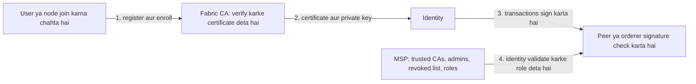
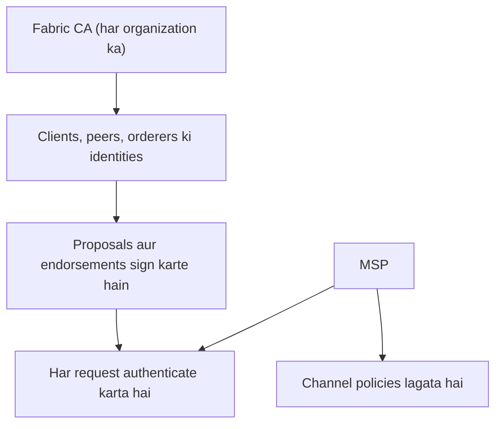

**Ek line mein:** <mark>Fabric CA identities banata hai (certificates issue karta hai), aur MSP tay karta hai ki identity accepted hai ya nahi aur woh kya kar sakti hai</mark>. <Cite id="hyperledger-fabric-membership" />

<Box kind="key">

**MSP aur CA question mein ye points likho:**

- Fabric **permissioned** hai: <mark>har member ki known identity chahiye</mark> (X.509 certificate).
- **Fabric CA** = <mark>server jo users register karta hai aur certificates issue, renew aur revoke karta hai</mark>.
- **MSP** = <mark>configuration (folders aur rules) jo trusted CAs, admins aur revoked certificates ki list rakhti hai aur roles deti hai</mark>.
- CA batata hai "**yeh kaun hai?**"; MSP batata hai "**kya hum ispe bharosa karein, aur yeh kya kar sakta hai?**".
- MSP types: <mark>local MSP</mark> (node ya user ka) aur <mark>channel MSP</mark> (saare peers same tarah judge karte hain).
- Dono milkar <mark>permissioned access dete hain, koi anonymous member nahi</mark>.

</Box>

## Core answer (5 marks, yahan ke har question ke liye)

<Box kind="definition">

**Fabric CA (Certificate Authority)** is a server that registers users and nodes and issues, renews and revokes their X.509 digital certificates. **MSP (Membership Service Provider)** is a configuration that lists which CAs an organization trusts, and it validates certificates and gives each holder a role. <Cite id="hyperledger-fabric-ca-guide" /> <Cite id="hyperledger-fabric-identity" />

</Box>

**Dono kyun:** Fabric mein anonymous members nahi hote. CA card issuer jaisa hai jo identity banata hai; MSP dukaan ki accepted cards ki list jaisa hai jo us par bharosa karne ka decision leta hai.

**Conclusion:** <mark>the CA issues identities, and the MSP trusts and authorises them; both are needed for a secure Fabric network</mark>. <Cite id="hyperledger-fabric-wiki-pki" />

## Extended answer (10 marks): ye add karo

### 1. Comparison table

| Point | Fabric CA | MSP |
|---|---|---|
| Yeh kya hai | Ek server jo tum chalate ho | Folders aur rules ki configuration |
| Main kaam | Identities banana: register, enroll, renew, revoke | Identities pehchanna aur roles dena |
| Kaunsa sawaal | "Yeh kaun hai? Yeh raha certificate." | "Kya is certificate pe bharosa hai, aur yeh kya kar sakta hai?" |
| Output | X.509 certificates aur keys | Decision: valid ya nahi, aur role |
| Scope | Ek CA server | Local (node) aur channel level |
| Zaroori? | Koi CA chahiye (Fabric CA diya hua hai) | Har organization aur node ko MSP chahiye |

### 2. Fabric CA detail mein

Yeh users register karta hai, unhe enroll karta hai (naam ko public key se jodne wala certificate deta hai; user private key rakhta hai) aur certificates revoke karta hai. Yeh LDAP ko user list ki tarah use kar sakta hai aur root ya intermediate CA ho sakta hai. <Cite id="hyperledger-fabric-ca-guide" />

### 3. MSP detail mein

MSP mein organization ke trusted root aur intermediate CA certificates, uske administrators, aur revoked certificates hote hain. Yeh certificate ko is list se check karta hai aur role deta hai: admin, peer, client, orderer ya member. **Local MSP** ek node ya user ka hota hai; **channel MSP** channel configuration mein hota hai, isliye saare peers identities ko same tarah judge karte hain. <Cite id="hyperledger-fabric-identity" />

### 4. Hyperledger Fabric mein role

CA har organization ke clients, peers aur orderers ko identities deta hai. MSP peers aur orderers ko requests authenticate karne, endorsement signatures check karne aur channel policies lagane mein madad karta hai. <Cite id="hyperledger-fabric-gfg-fabric" />

## Har question mein kaise fit karein

- **"Compare the role of MSP and Fabric CA. Explain their role in Hyperledger blockchain."** (10 marks) <PYQ id="2023-12-ce/q3a" />: core answer (definitions aur diagram), phir extended section 1 (comparison table) aur section 4 (Fabric mein role).

## Exam tips

- Flow **draw karo**: user, CA, certificate, phir MSP validate karke role deta hua.
- Keywords: <mark>X.509 certificate, enroll, revoke, local MSP, channel MSP, role, permissioned</mark>.
- Dono ko mix mat karo: CA **issue** karta hai, MSP **validate** karta hai.

Exam mein English mein likho.
