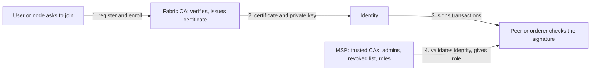
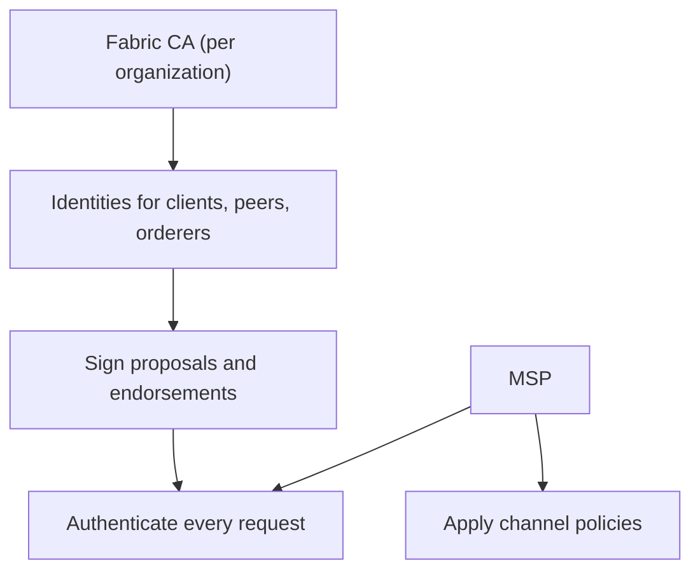

**In one line:** <mark>The Fabric CA creates identities (issues certificates), and the MSP decides whether an identity is accepted and what it may do</mark>. <Cite id="hyperledger-fabric-membership" />

<Box kind="key">

**Key points to write (MSP and CA question):**

- Fabric is **permissioned**: <mark>every member needs a known identity</mark> (an X.509 certificate).
- **Fabric CA** = a <mark>server that registers users and issues, renews and revokes certificates</mark>.
- **MSP** = a <mark>configuration (folders and rules) that lists trusted CAs, admins and revoked certificates, and assigns roles</mark>.
- CA answers "**who is this?**"; MSP answers "**do we trust it, and what may it do?**".
- MSP types: <mark>local MSP</mark> (a node or user) and <mark>channel MSP</mark> (all peers judge the same way).
- Together they give <mark>permissioned access with no anonymous members</mark>.

</Box>

## Core answer (5 marks, fits every question here)

<Box kind="definition">

**Fabric CA (Certificate Authority)** is a server that registers users and nodes and issues, renews and revokes their X.509 digital certificates. **MSP (Membership Service Provider)** is a configuration that lists which CAs an organization trusts, and it validates certificates and gives each holder a role. <Cite id="hyperledger-fabric-ca-guide" /> <Cite id="hyperledger-fabric-identity" />

</Box>

**Why both:** Fabric has no anonymous members. The CA is like a card issuer that creates the identity; the MSP is like the shop's list of accepted cards that decides to trust it.

**Conclusion:** <mark>the CA issues identities, and the MSP trusts and authorises them; both are needed for a secure Fabric network</mark>. <Cite id="hyperledger-fabric-wiki-pki" />

## Extended answer (10 marks): add these

### 1. Comparison table

| Point | Fabric CA | MSP |
|---|---|---|
| What it is | A server you run | A configuration of folders and rules |
| Main job | Create identities: register, enroll, renew, revoke | Recognise identities and assign roles |
| Question answered | "Who is this? Here is a certificate." | "Do we trust this certificate, and what may it do?" |
| Output | X.509 certificates and keys | A decision: valid or not, and the role |
| Scope | One CA server | Local (node) and channel level |
| Required? | Some CA is needed (Fabric CA is the one supplied) | Every organization and node needs an MSP |

### 2. Fabric CA in detail

It registers users, enrolls them (gives a certificate linking a name to a public key; the user keeps the private key) and revokes certificates. It can use LDAP as its user list and can be a root or an intermediate CA. <Cite id="hyperledger-fabric-ca-guide" />

### 3. MSP in detail

An MSP holds the root and intermediate CA certificates an organization trusts, its administrators, and the revoked certificates. It checks a certificate against this list and gives a role: admin, peer, client, orderer or member. A **local MSP** belongs to one node or user; a **channel MSP** is in the channel configuration, so all peers judge identities the same way. <Cite id="hyperledger-fabric-identity" />

### 4. Role in Hyperledger Fabric

The CA gives each organization's clients, peers and orderers their identities. The MSP lets peers and orderers authenticate requests, check endorsement signatures and apply channel policies. <Cite id="hyperledger-fabric-gfg-fabric" />

## Fit it to each question

- **"Compare the role of MSP and Fabric CA. Explain their role in Hyperledger blockchain."** (10 marks) <PYQ id="2023-12-ce/q3a" />: core answer (definitions and diagram), then extended section 1 (comparison table) and section 4 (role in Fabric).

## Exam tips

- **Draw** the flow: user, CA, certificate, then MSP validating and giving a role.
- Keywords: <mark>X.509 certificate, enroll, revoke, local MSP, channel MSP, role, permissioned</mark>.
- Do not mix them up: the CA **issues**, the MSP **validates**.
