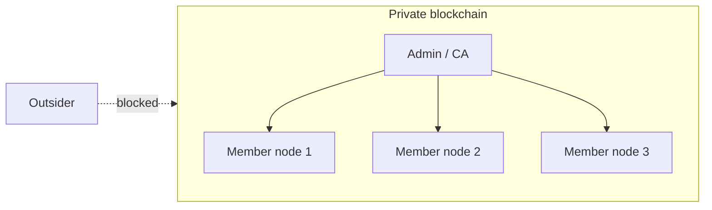
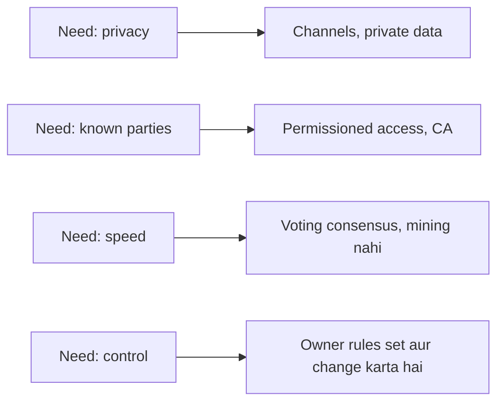

**Ek line mein:** <mark>Private (permissioned) blockchain woh blockchain hai jisme sirf invited, known members join, read ya write kar sakte hain</mark>; businesses ko privacy, speed aur control chahiye jo public chain nahi de sakti. <Cite id="private-blockchain-gfg-private" />

<Box kind="key">

**Need ya characteristics question mein ye points likho:**

- Definition: <mark>permissioned blockchain: sirf authorised, known nodes join karte hain; har ek ki identity hoti hai</mark>.
- **Need:** <mark>business data ki privacy</mark>, <mark>known identities</mark> (KYC, audit), <mark>high speed aur low cost</mark>, <mark>control aur governance</mark>, legal compliance, kam energy.
- **Characteristics:** <mark>permissioned access, ek organisation ya group ka control, fast aur scalable, mining nahi (PBFT, Raft, PoA), privacy, rules badle ja sakte hain</mark>.
- Trade-off: public chain se <mark>kam decentralised aur kam trustless</mark>.
- Examples: <mark>Hyperledger Fabric, Corda, Quorum</mark>.

</Box>

## Core answer (5 marks, yahan ke har question ke liye)

<Box kind="definition">

A **private (permissioned) blockchain** restricts who may join, validate and write. Participants are identified and approved by the owner, like a company's internal network. <Cite id="private-blockchain-gfg-private" />

</Box>

**Need (companies kyun use karti hain):**

1. **Business data ki privacy.** Public chain pe har transaction dikhti hai. Company apne rivals ko prices, contracts ya customers nahi dikha sakti.
2. **Known identities.** KYC aur audit jaise laws ko pata hona chahiye ki kaun participate kar raha hai.
3. **High speed, low cost.** Kam trusted nodes voting (Raft, PBFT) se agree karte hain, to mining nahi aur mining fees nahi.
4. **Control aur governance.** Owner ya consortium tay karta hai kaun read, write aur validate kare, aur rules badal sakta hai ya galtiyan sudhar sakta hai.
5. **Legal compliance aur kam energy.** Nodes known hain isliye data rules follow ho sakte hain, aur proof of work nahi lagta.

**Key characteristics:**

1. Identities ke saath permissioned access.
2. Ek organisation ya chhote group ka control.
3. Fast aur scalable: hazaaron transactions per second possible.
4. Mining nahi; PBFT, Raft ya Proof of Authority use hota hai.
5. Channels ya private data se privacy.
6. Rules badle ja sakte hain; galat data agreement se sudhara ja sakta hai.
7. Kam decentralised: members ko owner pe thoda bharosa karna padta hai. <Cite id="private-blockchain-fabric-whatis" />

**Conclusion:** <mark>private blockchains give shared-ledger benefits while keeping the privacy, speed and control that businesses require</mark>.

## Extended answer (10 marks): ye add karo

### 1. Public vs private

| Point | Public | Private |
|---|---|---|
| Kaun join kar sakta hai | Koi bhi | Invited members |
| Speed | Slow | Fast |
| Privacy | Kam (sab dikhta hai) | Zyada |
| Consensus | PoW, PoS | Raft, PBFT, PoA |
| Control | Kisi ka nahi | Owner ya consortium |
| Energy aur fees | Zyada | Kam |

<Cite id="private-blockchain-gfg-pubpriv" />

### 2. Examples aur uses

Hyperledger Fabric, Corda aur Quorum trade finance, supply chains aur banking mein use hote hain. <Cite id="blockchain-fundamentals-ibm-blockchain" />

### 3. Limitations

- Kam decentralised, isliye members ko owners pe bharosa karna padta hai.
- Kam validators matlab milibhagat (collusion) ka risk zyada.
- Network utna hi trusted hai jitne uske admins. <Cite id="blockchain-fundamentals-gfg-types" />

## Har question mein kaise fit karein

- **"Explain the need of private blockchain."** (5 marks) <PYQ id="2023-12/q1d" />: **Need** list (paanch points), public vs private table aur ek example likho. Characteristics list chhoti rakho.
- **"Explain the key characteristics of private Blockchain"** (5 marks) <PYQ id="2024-12/q1d" />: definition, saat **characteristics**, diagram aur public vs private table likho.

## Exam tips

- Band boundary **draw karo** jisme approved members andar aur outsiders bahar block hain.
- Keywords: <mark>permissioned, known identities, no mining, privacy, governance, PBFT, Raft</mark>.
- Limitation hamesha add karo: kam decentralised.

Exam mein English mein likho.
