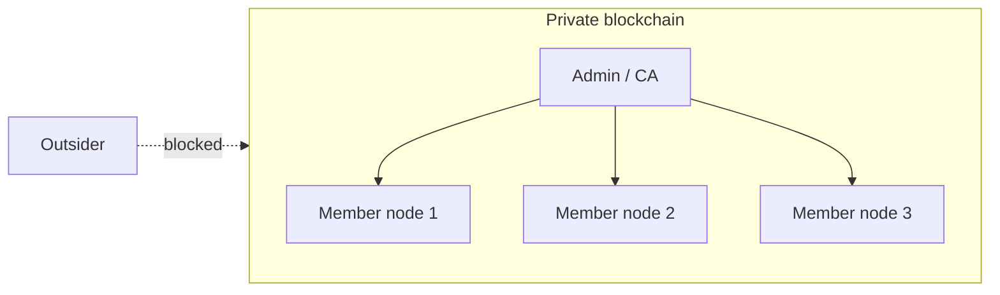
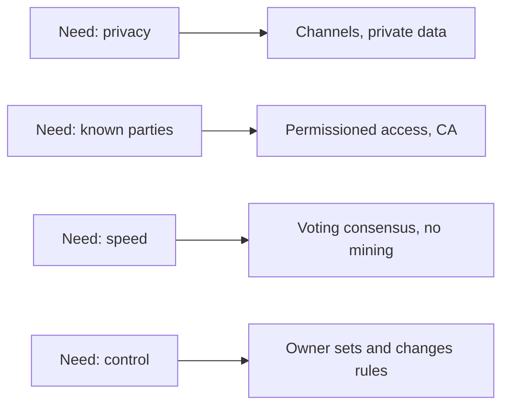

**In one line:** <mark>A private (permissioned) blockchain is a blockchain that only invited, known members can join, read or write</mark>; businesses need it for privacy, speed and control that a public chain cannot give. <Cite id="private-blockchain-gfg-private" />

<Box kind="key">

**Key points to write (need or characteristics):**

- Definition: <mark>permissioned blockchain: only authorised, known nodes join; each has an identity</mark>.
- **Need:** <mark>privacy of business data</mark>, <mark>known identities</mark> (KYC, audit), <mark>high speed and low cost</mark>, <mark>control and governance</mark>, legal compliance, less energy.
- **Characteristics:** <mark>permissioned access, controlled by one organisation or a group, fast and scalable, no mining (PBFT, Raft, PoA), privacy, rules can be changed</mark>.
- Trade-off: <mark>less decentralised and less trustless</mark> than a public chain.
- Examples: <mark>Hyperledger Fabric, Corda, Quorum</mark>.

</Box>

## Core answer (5 marks, fits every question here)

<Box kind="definition">

A **private (permissioned) blockchain** restricts who may join, validate and write. Participants are identified and approved by the owner, like a company's internal network. <Cite id="private-blockchain-gfg-private" />

</Box>

**Need (why companies use it):**

1. **Privacy of business data.** On a public chain every transaction is visible. A company cannot show prices, contracts or customers to rivals.
2. **Known identities.** Laws such as KYC and audit rules need to know who takes part.
3. **High speed, low cost.** Few trusted nodes agree by voting (Raft, PBFT), so no mining and no mining fees.
4. **Control and governance.** The owner or consortium decides who reads, writes and validates, and can change rules or fix errors.
5. **Legal compliance and less energy.** Data rules can be followed because nodes are known, and no proof of work is used.

**Key characteristics:**

1. Permissioned access with identities.
2. Controlled by one organisation or a small group.
3. Fast and scalable: thousands of transactions per second are possible.
4. No mining; uses PBFT, Raft or Proof of Authority.
5. Privacy through channels or private data.
6. Rules can be changed; bad data can be corrected by agreement.
7. Less decentralised: members must trust the owner somewhat. <Cite id="private-blockchain-fabric-whatis" />

**Conclusion:** <mark>private blockchains give shared-ledger benefits while keeping the privacy, speed and control that businesses require</mark>.

## Extended answer (10 marks): add these

### 1. Public versus private

| Point | Public | Private |
|---|---|---|
| Who can join | Anyone | Invited members |
| Speed | Slow | Fast |
| Privacy | Low (all visible) | High |
| Consensus | PoW, PoS | Raft, PBFT, PoA |
| Control | Nobody | Owner or consortium |
| Energy and fees | High | Low |

<Cite id="private-blockchain-gfg-pubpriv" />

### 2. Examples and uses

Hyperledger Fabric, Corda and Quorum are used for trade finance, supply chains and banking. <Cite id="blockchain-fundamentals-ibm-blockchain" />

### 3. Limitations

- Less decentralised, so members must trust the owners.
- Fewer validators means a smaller attack surface for collusion.
- The network is only as trusted as its admins. <Cite id="blockchain-fundamentals-gfg-types" />

## Fit it to each question

- **"Explain the need of private blockchain."** (5 marks) <PYQ id="2023-12/q1d" />: write the **Need** list (five points), the public versus private table and one example. Keep the characteristics list short.
- **"Explain the key characteristics of private Blockchain"** (5 marks) <PYQ id="2024-12/q1d" />: write the definition, the seven **characteristics**, the diagram and the public versus private table.

## Exam tips

- **Draw** the closed boundary with approved members inside and outsiders blocked.
- Keywords: <mark>permissioned, known identities, no mining, privacy, governance, PBFT, Raft</mark>.
- Always add the limitation: less decentralised.
