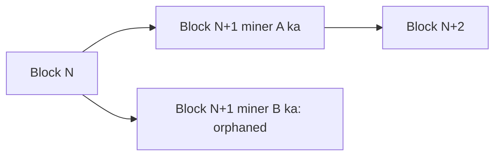
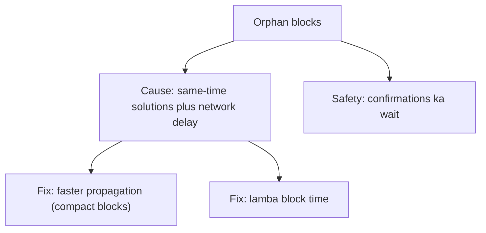

**Ek line mein:** <mark>Orphaned block ek valid block hai jo mine hua par main chain ka part nahi hai, kyunki usi height ka dusra block race jeet gaya</mark>. Uske miner ko reward nahi milta. <Cite id="block-structure-merkle-btcwiki-orphan" />

<Box kind="key">

**Orphaned block ke har question mein ye points likho:**

- Cause: <mark>do miners lagbhag ek saath block solve karte hain</mark> aur network delay se nodes split ho jaate hain: temporary **fork**.
- Rule: nodes <mark>sabse zyada accumulated work wali chain (longest chain)</mark> follow karte hain.
- Losing branch ka block <mark>orphaned (stale)</mark> ho jaata hai; uske transactions mempool mein wapas aate hain.
- Effect: miner <mark>block reward kho deta hai</mark> aur bijli ka kharcha bhi.
- Isliye exchanges payment final maanne se pehle <mark>kuch confirmations (lagbhag 6)</mark> ka wait karte hain.
- Merge se pehle Ethereum inhe **uncle (ommer) blocks** kehta tha aur chhota reward deta tha.

</Box>

## Core answer (5 marks, yahan ke har question ke liye)

<Box kind="definition">

An **orphaned block** is a valid block that is not on the main chain, because a competing block at the same height was accepted by the network instead. <Cite id="block-structure-merkle-btcwiki-orphan" />

</Box>

**Ye kaise hota hai:**

1. Network ki koi central clock nahi hai aur blocks ko travel karne mein time lagta hai.
2. Do miners, A aur B, block N ke upar lagbhag ek saath puzzle solve karte hain.
3. Kuch nodes ko pehle A ka block milta hai, kuch ko B ka: chain **fork** ho gayi.
4. Miners jo block pehle dekhte hain usi pe kaam karte rehte hain.
5. Agla block N+2 ek branch pe aata hai, maan lo A ki. Nodes **longest (most-work) chain** pe switch kar jaate hain.
6. B ka block drop ho jaata hai: wo **orphaned** hai. Uske transactions memory pool mein wapas aate hain aur baad mein mine hote hain. <Cite id="consensus-mining-gfg-conflicts" />

**Conclusion:** <mark>orphan blocks decentralised mining mein network delay ka normal side effect hain, aur longest-chain rule inhe automatically resolve kar deta hai</mark>.

## Extended answer (10 marks): ye add karo

### 1. Orphan blocks ke effects

- Orphan ka miner reward aur bijli ka kharcha kho deta hai.
- Usme ke transactions tab tak delay rehte hain jab tak koi naya block unhe include na kare, isliye exchanges kai **confirmations** (aam taur pe 6) ka wait karte hain. <Cite id="consensus-mining-btcwiki-confirmation" />
- Bahut orphans network ko kam efficient banate hain aur security thodi kamzor karte hain.

### 2. Naming note

Strictly, Bitcoin documents side branch ke valid block ko **stale block** kehte hain, aur "orphan" wo block hai jiska parent abhi pata nahi. Roz ki bhasha mein dono ko orphaned bolte hain. <Cite id="consensus-mining-btcwiki-orphan" />

### 3. Ethereum: uncle blocks

Merge se pehle Ethereum ke blocks 12 se 15 second ke the, isliye forks common the. Race haarne wala valid block baad ke block mein **uncle (ommer)** ke roop mein include ho sakta tha, aur uske miner ko chhota reward milta tha. Isse nuksan kam hota tha aur chhote miners tike rehte the. <Cite id="block-structure-merkle-me-ch14" />

| | Bitcoin orphan (stale) | Ethereum uncle (Merge se pehle) |
|---|---|---|
| Reward | Nahi | Chhota reward |
| Baad mein include | Nahi | Haan, baad ke block se reference |
| Block time | Lagbhag 10 minutes | Lagbhag 12 se 15 seconds |

## Har question mein kaise fit karein

- **"Explain the concept of an orphaned block."** (5 marks) <PYQ id="2024-05-ce/q1c" /> <PYQ id="2025-05-ce/q1a" />: **core answer** likho (definition, chhe steps, diagram), phir effects aur conclusion.

## Exam tips

- **Fork draw karo:** Block N do N+1 blocks mein split, aur N+2 sirf ek pe.
- <mark>"longest chain"</mark>, <mark>"fork"</mark> aur <mark>"confirmations"</mark> words use karo.
- Ye mat likho ki orphan invalid block hai. Wo valid hai, bas race haar gaya.

Exam mein English mein likho.
