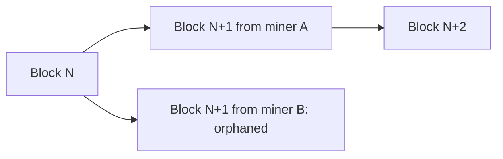
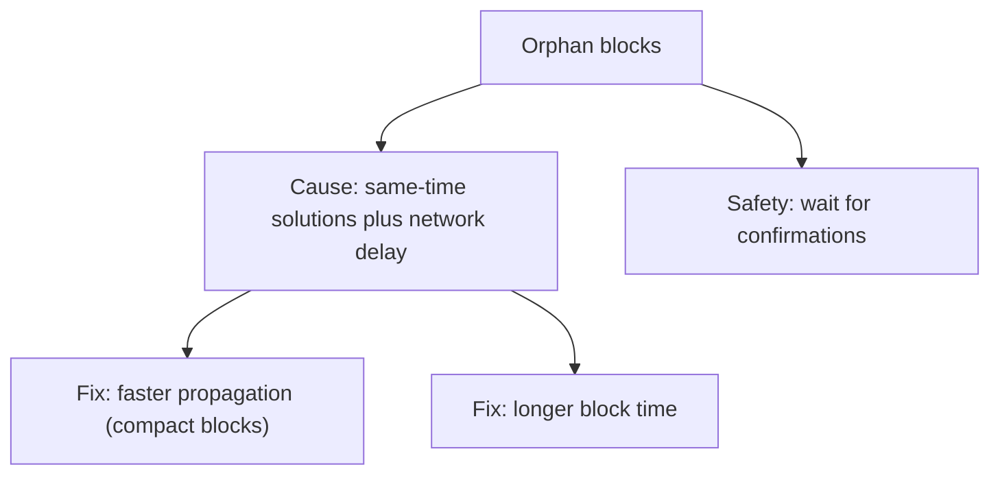

**In one line:** <mark>An orphaned block is a valid block that was mined but is not part of the main chain, because another block at the same height won the race</mark>. Its miner gets no reward. <Cite id="block-structure-merkle-btcwiki-orphan" />

<Box kind="key">

**Key points to write (any orphaned block question):**

- Cause: <mark>two miners solve a block at almost the same time</mark> and network delay splits the nodes: a temporary **fork**.
- Rule: nodes follow <mark>the chain with the most accumulated work (longest chain)</mark>.
- The block on the losing branch becomes <mark>orphaned (stale)</mark>; its transactions go back to the mempool.
- Effect: the miner <mark>loses the block reward</mark> and the electricity spent.
- That is why exchanges wait for <mark>several confirmations (about 6)</mark> before a payment is final.
- Ethereum before the Merge called these **uncle (ommer) blocks** and paid a small reward.

</Box>

## Core answer (5 marks, fits every question here)

<Box kind="definition">

An **orphaned block** is a valid block that is not on the main chain, because a competing block at the same height was accepted by the network instead. <Cite id="block-structure-merkle-btcwiki-orphan" />

</Box>

**How it happens:**

1. The network has no central clock and blocks take time to travel.
2. Two miners, A and B, solve the puzzle at almost the same time on top of block N.
3. Some nodes receive A's block first, others B's: the chain has **forked**.
4. Miners keep working on whichever block they saw first.
5. The next block N+2 lands on one branch, say A's. Nodes switch to the **longest (most-work) chain**.
6. B's block is dropped: it is **orphaned**. Its transactions return to the memory pool and are mined later. <Cite id="consensus-mining-gfg-conflicts" />

**Conclusion:** <mark>orphan blocks are a normal side effect of decentralised mining with network delay, and the longest-chain rule resolves them automatically</mark>.

## Extended answer (10 marks): add these

### 1. Effects of orphan blocks

- The orphan's miner loses the reward and the electricity spent.
- Transactions in it are delayed until a new block includes them, which is why exchanges wait for several **confirmations** (commonly 6). <Cite id="consensus-mining-btcwiki-confirmation" />
- Many orphans make the network less efficient and slightly weaken security.

### 2. Naming note

Strictly, Bitcoin documents call a valid block on a side branch a **stale block**, and an "orphan" is a block whose parent is not yet known. In everyday use both are called orphaned. <Cite id="consensus-mining-btcwiki-orphan" />

### 3. Ethereum: uncle blocks

Before the Merge, Ethereum had 12 to 15 second blocks, so forks were common. A valid block that lost the race could be included as an **uncle (ommer)** by a later block, and its miner got a smaller reward. This reduced the loss and kept small miners in the game. <Cite id="block-structure-merkle-me-ch14" />

| | Bitcoin orphan (stale) | Ethereum uncle (before Merge) |
|---|---|---|
| Reward | None | Small reward |
| Included later | No | Yes, referenced by a later block |
| Block time | About 10 minutes | About 12 to 15 seconds |

## Fit it to each question

- **"Explain the concept of an orphaned block."** (5 marks) <PYQ id="2024-05-ce/q1c" /> <PYQ id="2025-05-ce/q1a" />: write the **core answer** (definition, six steps, diagram), then the effects and the conclusion.

## Exam tips

- **Draw** the fork: Block N splitting into two N+1 blocks, with N+2 on only one of them.
- Use the words <mark>"longest chain"</mark>, <mark>"fork"</mark> and <mark>"confirmations"</mark>.
- Do not say an orphan is an invalid block. It is valid, it just lost the race.
