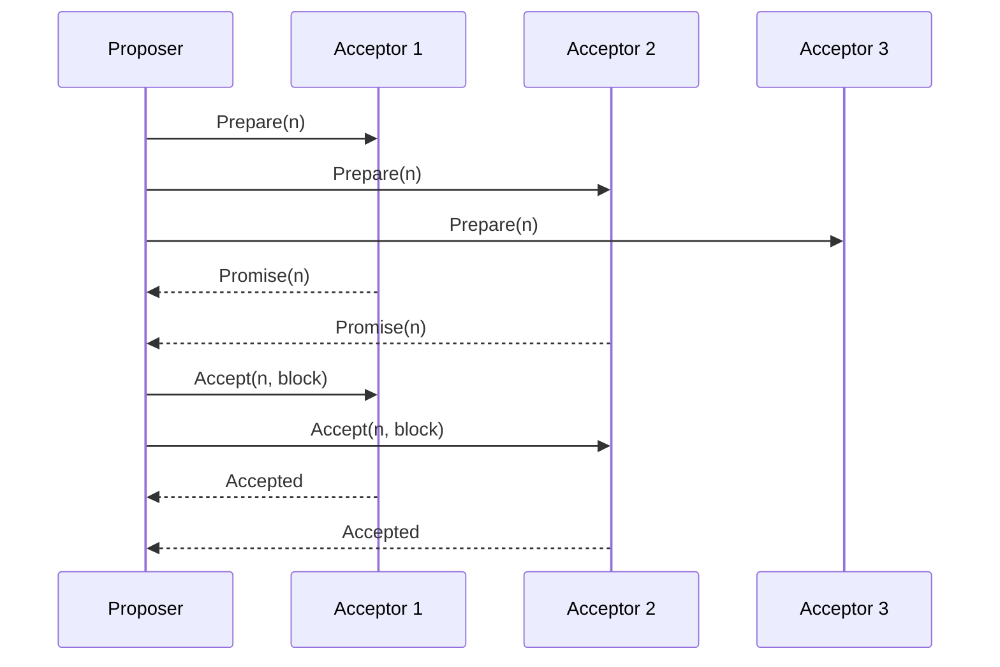

**Ek line mein:** <mark>Paxos ek consensus algorithm hai jisme nodes ka group ek value pe agree karta hai, chahe kuch nodes crash ho jayein ya messages kho jayein, jab tak majority alive hai</mark>. <Cite id="bft-paxos-raft-paxos-simple" />

<Box kind="key">

**Har Paxos question mein ye points likho:**

- <mark>Leslie Lamport</mark> ne banaya; <mark>sirf crash faults</mark> handle karta hai, jhooth bolne wale (Byzantine) nodes ko nahi.
- Teen roles: <mark>Proposer, Acceptor, Learner</mark>. Ek node teeno ho sakta hai.
- **Phase 1:** <mark>Prepare(n)</mark> aur <mark>Promise(n)</mark>. **Phase 2:** <mark>Accept(n, value)</mark> aur <mark>Accepted</mark>.
- Value **chosen** hoti hai jab <mark>acceptors ki majority</mark> use accept kare.
- Rule: agar acceptor pehle se koi value accept kar chuka hai, to proposer ko <mark>wahi value propose karni padti hai</mark> (sabse high number wali).
- f crashes survive karne ke liye <mark>2f + 1</mark> nodes. Weakness: samajhna mushkil; competing proposers livelock kar sakte hain.

</Box>

## Core answer (5 marks, yahan ke har question ke liye)

<Box kind="definition">

**Paxos** is a consensus algorithm that lets a group of computers agree on **one value** even if some of them crash or messages are lost. In a private blockchain, the nodes use it to agree on which block comes next. <Cite id="bft-paxos-raft-paxos-simple" />

</Box>

**Kyun chahiye:** private chains mein mining nahi hoti. Agar do nodes alag blocks propose karein to bhi group ko ek jawab chahiye. Paxos **majority** alive rehne tak woh jawab deta hai. <Cite id="bft-paxos-raft-wiki-paxos" />

**Roles:** *Proposer* value (block) suggest karta hai. *Acceptor* proposals pe vote karta hai. *Learner* chosen value ka pata lagata hai.

**Kaise kaam karta hai (do phases):**

1. **Prepare:** proposer unique number n chunta hai aur acceptors ko PREPARE(n) bhejta hai.
2. **Promise:** jis acceptor ne higher number nahi dekha woh PROMISE(n) deta hai, lower numbers ignore karne ka promise karta hai, aur pehle se accepted value bata deta hai.
3. **Accept request:** **majority** ke promises milne par proposer ACCEPT(n, value) bhejta hai. Agar kisi acceptor ne accepted value bataya ho to proposer ko sabse high number wali value use karni padti hai; warna woh apna block use kar sakta hai.
4. **Accepted:** acceptor accept karta hai jab tak usne higher number ka promise na kiya ho, aur learners ko batata hai.
5. **Chosen:** jab majority same value accept kare to woh decide ho jati hai aur block append hota hai. <Cite id="bft-paxos-raft-gfg-paxos" />

**Conclusion:** <mark>Paxos lets nodes agree on one value using prepare/promise and accept/accepted rounds with a majority</mark>.

## Extended answer (10 marks): ye add karo

### 1. Ek round ki picture

### 2. "Highest accepted value use karo" rule kyun

Yeh rule do alag values ko chosen hone se rokta hai. Maano value A number 1 ke saath majority ne accept kar li. Baad mein number 2 wala proposer Prepare bhejta hai. Kisi bhi majority mein kam se kam ek acceptor ne A accept kiya hota hai, woh apne Promise mein A batata hai. Proposer ko ab apni value nahi, A hi propose karni padti hai, isliye group A pe tika rehta hai. <Cite id="bft-paxos-raft-paxos-simple" />

### 3. Worked example (5 acceptors)

Majority = 3. P1 Prepare(1) bhejta hai aur 3 promises paata hai; woh Accept(1, block X) bhejta hai; 3 acceptors X accept karte hain, to X **chosen** ho jata hai. Baad mein P2 Prepare(2) bhejta hai. Uske 3 promises mein kam se kam ek woh hai jisne X accept kiya tha, to P2 ko X hi propose karna padta hai. Group X pe rehta hai.

<Box kind="verify">

n = 5 ke liye majority = floor(5/2) + 1 = 3, to Paxos 2 crashes survive karta hai (2f + 1 = 5 se f = 2). 5 ki koi bhi do majorities mein kam se kam 1 node common hota hai (3 + 3 - 5 = 1), isliye baad ka proposer hamesha aise acceptor se milta hai jo chosen value jaanta hai.

</Box>

### 4. Private blockchain mein Paxos

Saare nodes known hain aur jhooth nahi bolte, isliye woh agle block pe agree karne ke liye mining ki jagah Paxos (ya Raft) use kar sakte hain. Yeh fast hai aur bijli lagbhag nahi lagti. <Cite id="private-blockchain-wiki-paxos" />

### 5. Paxos vs Raft

| Point | Paxos | Raft |
|---|---|---|
| Kaunse faults | Crash | Crash |
| f faults ke liye nodes | 2f + 1 | 2f + 1 |
| Leader | Zaroori nahi (proposers compete karte hain) | Strong leader |
| Samajhna | Mushkil | Aasaan banane ke liye design |

### 6. Limits

Samajhna aur banana mushkil; competing proposers livelock kar sakte hain (har ek n badhata rehta hai aur dusre ko rok deta hai) jab tak leader na chuna jaye; malicious nodes ko nahi rokta, uske liye PBFT use hota hai. <Cite id="bft-paxos-raft-raft-paper" />

## Har question mein kaise fit karein

## Exam tips

- **Sequence diagram draw karo**: Prepare, Promise, Accept, Accepted.
- Keywords: <mark>proposer, acceptor, learner, proposal number, promise, majority, 2f + 1</mark>.
- Yeh mat likho ki Paxos malicious nodes handle karta hai; yeh sirf crash faults handle karta hai.

Exam mein English mein likho.
