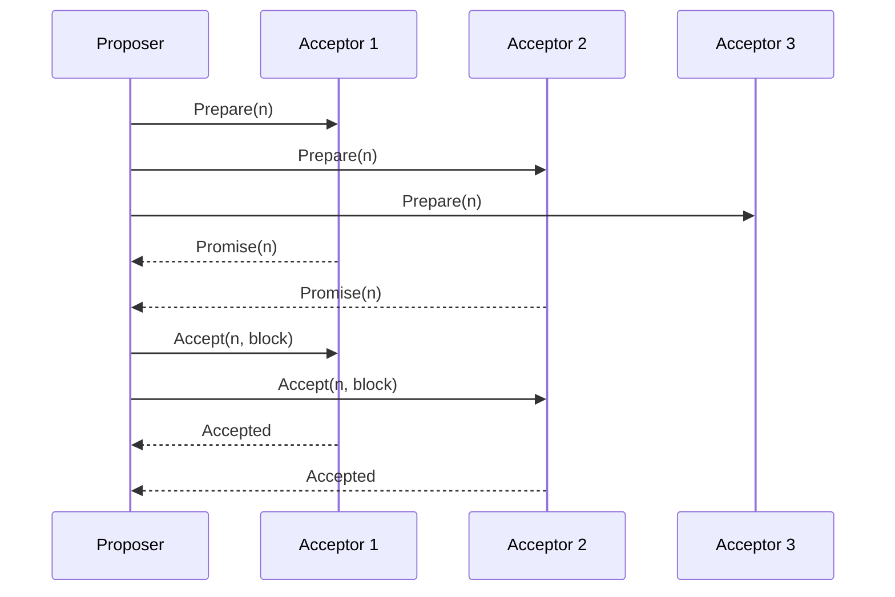

**In one line:** <mark>Paxos is a consensus algorithm in which a group of nodes agree on one value, even if some nodes crash or messages are lost, as long as a majority is alive</mark>. <Cite id="bft-paxos-raft-paxos-simple" />

<Box kind="key">

**Key points to write (any Paxos question):**

- Invented by <mark>Leslie Lamport</mark>; handles <mark>crash faults only</mark>, not lying (Byzantine) nodes.
- Three roles: <mark>Proposer, Acceptor, Learner</mark>. One node can play all three.
- **Phase 1:** <mark>Prepare(n)</mark> and <mark>Promise(n)</mark>. **Phase 2:** <mark>Accept(n, value)</mark> and <mark>Accepted</mark>.
- A value is **chosen** when a <mark>majority of acceptors</mark> accept it.
- Rule: if an acceptor already accepted a value, the proposer <mark>must propose that value</mark> (the one with the highest number).
- Needs <mark>2f + 1</mark> nodes to survive f crashes. Weakness: hard to understand; competing proposers can livelock.

</Box>

## Core answer (5 marks, fits every question here)

<Box kind="definition">

**Paxos** is a consensus algorithm that lets a group of computers agree on **one value** even if some of them crash or messages are lost. In a private blockchain, the nodes use it to agree on which block comes next. <Cite id="bft-paxos-raft-paxos-simple" />

</Box>

**Why it is needed:** private chains have no mining. If two nodes propose different blocks, the group still needs one answer. Paxos gives it while a **majority** is alive. <Cite id="bft-paxos-raft-wiki-paxos" />

**Roles:** *Proposer* suggests a value (a block). *Acceptor* votes on proposals. *Learner* finds out the chosen value.

**How it works (two phases):**

1. **Prepare:** the proposer picks a unique number n and sends PREPARE(n) to the acceptors.
2. **Promise:** an acceptor that has not seen a higher number replies PROMISE(n), promises to ignore lower numbers, and reports any value it already accepted.
3. **Accept request:** after promises from a **majority**, the proposer sends ACCEPT(n, value). If some acceptor reported an accepted value, the proposer must use the one with the highest number; otherwise it may use its own block.
4. **Accepted:** an acceptor accepts unless it promised a higher number, and tells the learners.
5. **Chosen:** when a majority accept the same value, it is decided and the block is appended. <Cite id="bft-paxos-raft-gfg-paxos" />

**Conclusion:** <mark>Paxos lets nodes agree on one value using prepare/promise and accept/accepted rounds with a majority</mark>.

## Extended answer (10 marks): add these

### 1. Picture of one round

### 2. Why the "must use the highest accepted value" rule

It stops two different values from being chosen. Suppose value A was already accepted by a majority with number 1. A later proposer with number 2 sends Prepare. At least one acceptor in any majority has accepted A, so it reports A in its Promise. The proposer must then propose A, not its own value, so the group keeps A. <Cite id="bft-paxos-raft-paxos-simple" />

### 3. Worked example (5 acceptors)

Majority = 3. P1 sends Prepare(1) and gets 3 promises; it sends Accept(1, block X); 3 acceptors accept X, so X is **chosen**. Later P2 sends Prepare(2). Its 3 promises include at least one that accepted X, so P2 must propose X. The group stays at X.

<Box kind="verify">

For n = 5, majority = floor(5/2) + 1 = 3, so Paxos survives 2 crashes (2f + 1 = 5 gives f = 2). Any two majorities of 5 share at least 1 node (3 + 3 - 5 = 1), so a later proposer always meets an acceptor that knows the chosen value.

</Box>

### 4. Paxos in a private blockchain

All nodes are known and trusted not to lie, so they can use Paxos (or Raft) to agree on the next block instead of mining. This is fast and uses almost no energy. <Cite id="private-blockchain-wiki-paxos" />

### 5. Paxos versus Raft

| Point | Paxos | Raft |
|---|---|---|
| Faults handled | Crash | Crash |
| Nodes for f faults | 2f + 1 | 2f + 1 |
| Leader | Not required (proposers compete) | Strong leader |
| Ease of understanding | Hard | Designed to be easy |

### 6. Limits

Hard to understand and build; competing proposers can livelock (each keeps raising n and blocks the other) unless a leader is chosen; it does not stop malicious nodes, for which PBFT is used. <Cite id="bft-paxos-raft-raft-paper" />

## Fit it to each question

- **"Explain PAXOS consensus algorithm for a private blockchain."** (10 marks) <PYQ id="2022-12-ce/q5a" />: core answer plus extended sections 4 (why private chains use it), 3 (example) and 5.
- **"PAXOS consensus algorithm"** (10 marks) <PYQ id="2024-12-ce/q6c" />: the whole answer: core, diagram, sections 1 to 3, then the comparison and limits.

## Exam tips

- **Draw** the sequence diagram: Prepare, Promise, Accept, Accepted.
- Keywords: <mark>proposer, acceptor, learner, proposal number, promise, majority, 2f + 1</mark>.
- Do not say Paxos handles malicious nodes; it handles only crash faults.
