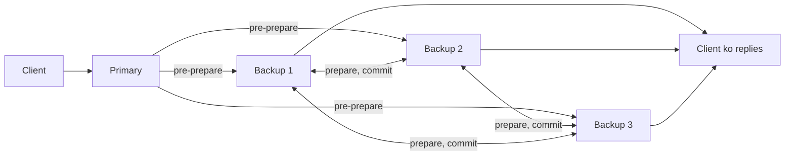
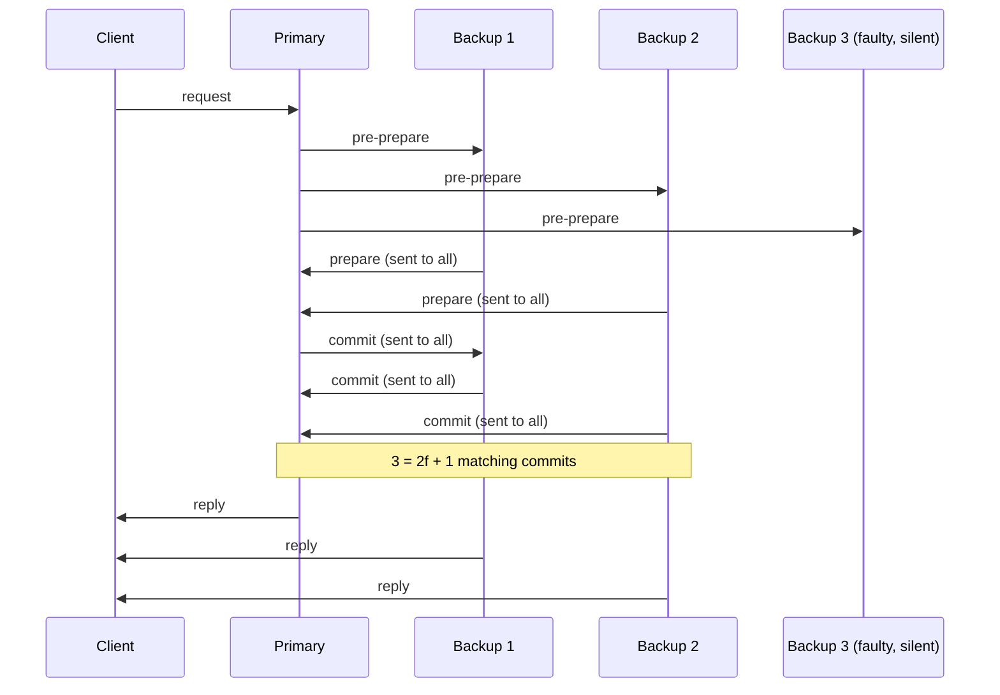

**Ek line mein:** <mark>PBFT mein ek replica primary hota hai (woh order propose karta hai) aur baaki sab backups hote hain (woh use check karke follow karte hain)</mark>; PBFT ek practical algorithm hai jo Byzantine Fault Tolerance problem solve karta hai. <Cite id="bft-paxos-raft-pbft-paper" />

<Box kind="key">

**PBFT aur BFT questions mein ye points likho:**

- **BFT** <mark>problem aur goal</mark> hai: kuch nodes jhooth bolein tab bhi agree karna. **PBFT** (Castro aur Liskov, 1999) uske liye <mark>ek fast, practical algorithm</mark> hai. <Cite id="consensus-mining-wiki-bft" />
- Dono ko f faulty nodes tolerate karne ke liye <mark>n >= 3f + 1</mark> nodes chahiye.
- <mark>Primary</mark> requests ka order tay karta hai; <mark>backups</mark> primary ka proposal check karte hain, echo karte hain aur commit karte hain.
- Phases: <mark>pre-prepare, prepare, commit</mark> (phir reply); client <mark>f + 1</mark> same replies ka wait karta hai.
- Chup ya jhootha primary <mark>view change</mark> se badla jata hai.
- Weakness: messages lagbhag <mark>n squared</mark> badhte hain, isliye sirf chhote, known groups (permissioned chains).

</Box>

## Core answer (5 marks, yahan ke har question ke liye)

<Box kind="definition">

In **PBFT (Practical Byzantine Fault Tolerance)** the replicas take two roles: one **primary** (the leader of the current view) and all others **backups**. A backup is any replica that is not the primary. It does not choose the order of requests; it accepts the primary's order only after checking it. <Cite id="bft-paxos-raft-pbft-paper" />

</Box>

**Backup kya karta hai:**

1. **Pre-prepare:** primary ka proposal (view, sequence number, request) receive karta hai aur check karta hai ki valid hai aur duplicate nahi.
2. **Prepare:** theek ho to baaki sab replicas ko PREPARE bhejta hai aur 2f matching prepares ka wait karta hai.
3. **Commit:** phir sabko COMMIT bhejta hai; 2f + 1 matching commits ke baad request chalata hai aur client ko reply deta hai.
4. **Primary pe nazar:** timer rakhta hai; primary chup ho ya conflicting orders bheje to backup **view change** (naya primary) maangta hai.

**Numbers:** PBFT ko n >= 3f + 1 chahiye. f = 1 ke liye 4 replicas: 1 primary aur 3 backups. <Cite id="bft-paxos-raft-gfg-pbft" />

**Conclusion:** <mark>backups are the checkers of PBFT: they verify the primary, vote in prepare and commit, and trigger a view change if it fails</mark>.

## Extended answer (10 marks): ye add karo

### 1. BFT: Byzantine Generals problem

Generals shehar ko gher kar baithe hain aur unhe saath attack ya saath retreat karna hai. Messenger orders le jaate hain, aur kuch generals traitors hain jo alag generals ko alag baatein batate hain. Lamport, Shostak aur Pease (1982) ne dikhaya ki f traitors ke liye agreement tabhi possible hai jab n >= 3f + 1. <Cite id="bft-paxos-raft-byz-generals" />

**3f + 1 kyun:** node sirf n - f replies ka wait kar sakta hai, kyunki f faulty nodes chup reh sakte hain. Un mein se f tak jhoothe ho sakte hain, to kam se kam n - 2f honest hain. Honest ko jhoothon se zyada hona chahiye: n - 2f > f, yaani n > 3f. <Cite id="bft-paxos-raft-gfg-bft" />

### 2. PBFT phases

1. **Request:** client request primary ko bhejta hai.
2. **Pre-prepare:** primary use sequence number deta hai aur sab backups ko bhejta hai.
3. **Prepare:** jo backup accept karta hai woh sabko batata hai; replica 2f matching prepares ke baad "prepared" hota hai.
4. **Commit:** har prepared replica sabko batata hai; 2f + 1 matching commits ke baad commit karta hai.
5. **Reply:** client jab f + 1 replicas same reply bhejein tab answer accept karta hai. <Cite id="web-bt-2-wiki-pbft" />

<Box kind="verify">

f = 1 se n = 3f + 1 = 4. Ek backup chup hai, to 3 replicas bachte hain. Commit quorum 2f + 1 = 3 hai, jo 3 honest replicas pa sakte hain. Sirf n = 3 aur f = 1 hota to 2 honest replies, 1 jhoothe aur 1 chup node se zyada nahi hote, isliye 3f + 1 minimum hai.

</Box>

### 3. Comparison: BFT vs PBFT

| Point | BFT (general idea) | PBFT |
|---|---|---|
| Yeh kya hai | Problem aur goal: traitors ke bawajood agree karna | Ek practical algorithm jo ise solve karta hai |
| Origin | Byzantine Generals paper, 1982 | Castro aur Liskov, 1999 |
| Nodes chahiye | n >= 3f + 1 | Wahi, n >= 3f + 1 |
| Network | Shuruati solutions maante hain messages time pe pahunchte hain | Network slow ho tab bhi safe |
| Speed | Bahut rounds ke messages, impractical | Teen phases, practical |
| Leader | Fixed nahi | Har view mein ek primary, view change se badalta hai |
| Decision rule | Honest values ki majority | 2f + 1 matching votes; client f + 1 replies ka wait karta hai |
| Weakness | Slow | Messages lagbhag n squared, isliye sirf chhote known groups |
| Use | Baad ke protocols ki theory | Permissioned chains, jaise Fabric mein BFT ordering |

<Cite id="bft-paxos-raft-gfg-pbft" />

## Har question mein kaise fit karein

- **"What is a backup in Practical Byzantine Fault Tolerance (PBFT) algorithm?"** (5 marks) <PYQ id="2022-12-ce/q1c" />: sirf **core answer** likho: definition, backup ke chaar kaam, diagram aur 3f + 1 line.
- **"Compare BFT and PBFT Consensus in detail."** (10 marks) <PYQ id="2023-12-ce/q2b" />: chhota core answer, phir extended sections 1 se 3. Comparison table sabse zyada marks wala hissa hai.

## Exam tips

- Primary ko backups ke saath **draw karo** aur pre-prepare, prepare, commit label karo.
- Keywords: <mark>primary, backup, view change, 3f + 1, 2f + 1, pre-prepare, prepare, commit</mark>.
- Saaf likho ki BFT problem hai aur PBFT algorithm hai; bahut students dono ko same samajhte hain.

Exam mein English mein likho.
