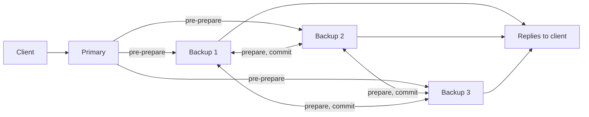
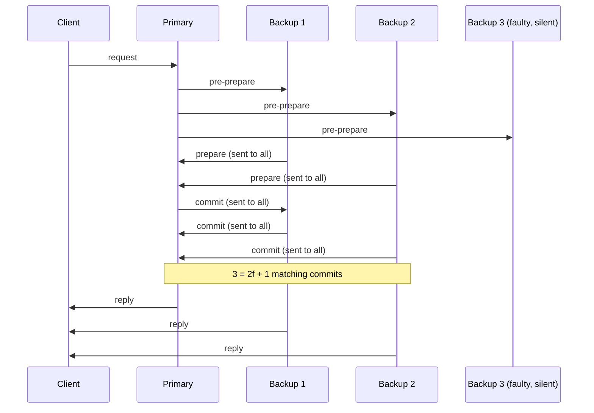

**In one line:** <mark>In PBFT one replica is the primary (it proposes the order) and all the others are backups (they check and follow it)</mark>; PBFT is a practical algorithm that solves the Byzantine Fault Tolerance problem. <Cite id="bft-paxos-raft-pbft-paper" />

<Box kind="key">

**Key points to write (PBFT and BFT questions):**

- **BFT** is the <mark>problem and goal</mark>: agree even if some nodes lie. **PBFT** (Castro and Liskov, 1999) is <mark>one fast, practical algorithm</mark> for it. <Cite id="consensus-mining-wiki-bft" />
- Both need <mark>n >= 3f + 1</mark> nodes to tolerate f faulty ones.
- <mark>Primary</mark> orders requests; <mark>backups</mark> check the primary's proposal, echo it and commit.
- Phases: <mark>pre-prepare, prepare, commit</mark> (then reply); client waits for <mark>f + 1</mark> equal replies.
- A silent or lying primary is replaced by a <mark>view change</mark>.
- Weakness: messages grow about <mark>n squared</mark>, so only small, known groups (permissioned chains).

</Box>

## Core answer (5 marks, fits every question here)

<Box kind="definition">

In **PBFT (Practical Byzantine Fault Tolerance)** the replicas take two roles: one **primary** (the leader of the current view) and all others **backups**. A backup is any replica that is not the primary. It does not choose the order of requests; it accepts the primary's order only after checking it. <Cite id="bft-paxos-raft-pbft-paper" />

</Box>

**What a backup does:**

1. **Pre-prepare:** receives the primary's proposal (view, sequence number, request) and checks it is valid and not a duplicate.
2. **Prepare:** if fine, sends PREPARE to all other replicas and waits for 2f matching prepares.
3. **Commit:** then sends COMMIT to all; after 2f + 1 matching commits it runs the request and replies to the client.
4. **Watch the primary:** it keeps a timer; if the primary is silent or sends conflicting orders, the backup asks for a **view change** (a new primary).

**Numbers:** PBFT needs n >= 3f + 1. For f = 1 there are 4 replicas: 1 primary and 3 backups. <Cite id="bft-paxos-raft-gfg-pbft" />

**Conclusion:** <mark>backups are the checkers of PBFT: they verify the primary, vote in prepare and commit, and trigger a view change if it fails</mark>.

## Extended answer (10 marks): add these

### 1. BFT: the Byzantine Generals problem

Generals surround a city and must attack together or retreat together. Messengers carry orders, and some generals are traitors who tell different generals different things. Lamport, Shostak and Pease (1982) showed that agreement is possible only if n >= 3f + 1 for f traitors. <Cite id="bft-paxos-raft-byz-generals" />

**Why 3f + 1:** a node can wait for only n - f replies, because f faulty nodes may stay silent. Of those, up to f may be lies, so at least n - 2f are honest. The honest ones must outnumber the lies: n - 2f > f, so n > 3f. <Cite id="bft-paxos-raft-gfg-bft" />

### 2. PBFT phases

1. **Request:** the client sends the request to the primary.
2. **Pre-prepare:** the primary gives it a sequence number and sends it to all backups.
3. **Prepare:** each backup that accepts tells all others; a replica is "prepared" after 2f matching prepares.
4. **Commit:** each prepared replica tells all; it commits after 2f + 1 matching commits.
5. **Reply:** the client accepts the answer when f + 1 replicas send the same reply. <Cite id="web-bt-2-wiki-pbft" />

<Box kind="verify">

f = 1 gives n = 3f + 1 = 4. One backup is silent, so 3 replicas remain. The commit quorum is 2f + 1 = 3, which the 3 honest replicas can reach. With only n = 3 and f = 1, 2 honest replies could not outvote 1 liar plus 1 silent node, so 3f + 1 is the minimum.

</Box>

### 3. Comparison: BFT versus PBFT

| Point | BFT (the general idea) | PBFT |
|---|---|---|
| What it is | Problem and goal: agree despite traitors | One practical algorithm that solves it |
| Origin | Byzantine Generals paper, 1982 | Castro and Liskov, 1999 |
| Nodes needed | n >= 3f + 1 | Same, n >= 3f + 1 |
| Network | Early solutions assume messages arrive on time | Safe even if the network is slow |
| Speed | Many rounds of messages, impractical | Three phases, practical |
| Leader | Not fixed | One primary per view, replaced by view change |
| Decision rule | Majority of honest values | 2f + 1 matching votes; client waits for f + 1 replies |
| Weakness | Slow | Messages grow about n squared, so small known groups only |
| Use | Theory behind later protocols | Permissioned chains, e.g. BFT ordering in Fabric |

<Cite id="bft-paxos-raft-gfg-pbft" />

## Fit it to each question

- **"What is a backup in Practical Byzantine Fault Tolerance (PBFT) algorithm?"** (5 marks) <PYQ id="2022-12-ce/q1c" />: write the **core answer** only: definition, the four duties of a backup, the diagram and the 3f + 1 line.
- **"Compare BFT and PBFT Consensus in detail."** (10 marks) <PYQ id="2023-12-ce/q2b" />: a short core answer, then extended sections 1 to 3. The comparison table is the main scoring part.

## Exam tips

- **Draw** the primary with backups and label pre-prepare, prepare, commit.
- Keywords: <mark>primary, backup, view change, 3f + 1, 2f + 1, pre-prepare, prepare, commit</mark>.
- Say clearly that BFT is the problem and PBFT is an algorithm; many students treat them as the same.
