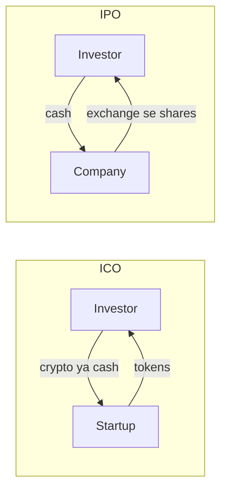

**Ek line mein:** <mark>ICO aur IPO dono public se paisa jutate hain: ICO mein investors ko naye digital tokens milte hain, IPO mein company ke shares (aanshik ownership)</mark>. <Cite id="cryptocurrencies-tokens-gfg-ico" />

<Box kind="key">

**ICO aur IPO ke pros aur cons mein ye points likho:**

- **ICO** = <mark>Initial Coin Offering</mark>: start-up whitepaper aur smart contract se ETH, BTC ya paise ke badle **tokens** bechta hai.
- **IPO** = <mark>Initial Public Offering</mark>: company bankers aur regulator se approved prospectus (India mein SEBI) ke saath **shares** bechti hai aur stock exchange pe list hoti hai.
- **ICO pros:** <mark>sab ke liye open, fast aur sasta, tokens jaldi trade hote hain, ownership nahi jaati</mark>.
- **ICO cons:** <mark>zyadatar unregulated, bahut scams, tokens se rights nahi mil sakte, bahut volatile</mark>.
- **IPO pros:** <mark>strong regulation aur disclosure, shares se ownership, votes aur dividends, regulated exchange</mark>.
- **IPO cons:** <mark>mehnga aur slow, sirf mature companies, heavy reporting, founders ka control kam hota hai</mark>.

</Box>

## Core answer (5 marks, yahan ke har question ke liye)

<Box kind="definition">

An **ICO (Initial Coin Offering)** is a way for a start-up to raise money by selling newly created tokens to the public. An **IPO (Initial Public Offering)** is a way for a company to raise money by selling its shares to the public for the first time and listing them on a stock exchange. <Cite id="cryptocurrencies-tokens-wiki-ico" /> <Cite id="cryptocurrencies-tokens-wiki-ipo" />

</Box>

**Har ek kaise kaam karta hai:**

- **ICO:** whitepaper publish karo, smart contract se tokens banao, aur Bitcoin, Ether ya paise ke badle becho.
- **IPO:** investment bankers (underwriters) hire karo, regulator (India mein SEBI) ko prospectus file karo, aur exchange pe shares list karo.

| | ICO pros | ICO cons |
|---|---|---|
| 1 | Duniya mein koi bhi invest kar sakta hai, chhote amounts bhi | Zyadatar unregulated: bahut scams aur failed projects |
| 2 | Fast aur sasta: bank ya exchange nahi chahiye | Tokens se company pe rights nahi mil sakte |
| 3 | Tokens aksar turant trade ho jaate hain | Price swings bahut zyada |
| 4 | Start-up ko ownership nahi chhodni padti | Investor protection kamzor, disclosure kam |

| | IPO pros | IPO cons |
|---|---|---|
| 1 | Strong regulation aur disclosure, isliye zyada trust | Mehnga (bankers, audit, legal) aur slow, aksar mahine |
| 2 | Shares se ownership, votes aur dividends | Sirf mature companies qualify karti hain |
| 3 | Bade amounts jute sakte hain; company ka status badhta hai | Listing ke baad heavy reporting rules |
| 4 | Shares regulated exchange pe trade hote hain | Founders ka control kam hota hai |

**Conclusion:** <mark>ICOs are open and fast but risky; IPOs are safer and regulated but costly</mark>. Ab kai desh token sales ko securities offerings maante hain. <Cite id="cryptocurrencies-tokens-wiki-howey" />

## Extended answer (10 marks): ye add karo

### 1. Side-by-side comparison

| Point | ICO | IPO |
|---|---|---|
| Kya bechte hain | Tokens | Shares |
| Regulation | Halka ya nahi | Strict |
| Cost aur time | Kam, jaldi | Zyada, slow |
| Kaun issue kar sakta hai | Idea wala koi bhi naya project | Audited records wali established companies |
| Kaun invest karta hai | Online koi bhi | Regulated market ke investors |
| Rights | Aam taur pe kam | Ownership, votes, dividends |
| Trading | Crypto exchanges | Stock exchange |
| Risk | Bahut zyada | Moderate |

<Cite id="cryptocurrencies-tokens-gfg-ico" />

### 2. Dono ke steps

### 3. Regulators kyun dhyan dete hain

July 2017 mein US SEC ne maana ki The DAO jaise tokens securities ho sakte hain, aur China aur South Korea ne September 2017 mein ICOs ban kar diye. Uske baad Security Token Offering (STO) jaise regulated alternatives badhe. <Cite id="cryptocurrencies-tokens-wiki-ico" /> <Cite id="cryptocurrencies-tokens-wiki-howey" />

### 4. Kaunsa chunein

| Situation | Behtar choice |
|---|---|
| Shuruati idea, audited accounts nahi, jaldi global funds chahiye | ICO (risk maankar) |
| Mature company, bada aur trusted raise chahiye | IPO |
| Token ki speed ke saath legal safety chahiye | STO |

## Har question mein kaise fit karein

- **"What are pros and cons of ICO and IPO?"** (10 marks) <PYQ id="2025-05/q5b" />: core answer likho (definitions, diagram aur dono pros-cons tables), phir extended section 1 (comparison table) aur ek line ka conclusion.

## Exam tips

- Dono money-flow diagrams **side by side draw karo** aur har ke chaar pros aur chaar cons rakho.
- Keywords: <mark>whitepaper, tokens, shares, prospectus, regulation, disclosure, scams, SEBI</mark>.
- Hamesha comparison table se khatam karo: extra marks wahin hain.

Exam mein English mein likho.
