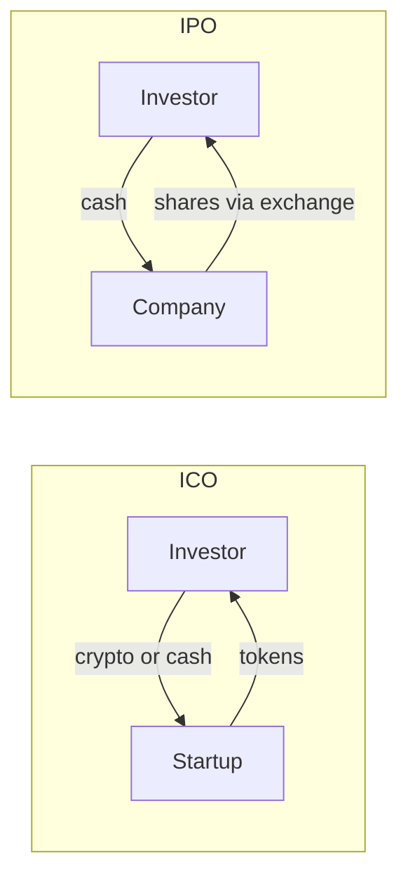
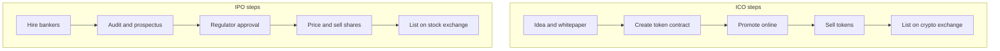

**In one line:** <mark>Both ICO and IPO raise money from the public: an ICO gives investors new digital tokens, an IPO gives them shares (part ownership) of a company</mark>. <Cite id="cryptocurrencies-tokens-gfg-ico" />

<Box kind="key">

**Key points to write (pros and cons of ICO and IPO):**

- **ICO** = <mark>Initial Coin Offering</mark>: a start-up sells **tokens** for ETH, BTC or money, via a whitepaper and a smart contract.
- **IPO** = <mark>Initial Public Offering</mark>: a company sells **shares** and lists on a stock exchange, via bankers and a regulator-approved prospectus (SEBI in India).
- **ICO pros:** <mark>open to anyone, fast and cheap, tokens tradable quickly, no loss of ownership</mark>.
- **ICO cons:** <mark>mostly unregulated, many scams, tokens may give no rights, very volatile</mark>.
- **IPO pros:** <mark>strong regulation and disclosure, shares give ownership, votes and dividends, regulated exchange</mark>.
- **IPO cons:** <mark>costly and slow, only mature companies, heavy reporting, founders lose some control</mark>.

</Box>

## Core answer (5 marks, fits every question here)

<Box kind="definition">

An **ICO (Initial Coin Offering)** is a way for a start-up to raise money by selling newly created tokens to the public. An **IPO (Initial Public Offering)** is a way for a company to raise money by selling its shares to the public for the first time and listing them on a stock exchange. <Cite id="cryptocurrencies-tokens-wiki-ico" /> <Cite id="cryptocurrencies-tokens-wiki-ipo" />

</Box>

**How each works:**

- **ICO:** publish a whitepaper, create tokens with a smart contract, and sell them for Bitcoin, Ether or money.
- **IPO:** hire investment bankers (underwriters), file a prospectus with the regulator (SEBI in India), and list shares on an exchange.

| | ICO pros | ICO cons |
|---|---|---|
| 1 | Anyone in the world can invest, even small amounts | Mostly unregulated: many scams and failed projects |
| 2 | Fast and cheap: no banks or exchange needed | Tokens may give no rights over the company |
| 3 | Tokens can often be traded straight away | Very high price swings |
| 4 | Start-ups need not give up ownership | Weak investor protection and little disclosure |

| | IPO pros | IPO cons |
|---|---|---|
| 1 | Strong regulation and disclosure, so more trust | Expensive (bankers, audit, legal) and slow, often months |
| 2 | Shares give ownership, votes and dividends | Only mature companies qualify |
| 3 | Large amounts can be raised; the company gains status | Heavy reporting rules after listing |
| 4 | Shares trade on a regulated exchange | Founders lose some control |

**Conclusion:** <mark>ICOs are open and fast but risky; IPOs are safer and regulated but costly</mark>. Many countries now treat token sales as securities offerings. <Cite id="cryptocurrencies-tokens-wiki-howey" />

## Extended answer (10 marks): add these

### 1. Side-by-side comparison

| Point | ICO | IPO |
|---|---|---|
| Offered | Tokens | Shares |
| Regulation | Light or none | Strict |
| Cost and time | Low, quick | High, slow |
| Who can issue | Any new project with an idea | Established companies with audited records |
| Who invests | Anyone online | Regulated market investors |
| Rights | Usually few | Ownership, votes, dividends |
| Trading | Crypto exchanges | Stock exchange |
| Risk | Very high | Moderate |

<Cite id="cryptocurrencies-tokens-gfg-ico" />

### 2. Steps of each

### 3. Why regulators care

In July 2017 the US SEC concluded that tokens like The DAO's could be securities, and China and South Korea banned ICOs in September 2017. After that, regulated alternatives such as the Security Token Offering (STO) grew. <Cite id="cryptocurrencies-tokens-wiki-ico" /> <Cite id="cryptocurrencies-tokens-wiki-howey" />

### 4. Which to choose

| Situation | Better choice |
|---|---|
| Early idea, no audited accounts, want quick global funds | ICO (accepting the risk) |
| Mature company, wants a large and trusted raise | IPO |
| Wants token speed with legal safety | STO |

## Fit it to each question

- **"What are pros and cons of ICO and IPO?"** (10 marks) <PYQ id="2025-05/q5b" />: write the core answer (definitions, diagram and the two pros and cons tables), then extended section 1 (comparison table) and a one-line conclusion.

## Exam tips

- **Draw** both money-flow diagrams side by side and keep four pros and four cons for each.
- Keywords: <mark>whitepaper, tokens, shares, prospectus, regulation, disclosure, scams, SEBI</mark>.
- Always end with the comparison table: it is where the extra marks are.
