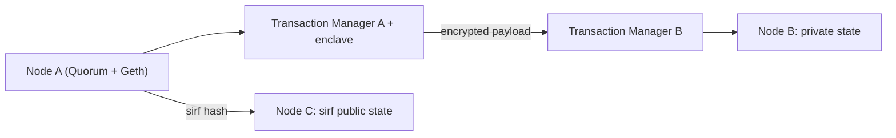
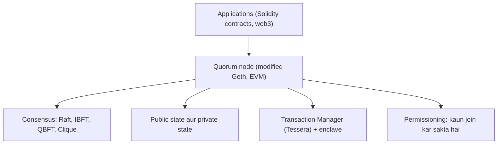

**Ek line mein:** <mark>Quorum Ethereum ka enterprise version hai un businesses ke liye jinhe privacy chahiye: Go-Ethereum ka permissioned fork jisme private transactions aur voting-based consensus hai</mark>. <Cite id="corda-ripple-quorum-quorum-github" />

<Box kind="key">

**Har Quorum question mein ye points likho:**

- <mark>J.P. Morgan (2016)</mark> ne banaya; <mark>Go-Ethereum (Geth)</mark> client ka fork; ab GoQuorum ke naam se maintain hota hai.
- <mark>Permissioned</mark>: sirf approved parties join karti hain.
- <mark>Public aur private transactions</mark>; private sirf named parties ko jaati hain, baaki ek encrypted hash dekhte hain.
- Har node mein <mark>public state aur private state</mark>.
- <mark>Transaction Manager (Tessera) aur enclave</mark> private payloads encrypt karke bhejte hain.
- Consensus: <mark>Proof of Work nahi</mark>; Raft, IBFT/QBFT ya Clique (Proof of Authority).
- <mark>Solidity aur EVM</mark> rakhta hai; fast, mining cost nahi.

</Box>

## Core answer (5 marks, yahan ke har question ke liye)

<Box kind="definition">

**Quorum** is an enterprise version of Ethereum. It was created by J.P. Morgan in 2016 as a fork of the Go-Ethereum (Geth) client and is now maintained as GoQuorum. It is a **permissioned** blockchain: only approved parties join. <Cite id="corda-ripple-quorum-quorum-github" />

</Box>

**Kyun chahiye:** public Ethereum har transaction sab ko dikhata hai aur banks ke liye slow aur mehnga hai. Companies ko privacy, speed aur known participants chahiye, saath hi Solidity aur Ethereum tools bhi.

**Main features:**

1. **Private aur public transactions.** Public sab nodes dekhte hain. Private transaction sirf named parties ke saath share hoti hai; baaki sirf encrypted hash dekhte hain.
2. **Do states.** Har node public state (sab ke liye same) aur private state (sirf unke contracts ke liye jinme woh shamil hai) rakhta hai.
3. **Transaction Manager (Tessera) aur enclave.** Transaction Manager private payload encrypt karke sirf sahi nodes ko bhejta hai; enclave keys rakhta hai.
4. **Pluggable consensus.** Raft (crash fault tolerant, fast), IBFT/QBFT (Byzantine fault tolerant) aur Clique (Proof of Authority). <Cite id="corda-ripple-quorum-quorum-ibft" />
5. **Permissioning.** Smart contracts tay karte hain kaunse nodes join kar sakte hain.
6. **Zyada throughput, mining cost nahi.** Fees zero ho sakti hain.

**Conclusion:** <mark>Quorum keeps Ethereum's smart contracts but adds privacy and permissions for businesses</mark>. <Cite id="corda-ripple-quorum-quorum-wp" />

## Extended answer (10 marks): ye add karo

### 1. Layers mein architecture

### 2. Private transaction kaise kaam karti hai

1. Sender transaction ko **private** mark karta hai aur participants ki list deta hai.
2. Transaction Manager payload encrypt karke sirf un participants ke Transaction Managers ko bhejta hai.
3. Chain pe sirf payload ka **hash** jata hai, isliye har node transaction ko order karta hai.
4. Participants decrypt karke apni **private state** mein use chalate hain; baaki skip karte hain. <Cite id="corda-ripple-quorum-gfg-quorum" />

### 3. Consensus options

| Option | Fault type | Note |
|---|---|---|
| Raft | Sirf crash | Fast, simple; trusted members |
| IBFT / QBFT | Byzantine | PBFT-style voting; 3f + 1 nodes chahiye |
| Clique (PoA) | Approved signers | Validators baari-baari se blocks sign karte hain |

### 4. Quorum vs public Ethereum

| Point | Public Ethereum | Quorum |
|---|---|---|
| Access | Koi bhi | Permissioned |
| Privacy | Nahi | Private transactions |
| Consensus | PoS | Raft, IBFT/QBFT, Clique |
| Fees | ETH mein gas | Zero ho sakti hain |
| Speed | Slow | Sainkdon transactions per second |

### 5. Advantages aur limits

**Advantages:** privacy, speed, Ethereum compatibility. **Limits:** permissioned isliye kam decentralised; private state complexity badhata hai. **Uses:** bank settlements, trade finance, supply chain. <Cite id="private-blockchain-wiki-eea" />

## Har question mein kaise fit karein

- **"Quorum"** (10 marks) <PYQ id="2022-12-ce/q6c" /> <PYQ id="2024-12-ce/q6a" />: core answer (definition, chhe features, diagram), phir extended sections 2, 3 aur 4.

## Exam tips

- Private transaction flow **draw karo**, Transaction Manager aur chain pe hash ke saath.
- Keywords: <mark>fork of Geth, permissioned, private transaction, Tessera, enclave, Raft, IBFT, QBFT</mark>.
- Yeh mat likho ki Quorum proof of work use karta hai.

Exam mein English mein likho.
