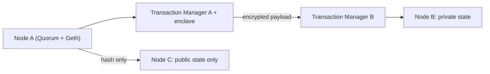
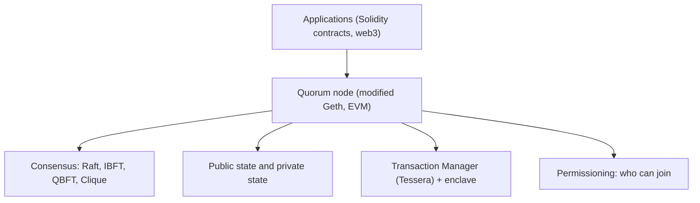

**In one line:** <mark>Quorum is an enterprise version of Ethereum for businesses that need privacy: a permissioned fork of Go-Ethereum with private transactions and voting-based consensus</mark>. <Cite id="corda-ripple-quorum-quorum-github" />

<Box kind="key">

**Key points to write (any Quorum question):**

- Created by <mark>J.P. Morgan (2016)</mark>; a fork of the <mark>Go-Ethereum (Geth)</mark> client; now maintained as GoQuorum.
- <mark>Permissioned</mark>: only approved parties join.
- <mark>Public and private transactions</mark>; private ones go only to named parties, others see an encrypted hash.
- <mark>Public state and private state</mark> in every node.
- <mark>Transaction Manager (Tessera) and enclave</mark> encrypt and send private payloads.
- Consensus: <mark>no Proof of Work</mark>; Raft, IBFT/QBFT or Clique (Proof of Authority).
- Keeps <mark>Solidity and the EVM</mark>; fast, no mining cost.

</Box>

## Core answer (5 marks, fits every question here)

<Box kind="definition">

**Quorum** is an enterprise version of Ethereum. It was created by J.P. Morgan in 2016 as a fork of the Go-Ethereum (Geth) client and is now maintained as GoQuorum. It is a **permissioned** blockchain: only approved parties join. <Cite id="corda-ripple-quorum-quorum-github" />

</Box>

**Why it is needed:** public Ethereum shows every transaction to everyone and is slow and costly for banks. Companies want privacy, speed and known participants, while still using Solidity and Ethereum tools.

**Main features:**

1. **Private and public transactions.** Public ones are seen by all nodes. A private transaction is shared only with named parties; others see just an encrypted hash.
2. **Two states.** Each node keeps a public state (same for all) and a private state (only for contracts it takes part in).
3. **Transaction Manager (Tessera) and enclave.** The Transaction Manager encrypts and sends private payloads to the right nodes only; the enclave holds the keys.
4. **Pluggable consensus.** Raft (crash fault tolerant, fast), IBFT/QBFT (Byzantine fault tolerant) and Clique (Proof of Authority). <Cite id="corda-ripple-quorum-quorum-ibft" />
5. **Permissioning.** Smart contracts control which nodes may join.
6. **Higher throughput, no mining cost.** Fees can be zero.

**Conclusion:** <mark>Quorum keeps Ethereum's smart contracts but adds privacy and permissions for businesses</mark>. <Cite id="corda-ripple-quorum-quorum-wp" />

## Extended answer (10 marks): add these

### 1. Architecture in layers

### 2. How a private transaction works

1. The sender marks the transaction **private** and lists the participants.
2. The Transaction Manager encrypts the payload and sends it only to those participants' Transaction Managers.
3. The chain carries only a **hash** of the payload, so every node orders the transaction.
4. Participants decrypt and run it in their **private state**; others skip it. <Cite id="corda-ripple-quorum-gfg-quorum" />

### 3. Consensus options

| Option | Fault type | Note |
|---|---|---|
| Raft | Crash only | Fast, simple; trusted members |
| IBFT / QBFT | Byzantine | PBFT-style voting; needs 3f + 1 nodes |
| Clique (PoA) | Approved signers | Validators sign blocks in turn |

### 4. Quorum versus public Ethereum

| Point | Public Ethereum | Quorum |
|---|---|---|
| Access | Anyone | Permissioned |
| Privacy | None | Private transactions |
| Consensus | PoS | Raft, IBFT/QBFT, Clique |
| Fees | Gas paid in ETH | Can be zero |
| Speed | Slower | Hundreds of transactions per second |

### 5. Advantages and limits

**Advantages:** privacy, speed, Ethereum compatibility. **Limits:** permissioned so less decentralised; private state adds complexity. **Uses:** bank settlements, trade finance, supply chain. <Cite id="private-blockchain-wiki-eea" />

## Fit it to each question

- **"Quorum"** (10 marks) <PYQ id="2022-12-ce/q6c" /> <PYQ id="2024-12-ce/q6a" />: core answer (definition, six features, diagram), then extended sections 2, 3 and 4.

## Exam tips

- **Draw** the private transaction flow with the Transaction Manager and the hash on the chain.
- Keywords: <mark>fork of Geth, permissioned, private transaction, Tessera, enclave, Raft, IBFT, QBFT</mark>.
- Do not say Quorum uses proof of work.
