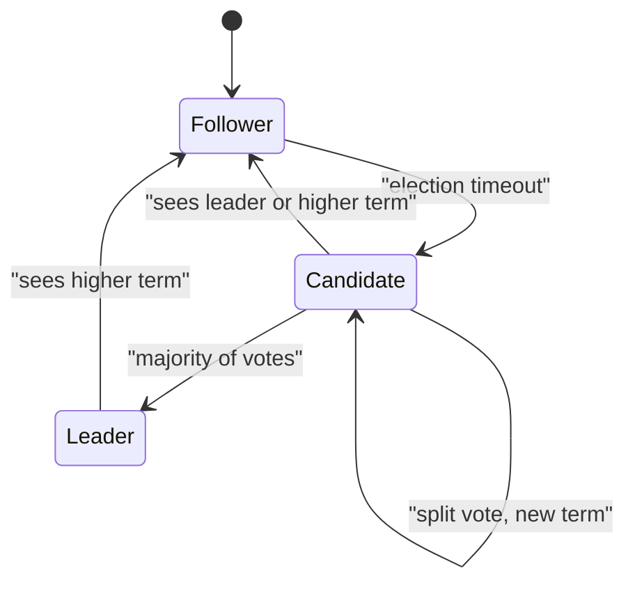
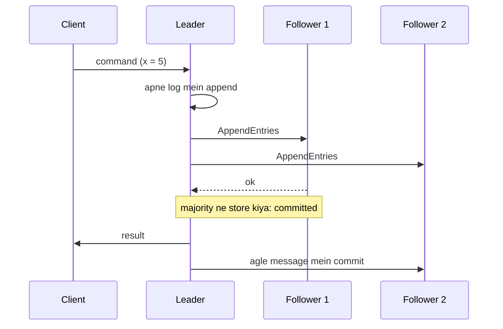

**Ek line mein:** <mark>Raft ek leader-based consensus algorithm hai jo majority servers ke chalte rehne tak sabhi servers par replicated log ko same rakhta hai</mark>; yeh crash faults handle karta hai, jhooth bolne wale nodes ko nahi. <Cite id="bft-paxos-raft-raft-paper" />

<Box kind="key">

**Har Raft question mein ye points likho:**

- Ongaro aur Ousterhout (2014) ne banaya, <mark>Paxos se aasaan samajhne ke liye</mark>.
- Teen roles: <mark>Follower, Candidate, Leader</mark>. Time numbered **terms** mein bata hota hai; ek term mein ek leader.
- **Leader election:** <mark>random election timeout (150 se 300 ms)</mark> tak heartbeat na aaye to follower candidate ban kar votes maangta hai; <mark>majority votes</mark> se leader banta hai.
- **Log replication:** leader command append karke <mark>AppendEntries</mark> bhejta hai; <mark>majority</mark> ke store karte hi entry **committed** hoti hai.
- **Safety:** out-of-date log wala candidate jeet nahi sakta, isliye <mark>committed entries kabhi lost nahi hoti</mark>.
- Fault tolerance: <mark>n >= 2f + 1</mark> servers f crashes survive karte hain. Fabric ordering, Quorum, etcd mein use hota hai.

</Box>

## Core answer (5 marks, yahan ke har question ke liye)

<Box kind="definition">

**Raft** is a consensus algorithm that makes a group of servers agree on one ordered **log** of commands, even if some servers crash. One server is elected **leader**; it accepts every client command and copies it to the **followers**. <Cite id="bft-paxos-raft-raft-site" />

</Box>

**Kyun chahiye:** ek machine pe service us machine ke fail hone par band ho jati hai. Kai machines pe copies tabhi safe hain jab sab copies same order mein agree karein. **Private blockchain** mein nodes known hain aur jhooth nahi bolte, isliye mining ki jagah Raft jaisa sasta voting algorithm use hota hai.

**Kaise kaam karta hai:**

1. **Roles:** har server follower, candidate ya leader hota hai.
2. **Election:** jo follower random timeout tak heartbeat nahi sunta woh candidate ban jata hai, term mein 1 jodta hai, khud ko vote deta hai aur votes maangta hai. **Majority** milne par woh leader ban jata hai.
3. **Replication:** leader client command apne log mein append karke followers ko bhejta hai. Majority ke store karte hi entry **committed** hoti hai aur apply hoti hai.
4. **Heartbeats:** leader regular khali messages bhejta hai taaki charge mein rahe. <Cite id="bft-paxos-raft-gfg-raft" />

**Conclusion:** <mark>Raft elects a leader, copies its log to a majority and so keeps all servers consistent</mark>. <Cite id="bft-paxos-raft-wiki-raft" />

## Extended answer (10 marks): ye add karo

### 1. Leader election detail mein

- Har follower ka apna random timer hota hai (jaise 150 se 300 ms), isliye aam taur pe ek server pehle timeout hota hai.
- Candidate khud ko vote deta hai aur **RequestVote** bhejta hai. Ek server ek term mein **sirf ek** candidate ko vote deta hai, aur tabhi jab candidate ka log uske apne log jitna ya usse zyada up to date ho.
- Votes split ho jayein to koi nahi jeetta; random timeouts alag-alag time pe khatam hote hain aur naya term shuru hota hai. <Cite id="bft-paxos-raft-raft-paper" />

### 2. Log replication detail mein

### 3. Safety

Sirf up-to-date log wala candidate jeet sakta hai. Isliye har naye leader ke paas saari committed entries pehle se hoti hain, aur committed entries kabhi lost ya overwrite nahi hoti.

### 4. Example (5 servers S1 se S5)

S1 term 1 mein leader hai. Client "set x = 5" bhejta hai. S1 use store karke bhejta hai; S1, S2 aur S3 store karte hain, to 5 mein se 3 majority hai aur entry **committed** ho jati hai. Phir S1 crash ho jata hai. S3 ka timer pehle khatam hota hai: woh **term 2** shuru karta hai, S2, S4, S5 yes vote dete hain, to S3 (4 votes) leader ban jata hai. S3 ke paas "x = 5" pehle se hai, isliye kuch lost nahi hota. S1 restart hone par term 2 dekhta hai aur follower ban jata hai.

<Box kind="verify">

n = 5 ke liye majority = floor(5/2) + 1 = 3, aur Raft floor((5-1)/2) = 2 crashes survive karta hai. S1 down hone par 4 servers bachte hain, jo 3 se zyada hain, isliye election succeed ho sakta hai. Agar 3 crash hote to sirf 2 bachte, majority nahi banti, aur cluster galat data ka risk lene ki jagah ruk jata hai.

</Box>

### 5. Private blockchain mein Raft

Hyperledger Fabric ki ordering service Raft use karti hai, aur Quorum mein Raft mode hai. Saare nodes known hain, isliye mining ki zaroorat nahi. <Cite id="bft-paxos-raft-fabric-orderer" /> <Cite id="corda-ripple-quorum-quorum-ibft" />

### 6. Comparison aur limits

| Point | Raft | Paxos | PBFT |
|---|---|---|---|
| Kaunse faults | Crash | Crash | Crash aur malicious |
| f faults ke liye nodes | 2f + 1 | 2f + 1 | 3f + 1 |
| Leader | Haan, strong leader | Optional | Primary |
| Aasaan? | Aasaan | Mushkil | Medium |

**Advantages:** samajhna aasaan, fast, widely used (etcd, Consul). **Limits:** saari writes ek leader se guzarti hain (bottleneck); malicious nodes ko nahi rokta. <Cite id="bft-paxos-raft-gfg-raft" />

## Har question mein kaise fit karein

- **"Describe RAFT consensus protocol."** (10 marks) <PYQ id="2025-05/q3a" />: core answer plus sections 1, 2 aur 3.

## Exam tips

- **Teen-state diagram banao** (Follower, Candidate, Leader) aur har arrow label karo.
- Keywords: <mark>term, heartbeat, election timeout, majority, AppendEntries, committed, 2f + 1</mark>.
- Yeh mat likho ki Raft malicious nodes handle karta hai; yeh sirf crash faults handle karta hai.

Exam mein English mein likho.
