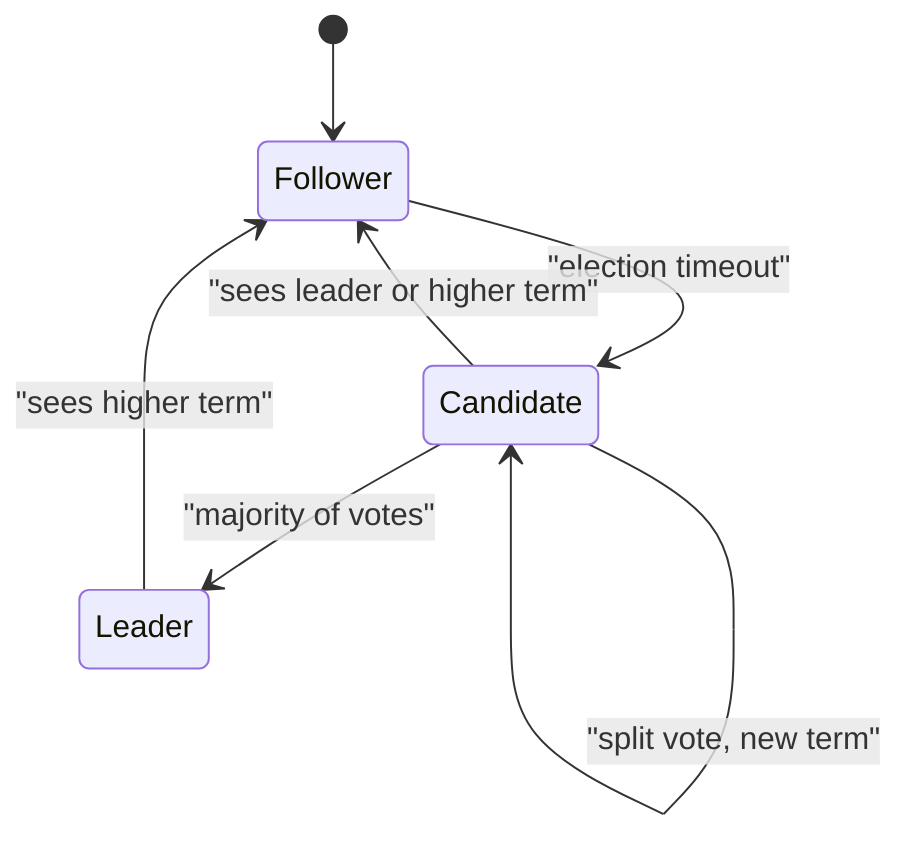
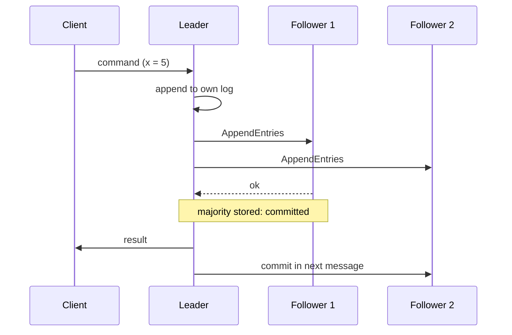

**In one line:** <mark>Raft is a leader-based consensus algorithm that keeps a replicated log identical on all servers while a majority is working</mark>; it handles crash faults, not lying nodes. <Cite id="bft-paxos-raft-raft-paper" />

<Box kind="key">

**Key points to write (any Raft question):**

- Designed by Ongaro and Ousterhout (2014) to be <mark>easier to understand than Paxos</mark>.
- Three roles: <mark>Follower, Candidate, Leader</mark>. Time is split into numbered **terms**; one leader per term.
- **Leader election:** no heartbeat for a <mark>random election timeout (150 to 300 ms)</mark>, so the follower becomes a candidate and asks for votes; a <mark>majority of votes</mark> makes it leader.
- **Log replication:** the leader appends the command and sends <mark>AppendEntries</mark>; once a <mark>majority</mark> store it, it is **committed**.
- **Safety:** a candidate with an out-of-date log cannot win, so <mark>committed entries are never lost</mark>.
- Fault tolerance: <mark>n >= 2f + 1</mark> servers survive f crashes. Used in Fabric ordering, Quorum, etcd.

</Box>

## Core answer (5 marks, fits every question here)

<Box kind="definition">

**Raft** is a consensus algorithm that makes a group of servers agree on one ordered **log** of commands, even if some servers crash. One server is elected **leader**; it accepts every client command and copies it to the **followers**. <Cite id="bft-paxos-raft-raft-site" />

</Box>

**Why it is needed:** a service on one machine fails when that machine fails. Copies on several machines are safe only if all copies agree, in the same order. In a **private blockchain** the nodes are known and trusted not to lie, so a cheap voting algorithm like Raft replaces mining.

**How it works:**

1. **Roles:** every server is a follower, candidate or leader.
2. **Election:** a follower that hears no heartbeat for a random timeout becomes a candidate, adds 1 to the term, votes for itself and asks for votes. A **majority** makes it leader.
3. **Replication:** the leader appends the client command to its log and sends it to followers. When a majority have stored it, the entry is **committed** and applied.
4. **Heartbeats:** the leader sends regular empty messages to stay in charge. <Cite id="bft-paxos-raft-gfg-raft" />

**Conclusion:** <mark>Raft elects a leader, copies its log to a majority and so keeps all servers consistent</mark>. <Cite id="bft-paxos-raft-wiki-raft" />

## Extended answer (10 marks): add these

### 1. Leader election in detail

- Each follower has its own random timer (for example 150 to 300 ms), so usually one server times out first.
- A candidate votes for itself and sends **RequestVote**. A server votes for **at most one** candidate per term, and only if the candidate's log is at least as up to date as its own.
- If votes split, nobody wins; the random timeouts expire at different times and a new term starts. <Cite id="bft-paxos-raft-raft-paper" />

### 2. Log replication in detail

### 3. Safety

Only a candidate whose log is up to date can win. So every new leader already has all committed entries, and committed entries are never lost or overwritten.

### 4. Example (5 servers S1 to S5)

S1 is leader in term 1. A client sends "set x = 5". S1 stores it and sends it out; S1, S2 and S3 store it, so 3 of 5 is a majority and it is **committed**. Then S1 crashes. S3's timer ends first: it starts **term 2**, and S2, S4, S5 vote yes, so S3 (4 votes) becomes leader. S3 already has "x = 5", so nothing is lost. When S1 restarts it sees term 2 and becomes a follower.

<Box kind="verify">

For n = 5, majority = floor(5/2) + 1 = 3, and Raft survives floor((5-1)/2) = 2 crashes. With S1 down, 4 servers remain, which is at least 3, so an election can succeed. If 3 had crashed, only 2 remain, no majority, and the cluster stops rather than risk wrong data.

</Box>

### 5. Raft in a private blockchain

Hyperledger Fabric's ordering service uses Raft, and Quorum offers a Raft mode. All nodes are known, so no mining is needed. <Cite id="bft-paxos-raft-fabric-orderer" /> <Cite id="corda-ripple-quorum-quorum-ibft" />

### 6. Comparison and limits

| Point | Raft | Paxos | PBFT |
|---|---|---|---|
| Faults handled | Crash | Crash | Crash and malicious |
| Nodes for f faults | 2f + 1 | 2f + 1 | 3f + 1 |
| Leader | Yes, strong leader | Optional | Primary |
| Ease | Easy | Hard | Medium |

**Advantages:** easy to understand, fast, widely used (etcd, Consul). **Limits:** all writes pass through one leader (bottleneck); it does not stop malicious nodes. <Cite id="bft-paxos-raft-gfg-raft" />

## Fit it to each question

- **"Describe RAFT consensus protocol."** (10 marks) <PYQ id="2025-05/q3a" />: core answer plus sections 1, 2 and 3.

## Exam tips

- **Draw** the three-state diagram (Follower, Candidate, Leader) and label each arrow.
- Keywords: <mark>term, heartbeat, election timeout, majority, AppendEntries, committed, 2f + 1</mark>.
- Do not say Raft handles malicious nodes; it handles only crash faults.
