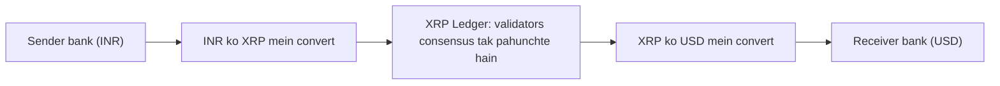
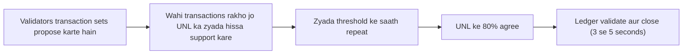

**Ek line mein:** <mark>Ripple ek company aur payment network hai jo banks ke beech fast, sasta cross-border paisa transfer deta hai, open XRP Ledger pe chalta hai jiska native token XRP hai</mark>. <Cite id="corda-ripple-quorum-gfg-ripple" />

<Box kind="key">

**Har Ripple question mein ye points likho:**

- Aim: <mark>fast, sasta cross-border payment</mark>; purana tareeka (SWIFT, correspondent banks) mein din lagte hain aur har hop pe fee lagti hai.
- Parts: <mark>XRP Ledger (XRPL)</mark>, <mark>XRP</mark> (fees aur bridge currency), <mark>RippleNet / On-Demand Liquidity (ODL)</mark>, gateways aur trust lines.
- Consensus: <mark>RPCA</mark> (Ripple Protocol Consensus Algorithm), mining nahi; har validator ki <mark>Unique Node List (UNL)</mark>; <mark>UNL ke 80% agree</mark> hone par ledger validate hota hai.
- Speed: <mark>3 se 5 seconds</mark>, bahut kam fees, lagbhag 1,500 transactions per second, energy efficient.
- Supply: <mark>100 billion XRP</mark>, shuru mein hi sab bana diye gaye.
- Limits: Bitcoin se zyada centralised, XRP ka bada hissa Ripple ke paas, US mein regulatory action.

</Box>

## Core answer (5 marks, yahan ke har question ke liye)

<Box kind="definition">

**Ripple** is a company and a payment network built for fast, cheap **cross-border money transfer** between banks and payment providers. The network runs on the open **XRP Ledger (XRPL)**, whose native token is **XRP**. <Cite id="corda-ripple-quorum-xrpl-whatis" />

</Box>

**Kyun chahiye:** international bank transfers correspondent banks (SWIFT) ki chain use karte hain, isliye din lagte hain aur har hop pe fee lagti hai. Ripple value ko seedhe seconds mein bhejta hai.

**Main parts:**

1. **XRP Ledger:** balances aur payments ka public, decentralized ledger. Settlement lagbhag 3 se 5 seconds mein hota hai aur fees bahut kam.
2. **XRP:** fees deta hai aur **bridge currency** ka kaam karta hai: INR turant XRP aur phir USD ban jata hai, isliye kisi ko dono currencies pehle se rakhni nahi padti.
3. **RippleNet / ODL:** woh product jise banks XRP ko bridge bana kar paisa bhejne ke liye use karte hain. <Cite id="corda-ripple-quorum-ripple-odl" />
4. **Gateways aur trust lines:** gateway asli paise ke IOUs issue karta hai; users unhe trust lines se rakhte hain.

**Conclusion:** <mark>Ripple targets the slow, costly part of international payments with a fast consensus ledger and XRP as a bridge currency</mark>.

## Extended answer (10 marks): ye add karo

### 1. Consensus: RPCA

XRPL mining use nahi karta. Har validator ke paas **Unique Node List (UNL)** hoti hai, un validators ki jinke milibhagat na karne par woh bharosa karta hai. Rounds mein validators proposed transaction sets exchange karte hain aur sirf wahi transactions rakhte hain jinhe unki UNL ka badhta hua hissa support kare. Jab **UNL ke 80%** agree karte hain to ledger validate ho jata hai. <Cite id="corda-ripple-quorum-xrpl-consensus" /> <Cite id="corda-ripple-quorum-xrpl-unl" />

### 2. Trust lines aur payment paths

**Trust line** batati hai ki user kisi issuer ka kitna IOU rakhne ko taiyar hai. Payment kai issuers aur market makers se guzar sakti hai, isliye XRPL payer se payee tak ek **path** dhoondhta hai, currencies ke par bhi. <Cite id="corda-ripple-quorum-xrpl-paths" />

### 3. Auto-bridging

XRP/USD aur XRP/EUR order books ko milakar bridged USD/EUR order book banti hai. Use direct USD/EUR order book ke saath merge karke ek combined book banti hai, isliye XRP bridge ka kaam karta hai. <Cite id="corda-ripple-quorum-xrpl-paths" />

### 4. Ripple vs Bitcoin

| Point | Bitcoin | Ripple (XRPL) |
|---|---|---|
| Aim | Digital cash | Cross-border payments |
| Consensus | PoW mining | UNL voting wala RPCA |
| Confirmation | Lagbhag 10 minutes ya zyada | 3 se 5 seconds |
| Supply | Dheere mine hota hai, 21 million cap | 100 billion pehle se bane |
| Energy | Bahut zyada | Bahut kam |

### 5. Features aur limitations

**Features:** fast, low cost, high throughput (lagbhag 1,500 transactions per second), energy efficient. **Limitations:** zyada centralised kyunki UNL aksar recommended list hoti hai, XRP ka bada hissa Ripple ke paas hai, aur XRP ki status par US regulatory action hua hai. <Cite id="web-bt-2-wiki-ripple" />

## Har question mein kaise fit karein

## Exam tips

- INR se XRP se USD ka bridge **draw karo** aur "3 to 5 seconds" likho.
- Keywords: <mark>XRP Ledger, XRP, RPCA, UNL, 80%, bridge currency, trust line, RippleNet</mark>.
- Yeh mat likho ki Ripple mining ya proof of work use karta hai.

Exam mein English mein likho.
