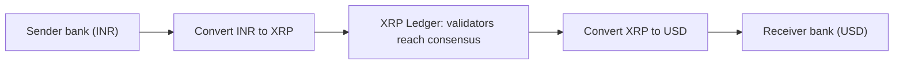
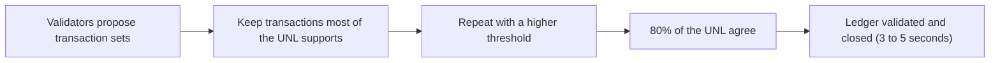

**In one line:** <mark>Ripple is a company and payment network for fast, cheap cross-border money transfer between banks, running on the open XRP Ledger whose native token is XRP</mark>. <Cite id="corda-ripple-quorum-gfg-ripple" />

<Box kind="key">

**Key points to write (any Ripple question):**

- Aim: <mark>fast, cheap cross-border payments</mark>; the old way (SWIFT, correspondent banks) takes days and charges at each hop.
- Parts: <mark>XRP Ledger (XRPL)</mark>, <mark>XRP</mark> (fees and bridge currency), <mark>RippleNet / On-Demand Liquidity (ODL)</mark>, gateways and trust lines.
- Consensus: <mark>RPCA</mark> (Ripple Protocol Consensus Algorithm), no mining; each validator has a <mark>Unique Node List (UNL)</mark>; ledger validated when <mark>80% of the UNL agree</mark>.
- Speed: <mark>3 to 5 seconds</mark>, tiny fees, about 1,500 transactions per second, energy efficient.
- Supply: <mark>100 billion XRP</mark>, all created at the start.
- Limits: more centralised than Bitcoin, Ripple holds a large part of XRP, regulatory action in the US.

</Box>

## Core answer (5 marks, fits every question here)

<Box kind="definition">

**Ripple** is a company and a payment network built for fast, cheap **cross-border money transfer** between banks and payment providers. The network runs on the open **XRP Ledger (XRPL)**, whose native token is **XRP**. <Cite id="corda-ripple-quorum-xrpl-whatis" />

</Box>

**Why it is needed:** international bank transfers use a chain of correspondent banks (SWIFT), so they take days and cost fees at each hop. Ripple lets value move directly in seconds.

**Main parts:**

1. **XRP Ledger:** a public, decentralized ledger of balances and payments. Settlement takes about 3 to 5 seconds and fees are tiny.
2. **XRP:** pays fees and acts as a **bridge currency**: INR becomes XRP and then USD at once, so no one must hold both currencies in advance.
3. **RippleNet / ODL:** the product banks use to send money with XRP as the bridge. <Cite id="corda-ripple-quorum-ripple-odl" />
4. **Gateways and trust lines:** a gateway issues IOUs for real money; users hold them through trust lines.

**Conclusion:** <mark>Ripple targets the slow, costly part of international payments with a fast consensus ledger and XRP as a bridge currency</mark>.

## Extended answer (10 marks): add these

### 1. Consensus: RPCA

XRPL does not use mining. Each validator has a **Unique Node List (UNL)** of validators it trusts not to collude. In rounds, validators exchange proposed transaction sets and keep only the transactions that a rising share of their UNL supports. When **80% of the UNL** agree, the ledger is validated. <Cite id="corda-ripple-quorum-xrpl-consensus" /> <Cite id="corda-ripple-quorum-xrpl-unl" />

### 2. Trust lines and payment paths

A **trust line** says how much of an issuer's IOU a user is willing to hold. A payment can pass through several issuers and market makers, so the XRPL finds a **path** from payer to payee, even across currencies. <Cite id="corda-ripple-quorum-xrpl-paths" />

### 3. Auto-bridging

Order books for XRP/USD and XRP/EUR are combined into a bridged USD/EUR order book. This is merged with the direct USD/EUR order book into one combined book, so XRP works as the bridge. <Cite id="corda-ripple-quorum-xrpl-paths" />

### 4. Ripple versus Bitcoin

| Point | Bitcoin | Ripple (XRPL) |
|---|---|---|
| Aim | Digital cash | Cross-border payments |
| Consensus | PoW mining | RPCA with UNL voting |
| Confirmation | About 10 minutes or more | 3 to 5 seconds |
| Supply | Mined gradually, 21 million cap | 100 billion pre-created |
| Energy | Very high | Very low |

### 5. Features and limitations

**Features:** fast, low cost, high throughput (about 1,500 transactions per second), energy efficient. **Limitations:** more centralised since the UNL is often a recommended list, a large part of XRP is held by Ripple, and there has been US regulatory action about XRP's status. <Cite id="web-bt-2-wiki-ripple" />

## Fit it to each question

- **"Ripple"** (10 marks) <PYQ id="2023-05-ce/q6a" /> <PYQ id="2024-05-ce/q6b" /> <PYQ id="2025-05-ce/q6c" />: the full answer: core answer (purpose, parts, diagram), then extended section 1 (RPCA), 4 (comparison) and 5 (features and limits). Add sections 2 and 3 if time allows.

## Exam tips

- **Draw** the INR to XRP to USD bridge and write "3 to 5 seconds".
- Keywords: <mark>XRP Ledger, XRP, RPCA, UNL, 80%, bridge currency, trust line, RippleNet</mark>.
- Do not say Ripple uses mining or proof of work.
