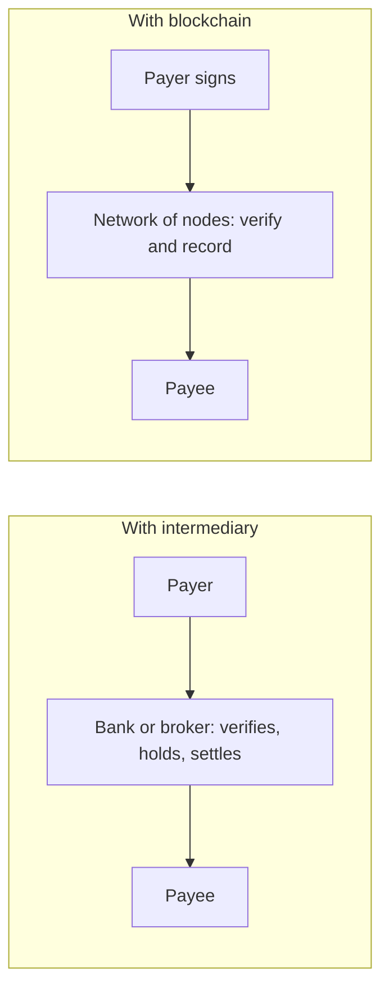
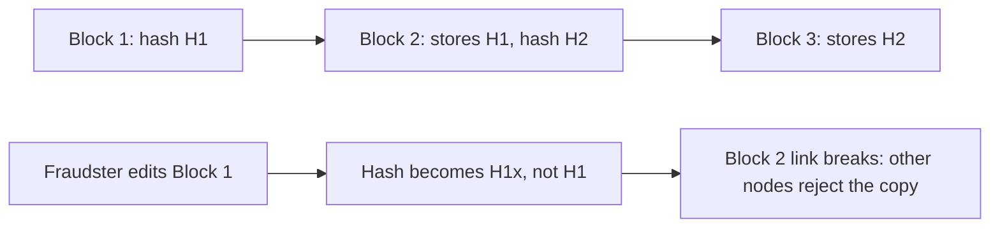

**In one line:** <mark>Blockchain replaces trusted middlemen (banks, brokers, notaries) with cryptography, a shared ledger and smart contracts, and it fights fraud because records are transparent, time-stamped and very hard to change</mark>. <Cite id="blockchain-fundamentals-nakamoto" loc="§1" />

<Box kind="key">

**Key points to write:**

- **Intermediary** = a third party that sits between two parties to verify, hold or settle (bank, broker, notary, clearing house). Removing it is called <mark>disintermediation</mark>. <Cite id="web-bt-sol-a-wiki-disint" />
- Blockchain is <mark>peer-to-peer with no trusted third party</mark>; the network verifies and settles. <Cite id="class-bt-m1" loc="slide 21" />
- Tools that replace the middleman: <mark>digital signatures, consensus, shared ledger, smart contracts</mark>.
- Gains: <mark>lower cost, faster settlement, fewer errors, direct dealing</mark>.
- Fraud fights: <mark>immutability, transparency, traceability, no double spending</mark>.
- Limits: <mark>trust moves to code, oracles and exchanges</mark>; some regulation and support roles stay.

</Box>

## Core answer (5 marks, fits every question here)

<Box kind="definition">

An **intermediary** is a third party that two parties must trust to complete a transaction. A blockchain lets the parties deal **directly (peer-to-peer)**, because the network itself verifies each transaction and records it in a shared ledger. <Cite id="class-bt-m1" loc="slide 20" /> <Cite id="class-bt-m1" loc="slide 21" />

</Box>

**Example:** sending money abroad normally passes through several banks, each taking a fee and some days. With a blockchain payment the sender signs a transaction and the network settles it, with no bank in between. <Cite id="class-bt-m1" loc="slide 6" />

**How blockchain removes the intermediary:**

1. **Cryptographic proof replaces trust.** The sender signs with a private key; anyone can check the signature with the public key. <Cite id="class-bt-m2" loc="slide 117" />
2. **Consensus replaces the clearing house.** Miners or validators agree on the next block, so no central body approves payments. <Cite id="class-bt-m2" loc="slide 29" />
3. **Shared ledger replaces private books.** Every node keeps the same copy, so there is nothing to reconcile between parties.
4. **Smart contracts replace brokers and agents.** The agreement runs by itself when its conditions are met. <Cite id="class-bt-m3a" loc="slide 48" />
5. **Result:** lower fees, faster settlement and fewer errors. <Cite id="web-bt-sol-a-gfg-complete" />

**Conclusion:** <mark>blockchain removes the need to trust a middleman by making the network, not a person, the verifier</mark>.

## Extended answer (10 marks): add these

### 1. Fighting fraud and improving transparency

1. **Immutability.** Each block holds the hash of the previous block, so changing an old record breaks every later block. <Cite id="class-bt-m1" loc="slide 105" />
2. **Transparency.** Permitted participants see the same history, so hidden changes are noticed. <Cite id="class-bt-m1" loc="slide 19" />
3. **Double spending is blocked.** Nodes verify signatures and check that coins are not already spent. <Cite id="class-bt-m2" loc="slide 84" />
4. **Traceability.** Every record is time-stamped, so a product or payment can be followed from origin to customer; useful against fake goods. <Cite id="class-bt-m1" loc="slide 7" />
5. **Identity and ownership.** Signatures prove who authorised an action; used for land records and voting. <Cite id="class-bt-m1" loc="slide 8" />
6. **Consensus and network design** help prevent double spending and other fraud; the slides list this as a feature of Ripple. <Cite id="class-bt-m4" loc="slide 76" />

### 2. Before and after

| Point | With intermediary | With blockchain |
|---|---|---|
| Who verifies | Bank, broker, notary | Network of nodes |
| Cost | Fees at each step | Network fee only |
| Time | Days for cross-border | Minutes to hours |
| Records | Each party keeps own books | One shared ledger |
| Fraud risk | Insiders can edit records | Edits are detected |
| Trust | In the institution | In code and consensus |

### 3. Where it is used

Banking and cross-border payment, supply chain (genuine or fake product), healthcare records, voting, real estate titles, energy trading. <Cite id="class-bt-m1" loc="slide 6" /> <Cite id="blockchain-applications-gfg-supply-revolution" />

### 4. Limits (write one line to show balance)

- Blockchain does not remove every middleman: exchanges, wallets and oracles (data feeds for contracts) are new ones.
- A fraudulent entry that is **true to the chain but false in the real world** (a fake certificate typed in) is not caught; blockchain protects data after it is written.
- Immutability makes mistakes hard to fix, and a 51% attack on a small chain is possible. <Cite id="blockchain-fundamentals-nist-8202" /> <Cite id="smart-contracts-eth-intro" />

## Fit it to each question

- **"Discuss the role of blockchain in eliminating intermediaries."** (10 marks) <PYQ id="assignment-1/q1f" />: core answer (definition, example, five ways, diagram), then extended section 2 (table) and section 4 (limits).
- **"Describe the role of blockchain in combating fraud and enhancing transparency."** (10 marks) <PYQ id="assignment-2/q6f" />: start with the one-line definition, then extended section 1 (six points and the broken-chain diagram), section 3 (uses) and a short line on limits.

## Exam tips

- **Draw** the with-middleman versus without-middleman picture, or the broken-chain picture for fraud.
- Keywords: <mark>peer-to-peer, disintermediation, consensus, smart contract, immutable, transparent, traceable</mark>.
- Always add one limit; it shows you know blockchain is not magic.
