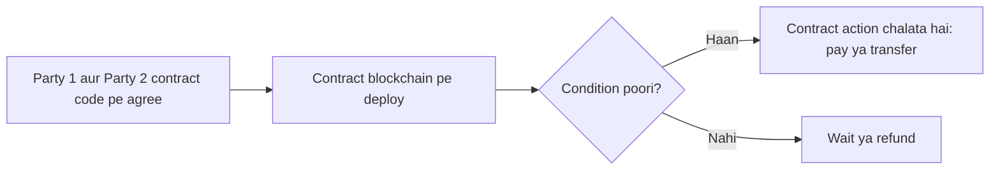
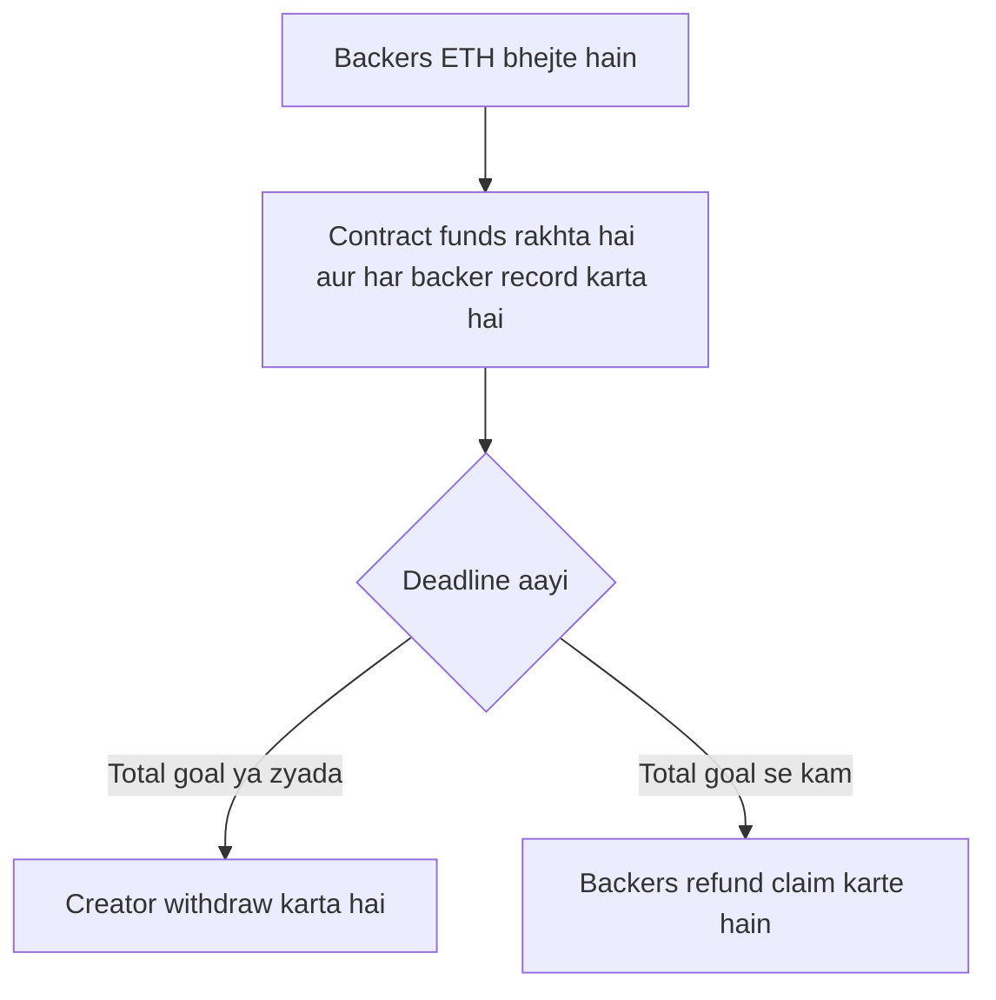

**Ek line mein:** <mark>Smart contract blockchain pe stored program hai jo shart poori hone pe khud chalta hai, bina middleman ke</mark>; idea Nick Szabo (1994) ka hai. <Cite id="smart-contracts-szabo-1994" />

<Box kind="key">

**Smart contract, types, crowdfunding ke question mein ye points likho:**

- <mark>Smart contract = blockchain pe address pe rakha code aur data</mark>; har node use same tarah chalata hai.
- Features: <mark>automatic, no middleman, transparent, deploy hone ke baad immutable</mark>; Ethereum pe Solidity mein likha aur EVM pe chalta hai.
- Analogy: <mark>vending machine</mark> (paise daalo, button dabao, item nikle).
- Types: <mark>smart legal contracts, DAOs, application logic (dApp) contracts, deterministic aur non-deterministic, multi-signature</mark>.
- Crowdfunding: <mark>contract paisa rakhta hai; goal poora to creator withdraw karta hai, goal miss to har backer ko refund</mark>.
- Limit: <mark>bug se paisa ja sakta hai aur code badalna mushkil</mark>.

</Box>

## Core answer (5 marks, yahan ke har question ke liye)

<Box kind="definition">

A **smart contract** is code and data kept at an address on a blockchain. Everyone can see the code and the network runs it the same way on every node, so no one can cheat or stop it. <Cite id="smart-contracts-eth-intro" />

</Box>

**Aasaan picture:** vending machine. Aap paise daalte ho aur button dabate ho; machine bina dukandaar ke item de deti hai. <Cite id="smart-contracts-szabo-1994" />

**Features:** automatic, no middleman, transparent, aur deploy hone ke baad badal nahi sakta. Ethereum pe ye Solidity mein likhe jaate hain aur EVM pe chalte hain. <Cite id="smart-contracts-gfg-smart-contracts" />

**Smart contracts ke types:**

1. **Smart legal contracts:** legal agreements jo code mein badle gaye, jaise rent ya insurance agreement jo automatically pay karta hai.
2. **DAOs (decentralised autonomous organisations):** contracts jo funds rakhte hain aur members ko vote karne dete hain ki use kaise karna hai. <Cite id="smart-contracts-eth-dao" />
3. **Application logic (dApp) contracts:** decentralised app ka back end, jaise token, game ya lending pool.
4. **Deterministic contracts:** bahar ka data nahi chahiye; same input, same result (token transfer).
5. **Non-deterministic contracts:** bahar ke data (price, weather) pe depend, jo oracle laata hai. <Cite id="smart-contracts-eth-oracles" />
6. **Multi-signature contracts:** paisa move karne se pehle kai owners ki approval chahiye.

**Conclusion:** <mark>smart contracts logon pe trust ki jagah code pe trust rakhte hain</mark>. <Cite id="smart-contracts-ibm-smart-contracts" />

## Extended answer (10 marks): ye add karo

### 1. Smart contract se crowdfunding

1. Creator ek **goal** (maan lo 100 ETH) aur **deadline** ke saath contract deploy karta hai.
2. Backers contract ko ETH bhejte hain. Wo har backer aur amount record karta hai.
3. Deadline pe contract total check karta hai.
4. **Goal poora:** creator saara fund withdraw kar sakta hai.
5. **Goal miss:** har backer refund call karke apna paisa wapas pa sakta hai.

**Benefits:** platform fee nahi, rules public, goal se pehle funds nikaale nahi ja sakte, refund automatic. **Limit:** bug se paisa ja sakta hai aur code aasaani se badal nahi sakta. Poora example Solidity by Example pe hai. <Cite id="web-bt-1-sbe-crowdfund" />

### 2. Smart contracts ke advantages aur disadvantages

| Advantages | Disadvantages |
|---|---|
| Middleman nahi, kam cost | Bugs aasaani se fix nahi hote (immutable) |
| Automatic aur fast | Real-world data ke liye oracles chahiye |
| Transparent aur tamper-proof | Kai jagah legal status clear nahi |
| Har node pe same result | Har action pe gas cost |

### 3. Kahan use hote hain

Crowdfunding, insurance payouts, supply chain, voting, tokens aur NFTs, decentralised finance. <Cite id="smart-contracts-sol-intro" />

## Har question mein kaise fit karein

## Exam tips

- Us question ke liye **crowdfunding flow draw karo** "total at least goal?" decision ke saath.
- <mark>automatic</mark>, <mark>immutable</mark>, <mark>no middleman</mark> words use karo.
- Har type ka ek-line example do.

Exam mein English mein likho.
