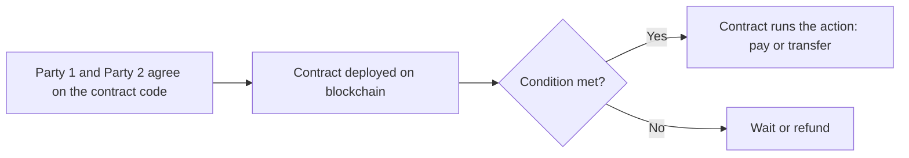
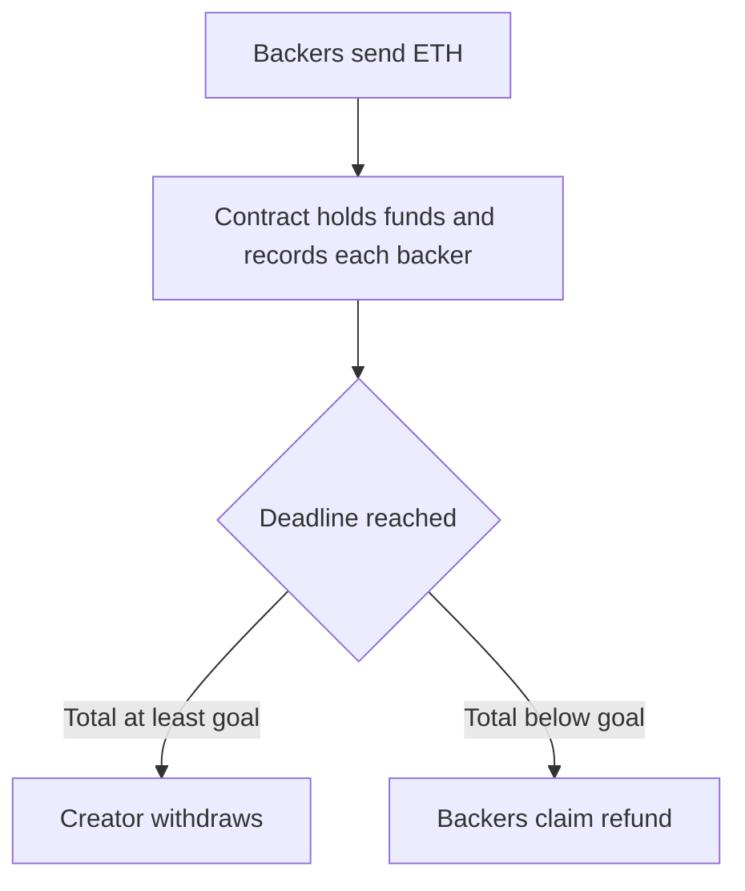

**In one line:** <mark>A smart contract is a program stored on the blockchain that runs by itself when its conditions are met, with no middleman</mark>; the idea came from Nick Szabo (1994). <Cite id="smart-contracts-szabo-1994" />

<Box kind="key">

**Key points to write (smart contract, types, crowdfunding):**

- <mark>Smart contract = code and data at an address on a blockchain</mark>; every node runs it the same way.
- Features: <mark>automatic, no middleman, transparent, immutable once deployed</mark>; on Ethereum written in Solidity and run on the EVM.
- Analogy: <mark>vending machine</mark> (money in, press button, item out).
- Types: <mark>smart legal contracts, DAOs, application logic (dApp) contracts, deterministic and non-deterministic, multi-signature</mark>.
- Crowdfunding: <mark>contract holds the money; goal met means creator withdraws, goal missed means every backer is refunded</mark>.
- Limit: <mark>a bug can lose money and code is hard to change</mark>.

</Box>

## Core answer (5 marks, fits every question here)

<Box kind="definition">

A **smart contract** is code and data kept at an address on a blockchain. Everyone can see the code and the network runs it the same way on every node, so no one can cheat or stop it. <Cite id="smart-contracts-eth-intro" />

</Box>

**Easy picture:** a vending machine. You put in money and press a button; the machine gives the item with no shopkeeper. <Cite id="smart-contracts-szabo-1994" />

**Features:** automatic, no middleman, transparent, and cannot be changed once deployed. On Ethereum they are written in Solidity and run on the EVM. <Cite id="smart-contracts-gfg-smart-contracts" />

**Types of smart contracts:**

1. **Smart legal contracts:** legal agreements turned into code, such as a rent or insurance agreement that pays automatically.
2. **DAOs (decentralised autonomous organisations):** contracts that hold funds and let members vote on how to use them. <Cite id="smart-contracts-eth-dao" />
3. **Application logic (dApp) contracts:** the back end of a decentralised app, such as a token, a game or a lending pool.
4. **Deterministic contracts:** need no outside data; same input, same result (a token transfer).
5. **Non-deterministic contracts:** depend on outside data (price, weather) brought in by an oracle. <Cite id="smart-contracts-eth-oracles" />
6. **Multi-signature contracts:** need approval from several owners before money moves.

**Conclusion:** <mark>smart contracts replace trust in people with trust in code</mark>. <Cite id="smart-contracts-ibm-smart-contracts" />

## Extended answer (10 marks): add these

### 1. Crowdfunding with a smart contract

1. The creator deploys a contract with a **goal** (say 100 ETH) and a **deadline**.
2. Backers send ETH to the contract. It records each backer and amount.
3. At the deadline the contract checks the total.
4. **Goal reached:** the creator can withdraw all the funds.
5. **Goal missed:** each backer can call refund and get their own money back.

**Benefits:** no platform fee, public rules, funds cannot be taken before the goal, automatic refunds. **Limit:** a bug can lose money and the code cannot easily be changed. A full example is on Solidity by Example. <Cite id="web-bt-1-sbe-crowdfund" />

### 2. Advantages and disadvantages of smart contracts

| Advantages | Disadvantages |
|---|---|
| No middleman, lower cost | Bugs cannot be fixed easily (immutable) |
| Automatic and fast | Needs oracles for real-world data |
| Transparent and tamper-proof | Legal status unclear in many places |
| Same result on every node | Gas cost for every action |

### 3. Where they are used

Crowdfunding, insurance payouts, supply chain, voting, tokens and NFTs, decentralised finance. <Cite id="smart-contracts-sol-intro" />

## Fit it to each question

- **"What is a smart contract? How crowdfunding platforms can be managed using smart contracts?"** (5 marks) <PYQ id="2022-12-ce/q1b" />: definition and vending machine (core answer), then section 1 (five steps, diagram, benefits).
- **"What is a Smart Contract? What are the different types of smart contracts?"** (5 marks) <PYQ id="2024-12-ce/q1d" />: definition, features and the six types from the core answer, with the working diagram.

## Exam tips

- **Draw** the crowdfunding flow with the decision "total at least goal?" for that question.
- Use the words <mark>automatic</mark>, <mark>immutable</mark>, <mark>no middleman</mark>.
- Give a one-line example for each type.
