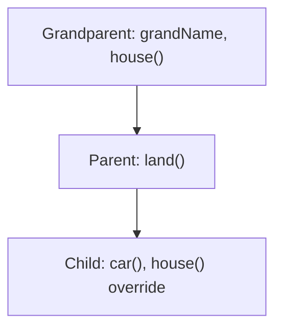
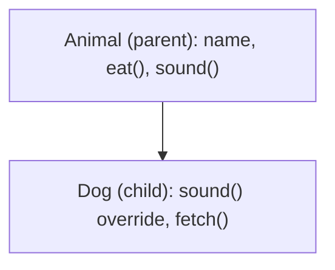
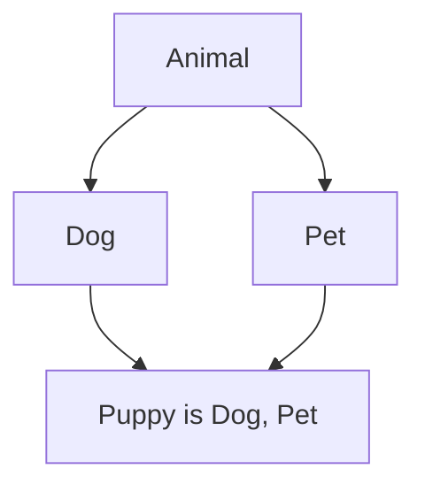

**Ek line mein:** <mark>Inheritance se naya contract purane contract ka code keyword is se reuse karta hai; types hain single (ek parent), multi-level (parents ki chain) aur multiple (ek saath kai parents)</mark>. <Cite id="solidity-docs-inheritance" />

<Box kind="key">

**Kisi bhi inheritance program mein ye points likho:**

- Keyword: <mark>contract Child is Parent</mark>; child ko saare non-private variables aur functions milte hain.
- Parent mein <mark>virtual</mark> matlab child function badal sakta hai; child mein <mark>override</mark> use replace karta hai.
- <mark>Single</mark>: ek parent. <mark>Multi-level</mark>: Grandparent, Parent, Child. <mark>Multiple</mark>: contract C is A, B.
- Arguments wale parent constructor ke liye: <mark>`constructor(...) Parent(_x) {}`</mark>.
- Multiple inheritance <mark>C3 linearization</mark> use karta hai; parents ko most base-like se most derived tak likho; do parents mein same function ho to <mark>override(A, B)</mark>.
- Deploy hone pe saare contracts <mark>ek address pe ek contract</mark> mein merge ho jaate hain.

</Box>

## Core answer (5 marks, yahan ke har question ke liye)

<Box kind="definition">

**Inheritance** lets one contract reuse the code of another, like a child getting things from a parent. In Solidity the keyword `is` makes a contract inherit. <Cite id="solidity-docs-inheritance" />

</Box>

**Multi-level inheritance:** chain mein teen ya zyada levels: Grandparent, phir Parent jo Grandparent ko inherit karta hai, phir Child jo Parent ko inherit karta hai. Child ko apne upar ke dono se sab kuch milta hai.

```solidity
// SPDX-License-Identifier: MIT
pragma solidity ^0.8.0;

contract Grandparent {
    string public grandName = "Grandparent";

    function house() public pure virtual returns (string memory) {
        return "House from Grandparent";
    }
}

contract Parent is Grandparent {
    function land() public pure returns (string memory) {
        return "Land from Parent";
    }
}

contract Child is Parent {
    function house() public pure override returns (string memory) {
        return "House renovated by Child";
    }

    function car() public pure returns (string memory) {
        return "Car bought by Child";
    }
}
```



**Line by line:**

- `contract Grandparent` sabse upar ka (base) contract hai, ek public variable aur `house()` ke saath.
- `house()` pe `virtual` matlab child contract use badal sakta hai.
- `contract Parent is Grandparent` `is` se inherit karta hai; Parent ke paas ab `grandName`, `house()` aur apna `land()` hai.
- `contract Child is Parent` doosra level hai, isliye Child ke paas Grandparent ke members bhi hain.
- Child ke `house()` pe `override` grandparent ka version replace karta hai; `car()` sirf Child mein hai.
- `pure` matlab function blockchain ka data nahi padhta. <Cite id="solidity-gfg-inheritance" />

<Box kind="verify">

**Sirf `Child` deploy karo aur call karo:** `land()` "Land from Parent" deta hai, `grandName()` "Grandparent" deta hai, `house()` "House renovated by Child" deta hai (override hua) aur `car()` "Car bought by Child" deta hai. Ek deployed contract ke paas chaaron members hain.

</Box>

**Conclusion:** <mark>inheritance code ko dohrane se bachata hai: common cheezein parent mein rehti hain aur child sirf wahi jodta ya badalta hai jo special hai</mark>. <Cite id="solidity-tp-inheritance" />

## Extended answer (10 marks): ye add karo

### 1. Single inheritance program

Child ka bilkul ek parent hota hai. Parent constructor `Animal(_name)` se call hota hai.

```solidity
// SPDX-License-Identifier: MIT
pragma solidity ^0.8.0;

// Parent (base) contract
contract Animal {
    string public name;

    constructor(string memory _name) {
        name = _name;
    }

    function eat() public pure returns (string memory) {
        return "This animal eats food";
    }

    function sound() public pure virtual returns (string memory) {
        return "Some sound";
    }
}

// Child contract: single inheritance, only one parent
contract Dog is Animal {
    constructor(string memory _name) Animal(_name) {}

    function sound() public pure override returns (string memory) {
        return "Bow bow";
    }

    function fetch() public pure returns (string memory) {
        return "Dog fetches the ball";
    }
}
```



- `constructor(string memory _name) Animal(_name) {}` naam ko parent constructor ko pass karta hai.
- `sound()` `override` hai, isliye child ka version chalta hai.

<Box kind="verify">

**"Tommy" ke saath `Dog` deploy karo:** `name()` "Tommy" deta hai, `eat()` "This animal eats food" (inherited), `sound()` "Bow bow" (overridden) aur `fetch()` "Dog fetches the ball".

</Box>

### 2. Multiple inheritance program

Contract kai parents se inherit kar sakta hai: `contract C is A, B`. Kaunsa parent jeetega ye tay karne ke liye Solidity **C3 linearization** use karta hai. <Cite id="solidity-docs-inheritance" />

```solidity
// SPDX-License-Identifier: MIT
pragma solidity ^0.8.0;

contract Animal {
    function sound() public pure virtual returns (string memory) {
        return "some sound";
    }
}

contract Dog is Animal {
    function sound() public pure virtual override returns (string memory) {
        return "bark";
    }
}

contract Pet is Animal {
    function sound() public pure virtual override returns (string memory) {
        return "purr";
    }
}

// Order matters: the right-most parent (Pet) is the most derived.
contract Puppy is Dog, Pet {
    function sound() public pure override(Dog, Pet) returns (string memory) {
        return super.sound();
    }
}
```



<Box kind="verify">

`Puppy.sound()`: order Puppy, Pet, Dog, Animal hai, isliye `super.sound()` `Pet.sound()` chalata hai aur "purr" deta hai. `is Pet, Dog` karo to "bark" milega.

</Box>

### 3. Yaad rakhne ke rules

1. Parents ko "most base-like" se "most derived" tak likho; galat order compile error deta hai.
2. Jo function child badal sake wo parent mein `virtual`; child use `override` mark karta hai.
3. Do parents mein same function ho to child `override(A, B)` likhta hai.
4. `super.f()` linearized order ka agla contract call karta hai, zaroori nahi direct parent.

| Type | Parents | Syntax |
|---|---|---|
| Single | Ek | `contract B is A` |
| Multi-level | Har ek ka ek parent, chain | `contract C is B`, `contract B is A` |
| Multiple | Kai | `contract C is A, B` |

<Cite id="solidity-by-example" />

## Har question mein kaise fit karein

- **"Write a program in solidity to implement multi-level inheritance."** (10 marks) <PYQ id="2022-12-ce/q4b" /> <PYQ id="2024-12-ce/q4b" /> <PYQ id="2025-05-ce/q3a" />: **core answer** ka program (Grandparent, Parent, Child) diagram, line by line aur check ke saath; section 3 ke rules add karo.
- **"Write a program in solidity to implement single inheritance."** (10 marks) <PYQ id="2023-05-ce/q4b" />: section 1 (Animal aur Dog) diagram, line by line aur check ke saath; definition aur section 3 ka table add karo.
- **"Describe how solidity supports multiple inheritance with an example."** (5 marks) <PYQ id="2024-05-ce/q1d" />: definition, section 2 ka program diamond diagram ke saath, aur section 3 ke rules.

## Exam tips

- **Poora program likho** `pragma`, `is`, `virtual` aur `override` ke saath; examiners yahi chaar check karte hain.
- Code ke paas chhota inheritance diagram draw karo.
- Ek call ka expected output dikhao taaki proof ho ki chalta hai.

Exam mein English mein likho.
