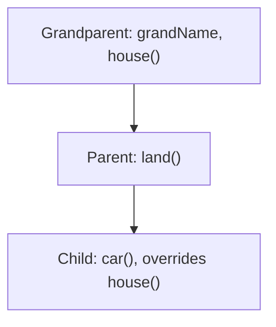
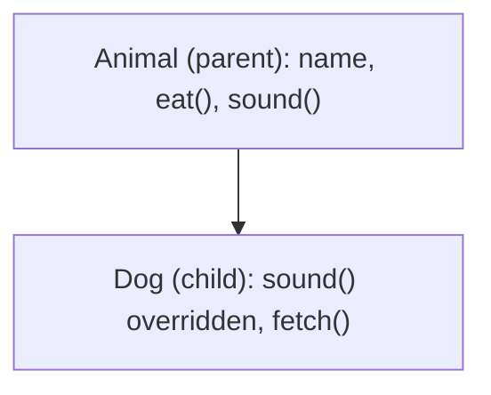
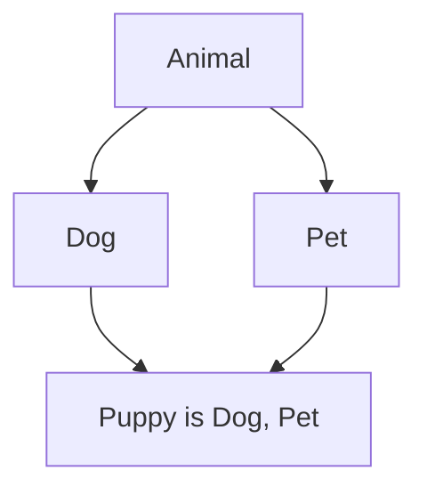

**In one line:** <mark>Inheritance lets a new contract reuse the code of an older one using the keyword is; the types are single (one parent), multi-level (a chain of parents) and multiple (several parents at once)</mark>. <Cite id="solidity-docs-inheritance" />

<Box kind="key">

**Key points to write (any inheritance program):**

- Keyword: <mark>contract Child is Parent</mark>; the child gets all non-private variables and functions.
- <mark>virtual</mark> in the parent means a child may change the function; <mark>override</mark> in the child replaces it.
- <mark>Single</mark>: one parent. <mark>Multi-level</mark>: Grandparent, Parent, Child. <mark>Multiple</mark>: contract C is A, B.
- Parent constructor with arguments: <mark>`constructor(...) Parent(_x) {}`</mark>.
- Multiple inheritance uses <mark>C3 linearization</mark>; list parents from most base-like to most derived; same function in two parents needs <mark>override(A, B)</mark>.
- When deployed, all contracts merge into <mark>one contract at one address</mark>.

</Box>

## Core answer (5 marks, fits every question here)

<Box kind="definition">

**Inheritance** lets one contract reuse the code of another, like a child getting things from a parent. In Solidity the keyword `is` makes a contract inherit. <Cite id="solidity-docs-inheritance" />

</Box>

**Multi-level inheritance:** the chain has three or more levels: Grandparent, then Parent inherits Grandparent, then Child inherits Parent. Child gets everything from both above it.

```solidity
// SPDX-License-Identifier: MIT
pragma solidity ^0.8.0;

contract Grandparent {
    string public grandName = "Grandparent";

    function house() public pure virtual returns (string memory) {
        return "House from Grandparent";
    }
}

contract Parent is Grandparent {
    function land() public pure returns (string memory) {
        return "Land from Parent";
    }
}

contract Child is Parent {
    function house() public pure override returns (string memory) {
        return "House renovated by Child";
    }

    function car() public pure returns (string memory) {
        return "Car bought by Child";
    }
}
```



**Line by line:**

- `contract Grandparent` is the top (base) contract with a public variable and `house()`.
- `virtual` on `house()` means a child contract is allowed to change it.
- `contract Parent is Grandparent` inherits with `is`; Parent now has `grandName`, `house()` and its own `land()`.
- `contract Child is Parent` is the second level, so Child also has Grandparent's members.
- `override` on Child's `house()` replaces the grandparent's version; `car()` exists only in Child.
- `pure` means the function reads no blockchain data. <Cite id="solidity-gfg-inheritance" />

<Box kind="verify">

**Deploy only `Child` and call:** `land()` returns "Land from Parent", `grandName()` returns "Grandparent", `house()` returns "House renovated by Child" (overridden) and `car()` returns "Car bought by Child". One deployed contract has all four members.

</Box>

**Conclusion:** <mark>inheritance avoids repeating code: common things live in the parent and the child adds or changes only what is special</mark>. <Cite id="solidity-tp-inheritance" />

## Extended answer (10 marks): add these

### 1. Single inheritance program

A child has exactly one parent. The parent constructor is called with `Animal(_name)`.

```solidity
// SPDX-License-Identifier: MIT
pragma solidity ^0.8.0;

// Parent (base) contract
contract Animal {
    string public name;

    constructor(string memory _name) {
        name = _name;
    }

    function eat() public pure returns (string memory) {
        return "This animal eats food";
    }

    function sound() public pure virtual returns (string memory) {
        return "Some sound";
    }
}

// Child contract: single inheritance, only one parent
contract Dog is Animal {
    constructor(string memory _name) Animal(_name) {}

    function sound() public pure override returns (string memory) {
        return "Bow bow";
    }

    function fetch() public pure returns (string memory) {
        return "Dog fetches the ball";
    }
}
```



- `constructor(string memory _name) Animal(_name) {}` passes the name to the parent constructor.
- `sound()` is `override`, so the child's version runs.

<Box kind="verify">

**Deploy `Dog` with "Tommy":** `name()` returns "Tommy", `eat()` returns "This animal eats food" (inherited), `sound()` returns "Bow bow" (overridden) and `fetch()` returns "Dog fetches the ball".

</Box>

### 2. Multiple inheritance program

A contract can inherit from several parents: `contract C is A, B`. Solidity uses **C3 linearization** to decide which parent wins. <Cite id="solidity-docs-inheritance" />

```solidity
// SPDX-License-Identifier: MIT
pragma solidity ^0.8.0;

contract Animal {
    function sound() public pure virtual returns (string memory) {
        return "some sound";
    }
}

contract Dog is Animal {
    function sound() public pure virtual override returns (string memory) {
        return "bark";
    }
}

contract Pet is Animal {
    function sound() public pure virtual override returns (string memory) {
        return "purr";
    }
}

// Order matters: the right-most parent (Pet) is the most derived.
contract Puppy is Dog, Pet {
    function sound() public pure override(Dog, Pet) returns (string memory) {
        return super.sound();
    }
}
```



<Box kind="verify">

`Puppy.sound()`: the order is Puppy, Pet, Dog, Animal, so `super.sound()` runs `Pet.sound()` and returns "purr". Swapping to `is Pet, Dog` would return "bark".

</Box>

### 3. Rules to remember

1. List parents from "most base-like" to "most derived"; a wrong order gives a compile error.
2. A function a child may change is `virtual` in the parent; the child marks it `override`.
3. If two parents define the same function, the child writes `override(A, B)`.
4. `super.f()` calls the next contract in the linearized order, not necessarily the direct parent.

| Type | Parents | Syntax |
|---|---|---|
| Single | One | `contract B is A` |
| Multi-level | Chain of one parent each | `contract C is B`, `contract B is A` |
| Multiple | Several | `contract C is A, B` |

<Cite id="solidity-by-example" />

## Fit it to each question

- **"Write a program in solidity to implement multi-level inheritance."** (10 marks) <PYQ id="2022-12-ce/q4b" /> <PYQ id="2024-12-ce/q4b" /> <PYQ id="2025-05-ce/q3a" />: the **core answer** program (Grandparent, Parent, Child) with the diagram, line by line and the check; add the section 3 rules.
- **"Write a program in solidity to implement single inheritance."** (10 marks) <PYQ id="2023-05-ce/q4b" />: section 1 (Animal and Dog) with the diagram, line by line and the check; add the definition and section 3 table.
- **"Describe how solidity supports multiple inheritance with an example."** (5 marks) <PYQ id="2024-05-ce/q1d" />: definition, section 2 program with the diamond diagram, and the rules in section 3.

## Exam tips

- **Write the full program** with `pragma`, `is`, `virtual` and `override`; examiners check these four.
- Draw the small inheritance diagram next to the code.
- Show the expected output of one call to prove it works.
