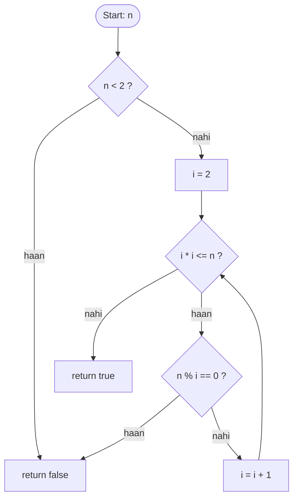

**Ek line mein:** <mark>Prime number 1 se bada hota hai aur sirf 1 aur khud se divisible hota hai, isliye hum 2 se square root of n tak divisors test karte hain</mark>; agar koi bhi n ko exactly divide kare to n prime nahi hai. <Cite id="solidity-docs-control" />

<Box kind="key">

**Har prime program mein ye points likho:**

- Prime: <mark>1 se bada, sirf 1 aur khud se divisible</mark>. 0 aur 1 prime **nahi** hain.
- Method: divisors `i = 2, 3, 4 ...` try karo aur <mark>n % i == 0</mark> use karo (remainder zero matlab divisible).
- <mark>`i * i <= n`</mark> pe ruko (square root), kyunki bada divisor hamesha chhote divisor ke saath jodi banata hai.
- Function: <mark>`function isPrime(uint n) public pure returns (bool)`</mark>; `pure` kyunki yeh blockchain data nahi padhta.
- Hamesha `pragma solidity ^0.8.0;` aur `contract` likho.
- Ek **dry run** dikhao (jaise 29 prime hai, 21 nahi).

</Box>

## Core answer (5 marks, yahan ke har question ke liye)

<Box kind="definition">

A **prime number** is a number greater than 1 that has no divisor other than 1 and itself (2, 3, 5, 7, 11, ...). The program checks this with a loop and the remainder operator `%`.

</Box>

**Algorithm:**

1. Agar `n < 2` hai to `false` return karo.
2. `i = 2` se jab tak `i * i <= n`: agar `n % i == 0` hai to `false` return karo.
3. Loop khatam ho jaye to `true` return karo.



```solidity
// SPDX-License-Identifier: MIT
pragma solidity ^0.8.0;

contract PrimeCheck {
    function isPrime(uint n) public pure returns (bool) {
        if (n < 2) {
            return false;
        }
        for (uint i = 2; i * i <= n; i++) {
            if (n % i == 0) {
                return false;
            }
        }
        return true;
    }
}
```

<Box kind="verify">

`isPrime(29)`: i = 2, 3, 4, 5 pe remainders 1, 2, 1, 4 aate hain. i = 6 pe 36 > 29, loop ruk jata hai: **true**. `isPrime(21)`: i = 3 pe 21 % 3 = 0: **false** (21 = 3 x 7). `isPrime(1)` aur `isPrime(0)`: **false**.

</Box>

**Conclusion:** loop lagbhag square root of n baar chalta hai, jo chhote numbers ke liye sasta hai. <Cite id="solidity-gfg-intro" />

## Extended answer (10 marks): ye add karo

### 1. Line by line

- `// SPDX-License-Identifier: MIT` licence batata hai; missing ho to compiler warning deta hai.
- `pragma solidity ^0.8.0;` matlab 0.8.0 ya naye 0.8.x se compile karo.
- `contract PrimeCheck` container hai, class jaisa.
- `public pure returns (bool)`: koi bhi call kar sakta hai, aur `pure` matlab blockchain data na padhta hai na likhta hai, isliye bahar se call karne pe gas nahi lagta. <Cite id="solidity-docs-view-pure" />
- `uint` unsigned whole number hai (negative nahi). <Cite id="solidity-docs-types" />

### 2. Faster version (even numbers skip karo)

```solidity
function isPrime(uint256 n) public pure returns (bool) {
    if (n < 2) return false;
    if (n == 2) return true;
    if (n % 2 == 0) return false;
    for (uint256 i = 3; i * i <= n; i += 2) {
        if (n % i == 0) return false;
    }
    return true;
}
```

2 handle karne ke baad sirf odd divisors try hote hain (`i += 2`), isliye loop lagbhag aadha lamba hota hai.

### 3. n = 29 ke liye trace table

| i | i * i | `i * i <= 29` ? | 29 % i | Action |
|---|---|---|---|---|
| 2 | 4 | yes | 1 | continue |
| 3 | 9 | yes | 2 | continue |
| 4 | 16 | yes | 1 | continue |
| 5 | 25 | yes | 4 | continue |
| 6 | 36 | no | - | stop, return true |

### 4. Square root kyun kaafi hai

Agar n = a x b aur a, b dono square root of n se bade hon to a x b, n se bada ho jayega. Isliye ek factor hamesha square root ya usse chhota hota hai. <Cite id="solidity-by-example" />

### 5. Gas note

Bahar se call karne par `pure` function free hai. Transaction ke andar bahut bada n zyada gas leta hai, kyunki loop lagbhag square root of n baar chalta hai.

## Har question mein kaise fit karein

- **"Write a program in solidity to check whether a number is prime or not."** (5 marks) <PYQ id="2022-12-ce/q1e" />: sirf core answer: definition, algorithm, flowchart, program aur dry run.
- **"Write a program in solidity to check given number is prime or not"** (5 marks) <PYQ id="2025-05/q1d" />: same; extended section 2 ka faster odd-only version bhi chalta hai.
- **"Write a program in solidity to check whether the number is prime or not."** (5 marks) <PYQ id="2025-05-ce/q1b" />: same; `pure` aur `%` ki do line explanation add karo.

## Exam tips

- Poora skeleton likho: <mark>SPDX line, pragma, contract, function</mark>. Har ek pe marks hain.
- Pehle <mark>n < 2</mark> handle karo; bahut students 0 aur 1 bhool jaate hain.
- Ek prime aur ek non-prime ka dry run dikhao.

Exam mein English mein likho.
