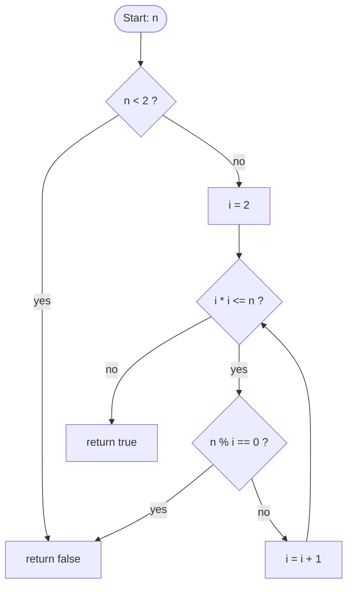

**In one line:** <mark>A prime number is greater than 1 and divisible only by 1 and itself, so we test divisors from 2 up to the square root of n</mark>; if any divides n exactly, n is not prime. <Cite id="solidity-docs-control" />

<Box kind="key">

**Key points to write (any prime program):**

- Prime: <mark>greater than 1, divisible only by 1 and itself</mark>. 0 and 1 are **not** prime.
- Method: try divisors `i = 2, 3, 4 ...` and use <mark>n % i == 0</mark> (remainder zero means divisible).
- Stop at <mark>`i * i <= n`</mark> (the square root), because a larger divisor always pairs with a smaller one.
- Function: <mark>`function isPrime(uint n) public pure returns (bool)`</mark>; `pure` because it reads no blockchain data.
- Always add `pragma solidity ^0.8.0;` and a `contract`.
- Show a **dry run** (for example 29 is prime, 21 is not).

</Box>

## Core answer (5 marks, fits every question here)

<Box kind="definition">

A **prime number** is a number greater than 1 that has no divisor other than 1 and itself (2, 3, 5, 7, 11, ...). The program checks this with a loop and the remainder operator `%`.

</Box>

**Algorithm:**

1. If `n < 2`, return `false`.
2. For `i = 2` while `i * i <= n`: if `n % i == 0`, return `false`.
3. If the loop ends, return `true`.



```solidity
// SPDX-License-Identifier: MIT
pragma solidity ^0.8.0;

contract PrimeCheck {
    function isPrime(uint n) public pure returns (bool) {
        if (n < 2) {
            return false;
        }
        for (uint i = 2; i * i <= n; i++) {
            if (n % i == 0) {
                return false;
            }
        }
        return true;
    }
}
```

<Box kind="verify">

`isPrime(29)`: i = 2, 3, 4, 5 give remainders 1, 2, 1, 4. At i = 6, 36 > 29, so the loop stops: **true**. `isPrime(21)`: i = 3 gives 21 % 3 = 0: **false** (21 = 3 x 7). `isPrime(1)` and `isPrime(0)`: **false**.

</Box>

**Conclusion:** the loop runs about the square root of n times, which is cheap for small numbers. <Cite id="solidity-gfg-intro" />

## Extended answer (10 marks): add these

### 1. Line by line

- `// SPDX-License-Identifier: MIT` states the licence; the compiler warns if it is missing.
- `pragma solidity ^0.8.0;` means compile with 0.8.0 or a newer 0.8.x.
- `contract PrimeCheck` is the container, like a class.
- `public pure returns (bool)`: anyone can call it, and `pure` means it neither reads nor writes blockchain data, so an outside call costs no gas. <Cite id="solidity-docs-view-pure" />
- `uint` is an unsigned whole number (no negatives). <Cite id="solidity-docs-types" />

### 2. Faster version (skip even numbers)

```solidity
function isPrime(uint256 n) public pure returns (bool) {
    if (n < 2) return false;
    if (n == 2) return true;
    if (n % 2 == 0) return false;
    for (uint256 i = 3; i * i <= n; i += 2) {
        if (n % i == 0) return false;
    }
    return true;
}
```

After handling 2, only odd divisors are tried (`i += 2`), so the loop is about half as long.

### 3. Trace table for n = 29

| i | i * i | `i * i <= 29` ? | 29 % i | Action |
|---|---|---|---|---|
| 2 | 4 | yes | 1 | continue |
| 3 | 9 | yes | 2 | continue |
| 4 | 16 | yes | 1 | continue |
| 5 | 25 | yes | 4 | continue |
| 6 | 36 | no | - | stop, return true |

### 4. Why the square root is enough

If n = a x b and both a and b are bigger than the square root of n, then a x b would be bigger than n. So one factor is always at most the square root. <Cite id="solidity-by-example" />

### 5. Gas note

Called from outside, a `pure` function is free. Called inside a transaction, a very large n costs more gas because the loop runs about the square root of n times.

## Fit it to each question

- **"Write a program in solidity to check given number is prime or not"** (5 marks) <PYQ id="2025-05/q1d" />: same; the faster odd-only version from extended section 2 is also accepted.

## Exam tips

- Write the full skeleton: <mark>SPDX line, pragma, contract, function</mark>. Marks go for each.
- Handle <mark>n < 2</mark> first; many students forget 0 and 1.
- Show one dry run with a prime and a non-prime.
