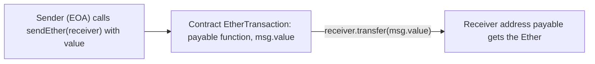
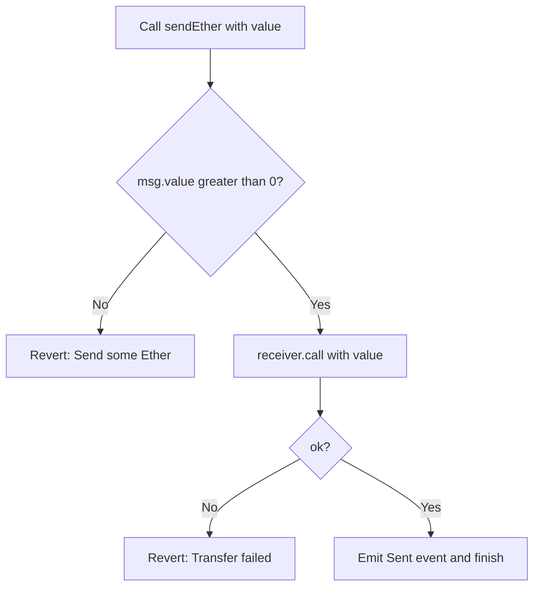

**In one line:** <mark>A transaction program in Solidity is a contract with a `payable` function that receives Ether (`msg.value`) and forwards it to a receiver address (`address payable`)</mark>. <Cite id="class-bt-m3a" loc="slide 54" />

<Box kind="key">

**Key points to write:**

- Skeleton: <mark>SPDX line, `pragma solidity ^0.8.0;`, `contract`, function</mark>.
- <mark>`payable`</mark> on a function lets it accept Ether sent with the call; <mark>`address payable`</mark> is an address that can receive Ether.
- <mark>`msg.value`</mark> = amount of Ether sent with the call (in **wei**; 1 ETH = 10^18 wei). <mark>`msg.sender`</mark> = who called.
- Sending: <mark>`receiver.transfer(amount)`</mark> (class version) or <mark>`call{value: amount}("")`</mark> (recommended today).
- Always <mark>check the result</mark> and use <mark>`require`</mark>; show a dry run.

</Box>

## Core answer (5 marks, fits every question here)

<Box kind="definition">

A **transaction** on Ethereum moves value or calls a contract. A Solidity contract can take part: it receives Ether from a sender and passes it to a receiver. <Cite id="ethereum-eth-transactions" />

</Box>

**Algorithm:**

1. The sender calls `sendEther(receiver)` and attaches Ether to the call.
2. The function is `payable`, so the Ether (`msg.value`) enters the contract.
3. The contract sends `msg.value` on to the `receiver`.
4. The receiver's balance goes up; the sender's balance goes down by the amount plus gas.



**Program (as in class):** <Cite id="class-bt-m3a" loc="slide 54" />

```solidity
// SPDX-License-Identifier: MIT
pragma solidity ^0.8.0;

contract EtherTransaction {
    // payable: the call may carry Ether; address payable: the receiver can get Ether
    function sendEther(address payable receiver) public payable {
        // pass the Ether that came with this call on to the receiver
        receiver.transfer(msg.value);
    }
}
```

**Line by line:** <Cite id="class-bt-m3a" loc="slide 56" />

- `contract EtherTransaction` creates the contract that handles the transaction.
- `address payable receiver` takes the receiver's address; `payable` means it can receive Ether. <Cite id="web-bt-sol-a-sol-types" />
- `public` lets anyone call the function from outside; `payable` lets the call carry Ether.
- `msg.value` is the amount of Ether sent with the call. <Cite id="web-bt-sol-a-sol-globals" />
- `receiver.transfer(msg.value)` sends that amount to the receiver and reverts the whole call if it fails.

<Box kind="verify">

**Dry run:** Asha calls `sendEther(Bob)` and attaches 1 ETH. So `msg.value = 1 ETH` (10^18 wei). The contract runs `Bob.transfer(1 ETH)`. Bob's balance rises by 1 ETH, the contract keeps 0, and Asha pays 1 ETH plus gas. If the attached value is 0, Bob simply gets 0.

</Box>

**Conclusion:** <mark>`payable` brings Ether in, `msg.value` tells how much, and `transfer` sends it out</mark>. <Cite id="solidity-gfg-intro" />

## Extended answer (10 marks): add these

### 1. A fuller version: send, receive and check the balance

```solidity
// SPDX-License-Identifier: MIT
pragma solidity ^0.8.0;

contract EtherTransaction {
    // events leave a public log of every move
    event Sent(address indexed from, address indexed to, uint256 amount);
    event Received(address indexed from, uint256 amount);

    // receive(): runs when someone sends plain Ether to the contract
    receive() external payable {
        emit Received(msg.sender, msg.value);
    }

    // send the Ether attached to this call on to the receiver
    function sendEther(address payable receiver) public payable {
        require(msg.value > 0, "Send some Ether");
        // call is the recommended way to send Ether today
        (bool ok, ) = receiver.call{value: msg.value}("");
        require(ok, "Transfer failed");
        emit Sent(msg.sender, receiver, msg.value);
    }

    // view: only reads data, so an outside call costs no gas
    function getBalance() public view returns (uint256) {
        return address(this).balance;
    }
}
```

- `receive() external payable` is the special function that accepts Ether sent without data, so the contract can **receive**. <Cite id="solidity-docs-fallback" />
- `require(...)` stops and undoes the call if the condition is false.
- `call{value: ...}("")` returns `(bool ok, ...)`; we must check `ok`.
- `address(this).balance` is the Ether held by the contract.

### 2. transfer, send and call

| Method | Gas forwarded | On failure | Use |
|---|---|---|---|
| `transfer` | Fixed 2300 | Reverts | Simple, used in class |
| `send` | Fixed 2300 | Returns `false` | Must check the result |
| `call{value: x}("")` | All available | Returns `false` | Recommended today; check the result |

The fixed 2300 gas can make `transfer` fail for a receiver that is a contract with logic, so common guides such as Solidity by Example now prefer `call`. <Cite id="web-bt-sol-a-sbe-send" />

### 3. Safe practice

- Check the result of `call` and use `require`.
- If the contract keeps balances, **update the balance first, then send** (checks, effects, interactions) to avoid re-entrancy attacks like the DAO hack. This program keeps no balances, so it is safe. <Cite id="smart-contracts-sol-security" />
- Remember amounts are in wei; use `1 ether` in code for 10^18 wei.

### 4. How the transaction looks in Remix

Deploy the contract, choose a receiver account, type the amount in the **Value** box, press `sendEther`; the receiver's balance rises. <Cite id="web-bt-sol-a-sbe-wallet" />



## Fit it to each question

- **"Write solidity program for transaction."** (10 marks) <PYQ id="assignment-3/q3f" />: core answer (algorithm, class program, line by line, dry run), then extended sections 1 to 3.

## Exam tips

- Write the full skeleton: <mark>SPDX line, pragma, contract, function</mark>; marks go for each.
- Say clearly: <mark>`payable` receives, `msg.value` is the amount, `transfer` sends</mark>.
- The class slide says "msg.value = 1 ETH" for simplicity; the real unit is wei. Mention it once.
