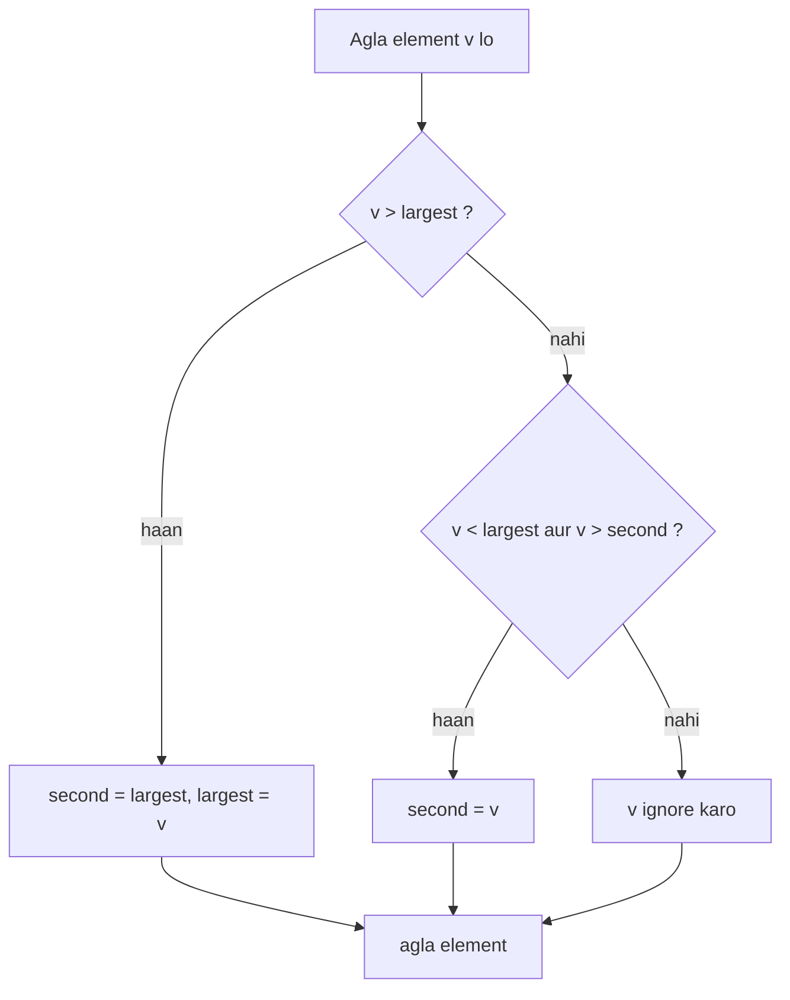

**Ek line mein:** <mark>Array ko ek baar padho aur do values rakho, ab tak ka largest aur second largest; har naya element inme se ek ko replace kar sakta hai</mark>. <Cite id="solidity-docs-control" />

<Box kind="key">

**Second largest program mein ye points likho:**

- Second largest = <mark>sabse bada value jo largest se chhota ho</mark>.
- Method: <mark>ek pass</mark>, do variables `largest` aur `second`.
- Agar `v > largest`: <mark>purana largest second ban jata hai</mark>, `v` largest ban jata hai.
- Warna agar `v < largest` aur `v > second`: <mark>v second ban jata hai</mark>.
- Largest ke barabar values **skip** hoti hain (repeated maximum second nahi hota).
- `uint[] memory arr`, `pure`, aur `require(arr.length >= 2)` use karo.

</Box>

## Core answer (5 marks, yahan ke har question ke liye)

<Box kind="definition">

The **second largest element** of an array is the biggest value that is strictly smaller than the largest value. We find it in one loop without sorting. <Cite id="solidity-gfg-arrays" />

</Box>

**Algorithm:**

1. Check karo ki array mein kam se kam 2 elements hain.
2. `largest = arr[0]` se shuru karo; `second` abhi unknown (`hasSecond = false`).
3. Har agle value `v` ke liye: agar `v > largest`, to `second = largest` aur `largest = v`; warna agar `v < largest` aur (abhi second nahi hai ya `v > second`), to `second = v`.
4. `second` return karo.



```solidity
// SPDX-License-Identifier: MIT
pragma solidity ^0.8.0;

contract SecondLargest {
    function secondLargest(uint[] memory arr) public pure returns (uint) {
        require(arr.length >= 2, "Need at least 2 elements");

        uint largest = arr[0];
        uint second = 0;
        bool hasSecond = false;

        for (uint i = 1; i < arr.length; i++) {
            uint v = arr[i];
            if (v > largest) {
                second = largest;
                largest = v;
                hasSecond = true;
            } else if (v < largest && (!hasSecond || v > second)) {
                second = v;
                hasSecond = true;
            }
        }

        require(hasSecond, "All elements are equal");
        return second;
    }
}
```

<Box kind="verify">

`secondLargest([10, 5, 20, 8])`: largest = 10 se shuru. v = 5 se second = 5. v = 20 se second = 10, largest = 20. v = 8, 20 se chhota hai aur 10 se bada nahi, isliye koi change nahi. Returns **10**. Sort karke check: 5, 8, 10, 20, second largest 10 hai.

</Box>

**Conclusion:** ek pass, sorting nahi, isliye kaam sirf array length n ke saath badhta hai. <Cite id="solidity-by-example" />

## Extended answer (10 marks): ye add karo

### 1. Line by line

- `uint[] memory arr`: whole numbers ka array; `memory` matlab temporary copy. `pure` matlab blockchain data nahi chhuta, isliye call free hai. <Cite id="solidity-docs-types" />
- `require(arr.length >= 2, ...)` message ke saath ruk jata hai agar doosra element hi nahi hai.
- `hasSecond` isliye chahiye kyunki `0` array ka asli value ho sakta hai, to `second == 0` ka matlab "mila nahi" nahi hota.
- Aakhri `require` tab rokta hai jab saare elements barabar hon, kyunki tab second largest hota hi nahi.

### 2. Aur dry runs

| Array | Result | Kyun |
|---|---|---|
| `[7, 7, 3]` | 3 | Dusra 7 largest ke barabar hai, skip hota hai; 3 second ban jata hai |
| `[4, 4]` | revert "All elements are equal" | `hasSecond` false rehta hai |
| `[1, 2, 3, 4]` | 3 | har naya value purane largest ko neeche dhakelta hai |

### 3. Alternative: pehle sort karo

Array sort karke second last element le sakte ho, lekin sorting zyada gas leti hai (simple sort mein lagbhag n squared steps) aur extra code chahiye. One-pass method mein lagbhag n steps lagte hain. <Cite id="solidity-tp-arrays" />

| Method | Steps | Extra code |
|---|---|---|
| One pass (do variables) | lagbhag n | Kam |
| Sort, phir pick | lagbhag n squared (bubble sort) | Sorting loop |

### 4. Gas note

Bahar se call karne par `pure` function ka kuch cost nahi. Transaction ke andar lambe arrays zyada gas lete hain kyunki har element ek baar padha jata hai.

## Har question mein kaise fit karein

- **"Write a program in solidity to find the second largest element in an array"** (5 marks) <PYQ id="2023-05-ce/q1e" />: core answer: definition, algorithm, flowchart, program aur ek dry run. Equal-values note add karo.

## Exam tips

- <mark>Array length 2 se kam</mark> aur <mark>sab elements barabar</mark> wale cases handle karo; examiner inhe dekhte hain.
- `second` ko flag ke bina 0 se shuru mat karo, kyunki 0 asli element ho sakta hai.
- Hamesha 4 numbers ka dry run dikhao.

Exam mein English mein likho.
