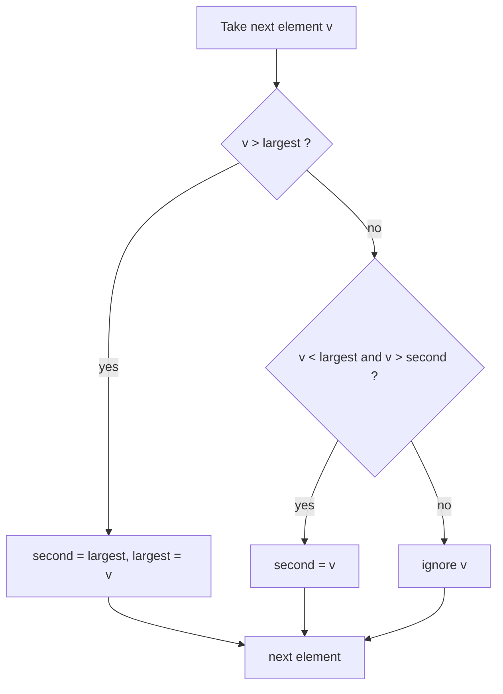

**In one line:** <mark>Read the array once and keep two values, the largest and the second largest so far; each new element may replace one of them</mark>. <Cite id="solidity-docs-control" />

<Box kind="key">

**Key points to write (second largest program):**

- Second largest = <mark>the biggest value that is smaller than the largest</mark>.
- Method: <mark>one pass</mark>, two variables `largest` and `second`.
- If `v > largest`: <mark>old largest becomes second</mark>, `v` becomes largest.
- Else if `v < largest` and `v > second`: <mark>v becomes second</mark>.
- Equal values to the largest are **skipped** (a repeated maximum is not the second).
- Use `uint[] memory arr`, `pure`, and `require(arr.length >= 2)`.

</Box>

## Core answer (5 marks, fits every question here)

<Box kind="definition">

The **second largest element** of an array is the biggest value that is strictly smaller than the largest value. We find it in one loop without sorting. <Cite id="solidity-gfg-arrays" />

</Box>

**Algorithm:**

1. Check the array has at least 2 elements.
2. Start with `largest = arr[0]`; `second` unknown (`hasSecond = false`).
3. For each next value `v`: if `v > largest`, then `second = largest` and `largest = v`; else if `v < largest` and (no second yet or `v > second`), then `second = v`.
4. Return `second`.



```solidity
// SPDX-License-Identifier: MIT
pragma solidity ^0.8.0;

contract SecondLargest {
    function secondLargest(uint[] memory arr) public pure returns (uint) {
        require(arr.length >= 2, "Need at least 2 elements");

        uint largest = arr[0];
        uint second = 0;
        bool hasSecond = false;

        for (uint i = 1; i < arr.length; i++) {
            uint v = arr[i];
            if (v > largest) {
                second = largest;
                largest = v;
                hasSecond = true;
            } else if (v < largest && (!hasSecond || v > second)) {
                second = v;
                hasSecond = true;
            }
        }

        require(hasSecond, "All elements are equal");
        return second;
    }
}
```

<Box kind="verify">

`secondLargest([10, 5, 20, 8])`: start largest = 10. v = 5 gives second = 5. v = 20 gives second = 10, largest = 20. v = 8 is below 20 and not above 10, so no change. Returns **10**. Check by sorting: 5, 8, 10, 20, second largest is 10.

</Box>

**Conclusion:** one pass, no sorting, so the work grows only with the array length n. <Cite id="solidity-by-example" />

## Extended answer (10 marks): add these

### 1. Line by line

- `uint[] memory arr`: an array of whole numbers; `memory` means a temporary copy. `pure` means no blockchain data is touched, so calling it is free. <Cite id="solidity-docs-types" />
- `require(arr.length >= 2, ...)` stops with a message if there is no second element.
- `hasSecond` is needed because `0` can be a real array value, so `second == 0` does not mean "not found".
- The last `require` stops when every element is equal, because then there is no second largest.

### 2. More dry runs

| Array | Result | Why |
|---|---|---|
| `[7, 7, 3]` | 3 | The second 7 equals the largest, so it is skipped; 3 becomes second |
| `[4, 4]` | revert "All elements are equal" | `hasSecond` stays false |
| `[1, 2, 3, 4]` | 3 | each new value pushes the old largest down |

### 3. Alternative: sort first

You could sort the array and take the second last element, but sorting costs more gas (about n squared steps for a simple sort) and needs extra code. The one-pass method needs about n steps. <Cite id="solidity-tp-arrays" />

| Method | Steps | Extra code |
|---|---|---|
| One pass (two variables) | about n | Little |
| Sort, then pick | about n squared (bubble sort) | Sorting loop |

### 4. Gas note

Called from outside, the `pure` function costs nothing. Used inside a transaction, long arrays cost more gas because every element is read once.

## Fit it to each question

- **"Write a program in solidity to find the second largest element in an array"** (5 marks) <PYQ id="2023-05-ce/q1e" />: core answer: definition, algorithm, flowchart, program and one dry run. Add the equal-values note.

## Exam tips

- Handle <mark>array length below 2</mark> and <mark>all-equal arrays</mark>; examiners look for them.
- Do not start `second` at 0 without a flag, because 0 can be a real element.
- Always show a dry run with 4 numbers.
