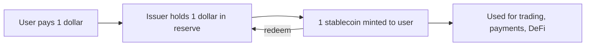
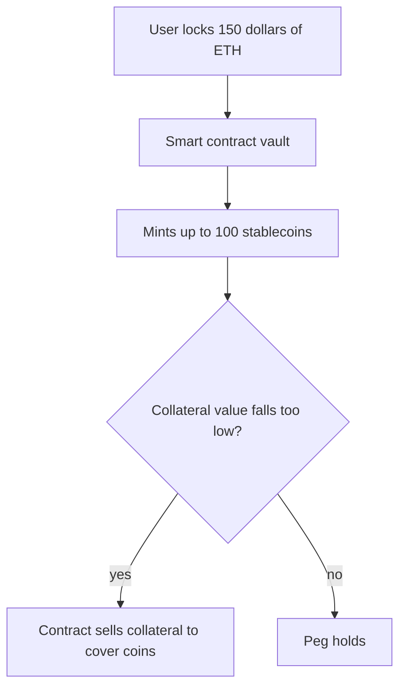

**In one line:** <mark>A stablecoin is a cryptocurrency designed to keep a steady value by tying it to an outside asset such as the US dollar</mark>, unlike Bitcoin whose price moves freely. <Cite id="class-bt-m5" loc="slide 10" />

<Box kind="key">

**Key points to write (stablecoins):**

- Definition: <mark>values are designed to stay stable relative to real-world assets like the U.S. dollar</mark> (class wording). <Cite id="class-bt-m5" loc="slide 10" />
- Problem solved: <mark>volatility</mark> of Bitcoin and Ether.
- Types: <mark>fiat-backed (USDT, USDC), crypto-backed (DAI), commodity-backed (gold), algorithmic</mark>.
- Mostly <mark>ERC-20 tokens</mark>; <mark>Circle</mark> issues a dollar token on ERC-20. <Cite id="class-bt-m5" loc="slide 21" />
- Uses: <mark>trading, payments, remittances, DeFi lending, a safe place to park value</mark>.
- Risks: <mark>trust in the issuer, reserves, de-pegging, regulation</mark>; algorithmic ones have collapsed (TerraUSD, 2022).

</Box>

## Core answer (5 marks, fits every question here)

<Box kind="definition">

**Stablecoins** are the class of cryptocurrencies whose values are designed to stay stable relative to real-world assets like the U.S. dollar. <Cite id="class-bt-m5" loc="slide 10" />

</Box>

**Why they are needed:** a coin whose price swings by 10 percent in a day cannot be used to price goods, pay salaries or give loans. A stablecoin keeps the speed and openness of crypto and removes most of the price swings. <Cite id="web-bt-sol-b-gfg-stablecoins" />

**How the peg works (1 coin = 1 dollar):**

1. **Fiat-backed:** the issuer keeps a dollar in a bank for each coin and promises to redeem it. *Examples:* USDT, USDC.
2. **Crypto-backed:** users lock more crypto than the coin value in a smart contract, which is over-collateralised. *Example:* DAI.
3. **Commodity-backed:** each coin stands for a unit of gold or similar. *Example:* DGX (gold).
4. **Algorithmic:** code changes the supply to hold the price. This is the riskiest type. <Cite id="cryptocurrencies-tokens-wiki-stablecoin" />

**Conclusion:** <mark>stablecoins give crypto speed with a steady price, but their safety depends on the backing and the issuer</mark>.

## Extended answer (10 marks): add these

### 1. Stablecoin versus traditional cryptocurrency

| Point | Bitcoin or Ether | Stablecoin |
|---|---|---|
| Price | Moves freely with demand | Pegged to an asset (for example 1 dollar) |
| Backing | None (value from demand and scarcity) | Dollars, crypto, gold or an algorithm |
| Volatility | High | Low |
| Main use | Store of value, investment, fees | Payments, trading pair, DeFi, remittance |
| Issuer | No one | Usually a company or protocol |
| Supply | Fixed rules or mining | Grows when users deposit backing |
| Risk | Price risk | Reserve, issuer and de-peg risk |

<Cite id="cryptocurrencies-tokens-wiki-crypto" /> <Cite id="web-bt-sol-b-wiki-tether" />

### 2. Types in a table

| Type | Backing | Example | Main risk |
|---|---|---|---|
| Fiat-backed | Bank money | USDT, USDC | Trust in reserves |
| Crypto-backed | Locked crypto (over-collateralised) | DAI | Collateral price crash |
| Commodity-backed | Gold or other goods | DGX | Custody of the commodity |
| Algorithmic | Code and a sister token | TerraUSD (failed 2022) | Loss of confidence, collapse |

<Cite id="web-bt-sol-b-gfg-stablecoins" />

### 3. How a crypto-backed coin keeps its peg

### 4. Uses and role in DeFi

Stablecoins are the base currency of many DeFi lending and trading pools, and are used for cross-border payments because they are quick and priced in dollars. They are usually ERC-20 tokens. <Cite id="cryptocurrencies-tokens-eth-erc20" />

### 5. Risks and regulation

Doubts about whether reserves exist, **de-pegging** (price drops below 1 dollar), runs by holders, and the power of the issuer to freeze coins. Regulators study global stablecoins closely. <Cite id="web-bt-sol-b-fsb-crypto" />

## Fit it to each question

- **"What are stablecoins? How do they differ from traditional cryptocurrencies?"** (10 marks) <PYQ id="assignment-2/q5e" />: core answer (definition, four types, diagram), then extended section 1 (comparison table), section 3 or 5 for the extra marks.

## Exam tips

- **Start** with the class definition word for word, then the comparison table.
- Keywords: <mark>peg, reserve, fiat-backed, crypto-backed, algorithmic, collateral, de-peg, volatility</mark>.
- Do not say stablecoins have no risk. A peg can break.
