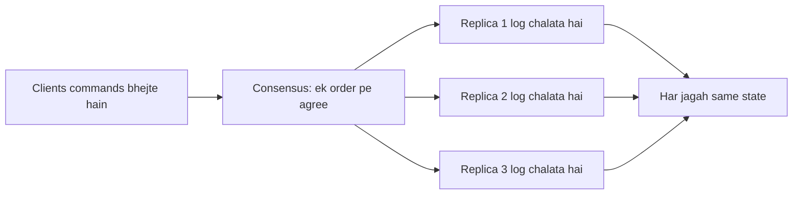
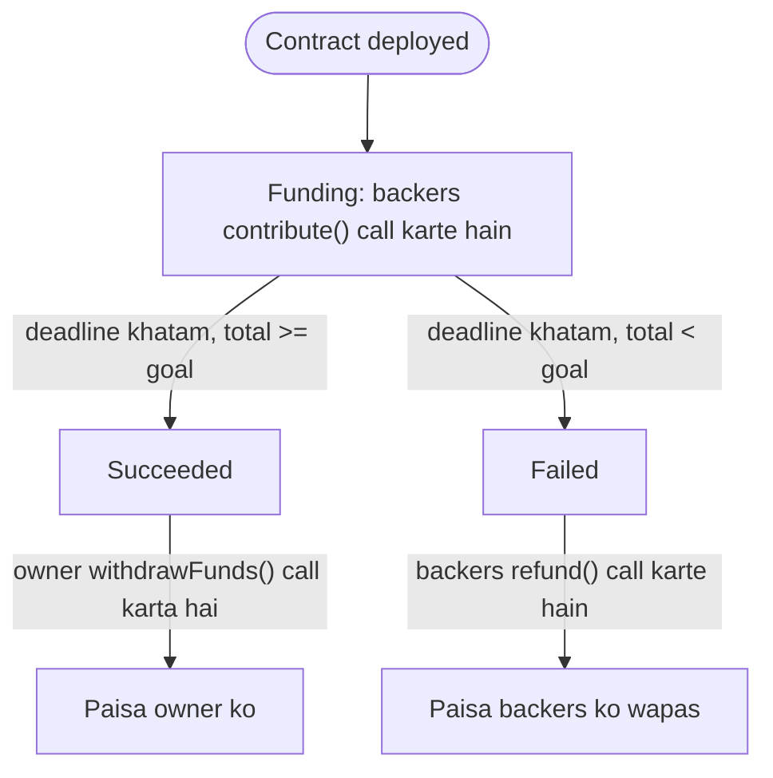
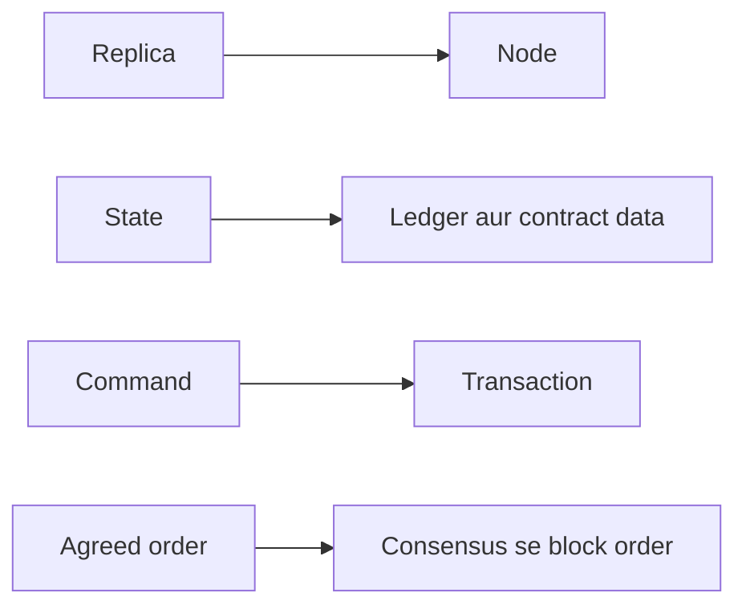

**Ek line mein:** <mark>State machine replication (SMR) ek hi deterministic program ko kai servers pe chalata hai aur har copy ko same commands same order mein deta hai, isliye saari copies hamesha same state mein rehti hain</mark>. <Cite id="smart-contracts-wiki-smr" />

<Box kind="key">

**Har SMR question mein ye points likho:**

- **State machine** ke paas stored state hoti hai aur woh sirf commands chala kar badalti hai; use <mark>deterministic</mark> hona chahiye (same state + same command = same new state). <Cite id="smart-contracts-schneider-1990" />
- SMR = <mark>kai replicas, same start state, same commands, same order</mark>.
- Mushkil step hai <mark>order pe agree karna</mark>: **consensus algorithm** (PoW, PoS, Paxos, Raft, PBFT) yeh karta hai.
- Fault tolerance: crash faults ke liye <mark>2f + 1</mark> replicas; Byzantine faults ke liye <mark>3f + 1</mark>.
- <mark>Blockchain SMR hi hai</mark>: nodes = replicas, ledger = state, transactions = commands.
- <mark>Smart contract ek state machine hai</mark>: variables = state, function calls = commands, `require` checks = transition rules.

</Box>

## Core answer (5 marks, yahan ke har question ke liye)

<Box kind="definition">

**State machine replication** keeps many copies (replicas) of the same state machine on many computers. Every replica runs the same commands in the same order, so all replicas reach the same state, and the service continues if some replicas fail. <Cite id="web-bt-2-wiki-smr" />

</Box>

**Kyun chahiye:** ek server single point of failure hai. Kai servers tabhi safe hain jab woh kabhi alag na hon, aur woh tab alag hote hain jab unhe commands alag order mein milte hain.

**Kaise kaam karta hai:**

1. n servers pe ek-ek replica rakho, sab same start state mein.
2. Clients commands bhejte hain (blockchain mein: transactions).
3. **Consensus algorithm** sab replicas ko ek order pe agree karata hai.
4. Har replica commands us order mein chalata hai.
5. Sab replicas same state mein pahunchte hain aur same replies dete hain.

**Blockchain se link:** ledger state hai, transactions commands hain, consensus block order deta hai, aur har node same transactions chalata hai. Ethereum mein EVM state machine hai. <Cite id="bft-paxos-raft-wiki-consensus" />

**Conclusion:** <mark>SMR plus consensus gives a service that stays correct even when some replicas fail</mark>.

## Extended answer (10 marks): ye add karo

### 1. Smart contract state machine ke roop mein

<Box kind="definition">

A **smart contract** is a program stored on the blockchain with its own data and functions. Its **state** is the values of its variables, its **commands** are the transactions that call its functions, and its **transitions** are the function code with `require` checks. <Cite id="smart-contracts-gfg-smart-contracts" />

</Box>

| State machine term | Smart contract |
|---|---|
| State | Stored variables aur balance |
| Command | Function call karne wali transaction |
| Transition rule | `require` checks wala function code |
| Sab ke liye same order | Consensus se block order |
| Replicas | EVM chalane wala har node |

Agar `require` fail ho to transaction **revert** ho jati hai aur state pehle jaisi rehti hai. Contract deterministic hai, isliye har node kisi dusre node pe bharosa kiye bina same result pe pahunchta hai. <Cite id="smart-contracts-sol-patterns" />

### 2. Example: crowdfunding application

States: **Funding** (open), **Succeeded** (deadline khatam, goal poora), **Failed** (deadline khatam, goal poora nahi). Commands: `contribute()`, `withdrawFunds()`, `refund()`. <Cite id="smart-contracts-eth-intro" />

**Worked example:** goal = 1000. Asha ka `contribute(500)` aur Ravi ka `contribute(300)` alag nodes pe alag time pe pahunchte hain. Consensus order tay karta hai (pehle Asha, phir Ravi). Har node dono ko us order mein chalata hai, isliye har node 500 + 300 = 800 dikhata hai. Deadline ke baad 800 < 1000, to har node **Failed** state mein jata hai, aur backers refund le sakte hain. Koi node disagree nahi kar sakta, kyunki sabne same commands same order mein chalaye.

### 3. Fault limits aur uses

| Fault type | Replicas chahiye | Algorithms |
|---|---|---|
| Crash (node ruk jata hai) | 2f + 1 | Paxos, Raft |
| Byzantine (node jhooth bolta hai) | 3f + 1 | PBFT |

Real uses: Google Chubby, etcd, Hyperledger Fabric ordering. <Cite id="smart-contracts-wiki-smr" />

## Har question mein kaise fit karein

- **"Describe the concept of state machine replication. How is a smart contract represented as a state machine?"** (10 marks) <PYQ id="2023-05-ce/q3a" />: core answer plus extended section 1 (mapping table) aur crowdfunding diagram.
- **"Explain the function of state machine replication. Explain with respect to crowd funding application."** (10 marks) <PYQ id="2023-12-ce/q2a" />: core answer ("function" matlab kyun chahiye) plus extended section 2, 800 vs 1000 worked example ke saath.
- **"Explain state machine replication with suitable example."** (10 marks) <PYQ id="2024-05-ce/q5a" />: core answer plus crowdfunding example (section 2).
- **"Explain state machine replication."** (10 marks) <PYQ id="2024-12-ce/q3b" />: core answer plus section 3 (fault limits) aur blockchain mapping diagram.

## Exam tips

- Flow **draw karo**: clients, consensus (order), replicas, same state.
- Keywords: <mark>deterministic, replica, consensus, same order, same state, 2f + 1, 3f + 1</mark>.
- "Smart contract as state machine" mein hamesha state, command aur transition ka mapping do.

Exam mein English mein likho.
