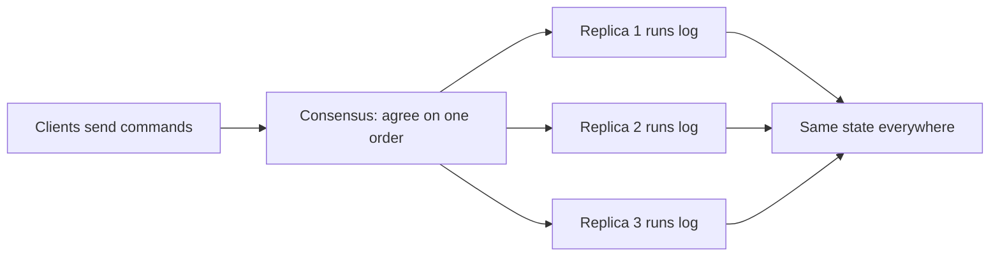
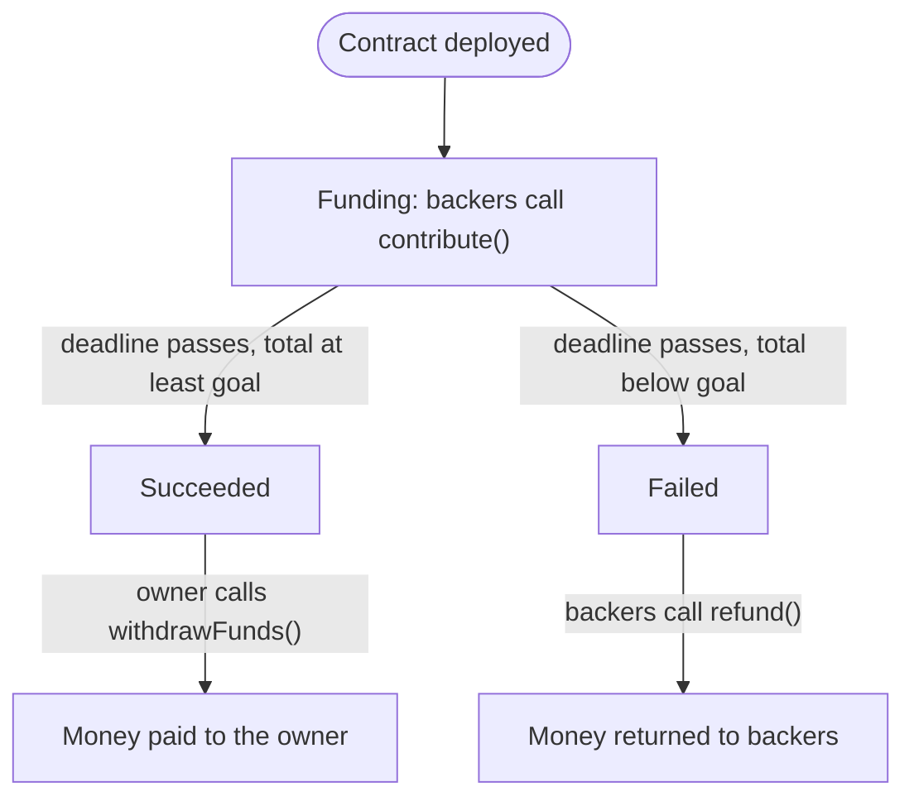
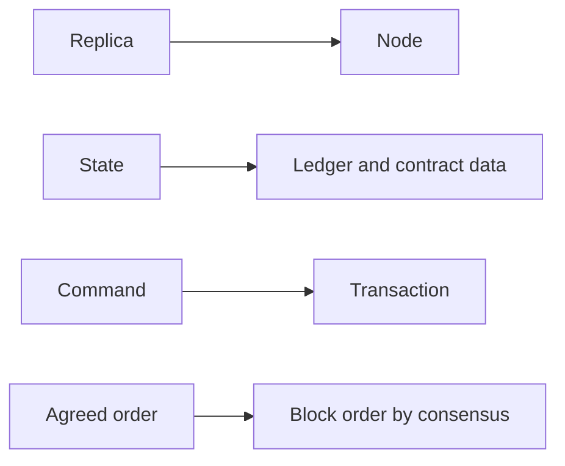

**In one line:** <mark>State machine replication (SMR) runs the same deterministic program on many servers and feeds every copy the same commands in the same order, so all copies always hold the same state</mark>. <Cite id="smart-contracts-wiki-smr" />

<Box kind="key">

**Key points to write (any SMR question):**

- A **state machine** has a stored state and changes it only by running commands; it must be <mark>deterministic</mark> (same state + same command = same new state). <Cite id="smart-contracts-schneider-1990" />
- SMR = <mark>many replicas, same start state, same commands, same order</mark>.
- The hard step is <mark>agreeing on the order</mark>: a **consensus algorithm** (PoW, PoS, Paxos, Raft, PBFT) does it.
- Fault tolerance: crash faults need <mark>2f + 1</mark> replicas; Byzantine faults need <mark>3f + 1</mark>.
- <mark>A blockchain is SMR</mark>: nodes = replicas, ledger = state, transactions = commands.
- A <mark>smart contract is a state machine</mark>: variables = state, function calls = commands, `require` checks = transition rules.

</Box>

## Core answer (5 marks, fits every question here)

<Box kind="definition">

**State machine replication** keeps many copies (replicas) of the same state machine on many computers. Every replica runs the same commands in the same order, so all replicas reach the same state, and the service continues if some replicas fail. <Cite id="web-bt-2-wiki-smr" />

</Box>

**Why needed:** one server is a single point of failure. Many servers are safe only if they never drift apart, and they drift apart if they see commands in a different order.

**How it works:**

1. Place a replica on each of n servers, all in the same start state.
2. Clients send commands (in a blockchain: transactions).
3. A **consensus algorithm** makes all replicas agree on one order.
4. Each replica runs the commands in that order.
5. All replicas end in the same state and give the same replies.

**Blockchain link:** the ledger is the state, transactions are commands, consensus gives the block order, and every node runs the same transactions. In Ethereum the EVM is the state machine. <Cite id="bft-paxos-raft-wiki-consensus" />

**Conclusion:** <mark>SMR plus consensus gives a service that stays correct even when some replicas fail</mark>.

## Extended answer (10 marks): add these

### 1. A smart contract as a state machine

<Box kind="definition">

A **smart contract** is a program stored on the blockchain with its own data and functions. Its **state** is the values of its variables, its **commands** are the transactions that call its functions, and its **transitions** are the function code with `require` checks. <Cite id="smart-contracts-gfg-smart-contracts" />

</Box>

| State machine term | Smart contract |
|---|---|
| State | Stored variables and balance |
| Command | Transaction calling a function |
| Transition rule | Function code with `require` checks |
| Same order for all | Block order from consensus |
| Replicas | Every node running the EVM |

If a `require` fails, the transaction **reverts** and the state stays as it was. Because the contract is deterministic, every node reaches the same result without trusting any other node. <Cite id="smart-contracts-sol-patterns" />

### 2. Example: crowdfunding application

States: **Funding** (open), **Succeeded** (deadline over, goal reached), **Failed** (deadline over, goal missed). Commands: `contribute()`, `withdrawFunds()`, `refund()`. <Cite id="smart-contracts-eth-intro" />

**Worked example:** goal = 1000. Asha's `contribute(500)` and Ravi's `contribute(300)` reach different nodes at different times. Consensus fixes the order (Asha, then Ravi). Every node runs both in that order, so every node shows 500 + 300 = 800. After the deadline 800 < 1000, so every node moves to **Failed**, and backers can refund. No node can disagree, because all ran the same commands in the same order.

### 3. Fault limits and uses

| Fault type | Replicas needed | Algorithms |
|---|---|---|
| Crash (node stops) | 2f + 1 | Paxos, Raft |
| Byzantine (node lies) | 3f + 1 | PBFT |

Real uses: Google Chubby, etcd, Hyperledger Fabric ordering. <Cite id="smart-contracts-wiki-smr" />

## Fit it to each question

- **"Describe the concept of state machine replication. How is a smart contract represented as a state machine?"** (10 marks) <PYQ id="2023-05-ce/q3a" />: core answer plus extended section 1 (the mapping table) and the crowdfunding diagram.
- **"Explain the function of state machine replication. Explain with respect to crowd funding application."** (10 marks) <PYQ id="2023-12-ce/q2a" />: core answer ("function" means why it is needed) plus extended section 2, with the 800 versus 1000 worked example.
- **"Explain state machine replication with suitable example."** (10 marks) <PYQ id="2024-05-ce/q5a" />: core answer plus the crowdfunding example (section 2).
- **"Explain state machine replication."** (10 marks) <PYQ id="2024-12-ce/q3b" />: core answer plus section 3 (fault limits) and the blockchain mapping diagram.

## Exam tips

- **Draw** the flow: clients, consensus (order), replicas, same state.
- Keywords: <mark>deterministic, replica, consensus, same order, same state, 2f + 1, 3f + 1</mark>.
- For "smart contract as state machine", always give the state, command and transition mapping.
