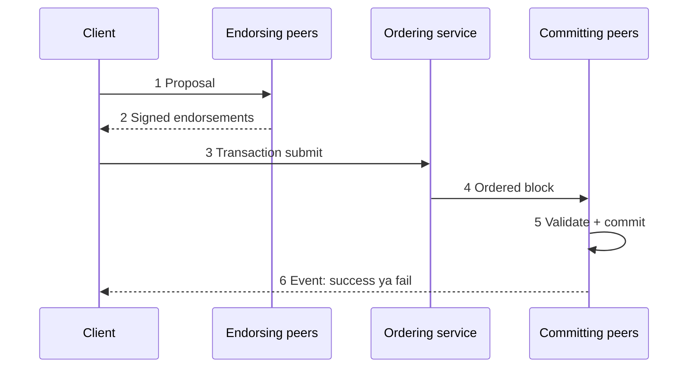
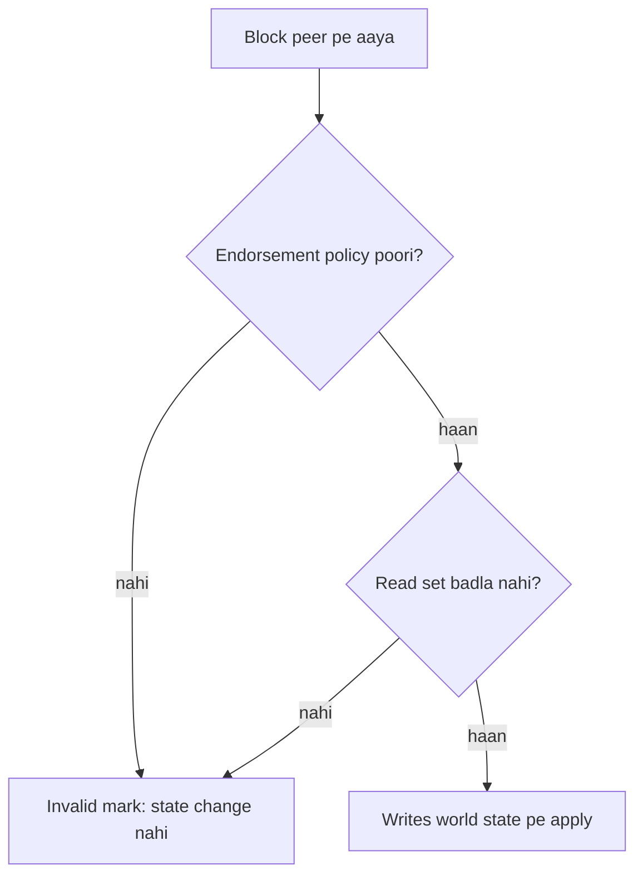

**Ek line mein:** <mark>Private blockchain (Hyperledger Fabric) mein transaction teen stages se guzarti hai: execute (endorse), order, aur validate aur commit</mark>. <Cite id="private-blockchain-fabric-txflow" />

<Box kind="key">

**Lifecycle question mein ye points likho:**

- Model: <mark>execute, order, validate</mark>. Fabric standard example hai.
- **Proposal:** client proposal sign karke <mark>endorsing peers</mark> ko bhejta hai.
- **Endorsement:** peers apne world state pe chaincode chalate hain (<mark>simulation, koi change nahi</mark>) aur signed <mark>read-write set</mark> lautate hain.
- **Ordering:** orderer transactions ko ek sequence mein rakhta hai aur <mark>block</mark> banata hai; woh contents nahi padhta.
- **Validation:** har peer <mark>endorsement policy</mark> aur <mark>read-set conflicts</mark> check karta hai; kharab transactions invalid mark hoti hain.
- **Commit:** valid writes <mark>world state</mark> update karti hain; block append hota hai; client ko notify kiya jata hai.
- Public chains se alag: <mark>mining nahi, parties known, turant finality</mark>.

</Box>

## Core answer (5 marks, yahan ke har question ke liye)

<Box kind="definition">

The **transaction lifecycle** in a private blockchain is the path a transaction takes from the client to a committed block. In Hyperledger Fabric it follows **execute, order, validate**: endorsing peers first run it, the ordering service then orders it, and every peer finally validates and commits it. <Cite id="hyperledger-fabric-txflow" />

</Box>

**Steps:**

1. **Proposal.** Client signed transaction proposal bhejta hai un endorsing peers ko jo endorsement policy mein likhe hain.
2. **Endorsement.** Har peer client ki identity check karta hai, apne current world state pe chaincode chalata hai (change kiye bina) aur read-write set ke saath signed result lautata hai.
3. **Endorsements jama karo.** Client check karta hai ki responses match karte hain aur kaafi signatures jama karta hai.
4. **Ordering ko submit karo.** Client endorsed transaction ordering service ko bhejta hai.
5. **Ordering.** Orderers transactions ko ek agreed sequence mein rakhte hain aur block banate hain. Woh contents nahi dekhte. <Cite id="hyperledger-fabric-ordering" />
6. **Distribution.** Block channel ke saare peers ko deliver hota hai.
7. **Validation.** Har peer endorsement policy check karta hai aur yeh ki simulation ke baad read set badla nahi. Kharab transactions invalid mark hoti hain par block mein rehti hain.
8. **Commit.** Valid writes world state update karti hain; block ledger mein append hota hai.
9. **Notification.** Peer client ko result batata hai.

**Conclusion:** <mark>execute first, order second, validate last; this keeps private chains fast and consistent</mark>. <Cite id="hyperledger-fabric-gfg-fabric" />

## Extended answer (10 marks): ye add karo

### 1. Yeh order kyun

- **Pehle execute** matlab kaam sirf endorsing peers karte hain, har node nahi, aur ordering se pehle result check ho jata hai.
- **Phir order** se saare peers ko same sequence milti hai, isliye woh same state pe pahunchte hain.
- **Aakhir mein validate** conflicts pakadta hai: do transactions ne same key padhi ho sakti hai, to doosri invalid hoti hai. <Cite id="hyperledger-fabric-readwrite" />

### 2. Kya galat ho sakta hai

| Stage | Failure | Result |
|---|---|---|
| Endorsement | Signatures kam | Client policy poori nahi kar paata; submit nahi hota |
| Validation | Policy poori nahi | Invalid mark, state change nahi |
| Validation | Read set badal gaya (conflict) | Invalid mark, client retry karta hai |

### 3. Public chain se farq

| Point | Private (Fabric) | Public (Bitcoin ya Ethereum) |
|---|---|---|
| Transaction kaun chalata hai | Sirf endorsing peers | Har node |
| Ordering | Ordering service | Miners ya validators, consensus se |
| Mining | Nahi | PoW ya PoS |
| Finality | Commit pe turant | Kai confirmations ke baad |
| Parties | Known aur permissioned | Anonymous |

<Cite id="private-blockchain-gfg-private" />

## Har question mein kaise fit karein

- **"Explain transaction lifecycle with respect to private blockchain."** (10 marks) <PYQ id="2024-12/q6a" />: core answer (nau steps aur sequence diagram), phir extended sections 1 se 3.

## Exam tips

- **Sequence diagram draw karo** aur messages number karo.
- Keywords: <mark>proposal, endorsement, read-write set, ordering service, validation, commit, world state</mark>.
- Likho ki endorsement sirf **simulate** karta hai; ledger sirf commit pe badalta hai.

Exam mein English mein likho.
