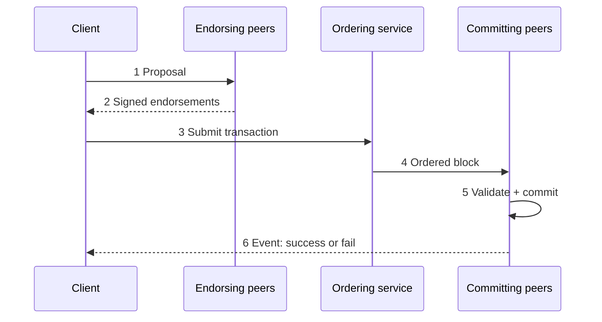
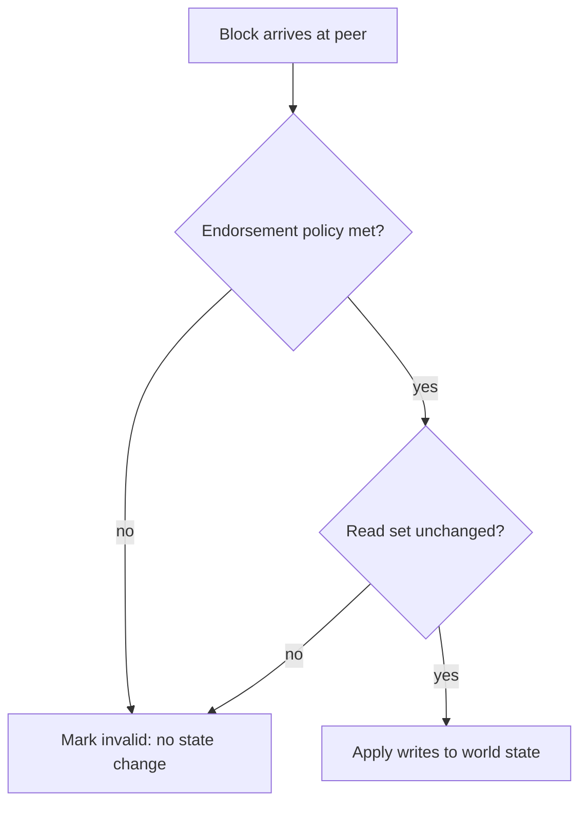

**In one line:** <mark>In a private blockchain (Hyperledger Fabric) a transaction goes through three stages: execute (endorse), order, and validate and commit</mark>. <Cite id="private-blockchain-fabric-txflow" />

<Box kind="key">

**Key points to write (lifecycle question):**

- Model: <mark>execute, order, validate</mark>. Fabric is the standard example.
- **Proposal:** client signs a proposal and sends it to the <mark>endorsing peers</mark>.
- **Endorsement:** peers run the chaincode on their world state (<mark>simulation, no change</mark>) and return a signed <mark>read-write set</mark>.
- **Ordering:** the orderer puts transactions in one sequence and cuts a <mark>block</mark>; it does not read the contents.
- **Validation:** every peer checks the <mark>endorsement policy</mark> and <mark>read-set conflicts</mark>; bad transactions are marked invalid.
- **Commit:** valid writes update the <mark>world state</mark>; block is appended; client is notified.
- Unlike public chains: <mark>no mining, known parties, immediate finality</mark>.

</Box>

## Core answer (5 marks, fits every question here)

<Box kind="definition">

The **transaction lifecycle** in a private blockchain is the path a transaction takes from the client to a committed block. In Hyperledger Fabric it follows **execute, order, validate**: endorsing peers first run it, the ordering service then orders it, and every peer finally validates and commits it. <Cite id="hyperledger-fabric-txflow" />

</Box>

**Steps:**

1. **Proposal.** The client signs a transaction proposal and sends it to the endorsing peers named in the endorsement policy.
2. **Endorsement.** Each peer checks the client's identity, runs the chaincode on its current world state (without changing it) and returns a signed result with a read-write set.
3. **Collect endorsements.** The client checks the responses match and gathers enough signatures.
4. **Submit to ordering.** The client sends the endorsed transaction to the ordering service.
5. **Ordering.** Orderers put transactions in one agreed sequence and cut a block. They do not look at the contents. <Cite id="hyperledger-fabric-ordering" />
6. **Distribution.** The block is delivered to all peers of the channel.
7. **Validation.** Each peer checks the endorsement policy and that the read set has not changed since simulation. Bad transactions are marked invalid but stay in the block.
8. **Commit.** Valid writes update the world state; the block is appended to the ledger.
9. **Notification.** The peer tells the client the result.

**Conclusion:** <mark>execute first, order second, validate last; this keeps private chains fast and consistent</mark>. <Cite id="hyperledger-fabric-gfg-fabric" />

## Extended answer (10 marks): add these

### 1. Why this order

- **Execute first** means only the endorsing peers do the work, not every node, and the result is checked before ordering.
- **Order second** gives all peers the same sequence, so they reach the same state.
- **Validate last** catches conflicts: two transactions may have read the same key, and the second one is invalid. <Cite id="hyperledger-fabric-readwrite" />

### 2. What can go wrong

| Stage | Failure | Result |
|---|---|---|
| Endorsement | Not enough signatures | Client cannot satisfy the policy; no submission |
| Validation | Policy not met | Marked invalid, no state change |
| Validation | Read set changed (conflict) | Marked invalid, client retries |

### 3. Difference from a public chain

| Point | Private (Fabric) | Public (Bitcoin or Ethereum) |
|---|---|---|
| Who runs the transaction | Only endorsing peers | Every node |
| Ordering | Ordering service | Miners or validators, by consensus |
| Mining | None | PoW or PoS |
| Finality | Immediate on commit | After several confirmations |
| Parties | Known and permissioned | Anonymous |

<Cite id="private-blockchain-gfg-private" />

## Fit it to each question

- **"Explain transaction lifecycle with respect to private blockchain."** (10 marks) <PYQ id="2024-12/q6a" />: core answer (nine steps and the sequence diagram), then extended sections 1 to 3.

## Exam tips

- **Draw** the sequence diagram and number the messages.
- Keywords: <mark>proposal, endorsement, read-write set, ordering service, validation, commit, world state</mark>.
- Mention that endorsement only **simulates**; the ledger changes only at commit.
