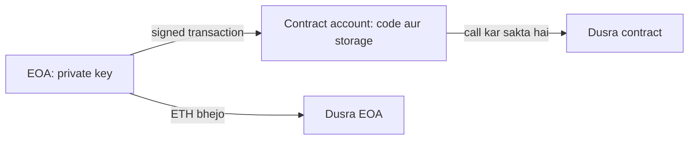
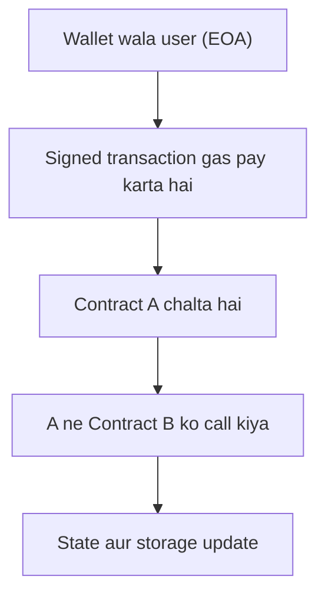

**Ek line mein:** <mark>Ethereum account ek identity hai jo ether rakhti hai aur transactions mein hissa leti hai; do types hain: private key se controlled externally owned account (EOA) aur code se controlled contract account</mark>. <Cite id="ethereum-eth-accounts" />

<Box kind="key">

**Types of accounts ke question mein ye points likho:**

- <mark>EOA</mark>: <mark>private key</mark> se controlled, code nahi, <mark>transactions shuru kar sakta hai</mark>, banana free; example: MetaMask account.
- <mark>Contract account</mark>: <mark>code</mark> se controlled, private key nahi, <mark>khud transaction shuru nahi kar sakta</mark>, sirf call hone pe chalta hai; banane mein gas lagta hai.
- Har account ke chaar fields: <mark>nonce, balance, storageRoot, codeHash</mark>.
- Dono ka address hota hai aur dono ETH rakh sakte hain.
- Table: controlled by, code hai ya nahi, transaction shuru kar sakta hai, banane ki cost.

</Box>

## Core answer (5 marks, yahan ke har question ke liye)

<Box kind="definition">

An **Ethereum account** is an identity that can hold ether (ETH) and send or receive transactions. Ethereum has **two types of accounts**: externally owned accounts and contract accounts. <Cite id="ethereum-eth-accounts" />

</Box>

**1. Externally Owned Account (EOA)**

- Insaan (ya program) **private key** se control karta hai.
- Address public key se banta hai aur **code nahi** hota.
- ETH rakh sakta hai aur transactions **shuru** kar sakta hai (ETH bhejna, contracts call ya deploy karna).
- Banana free hai: sirf key pair chahiye.
- Example: aapka MetaMask wallet account.

**2. Contract account**

- Apne **code** (smart contract) se controlled; **private key nahi** hoti.
- Contract deploy hone pe banta hai, apne address ke saath.
- ETH rakh sakta hai aur storage hota hai.
- Khud transaction **shuru nahi** kar sakta; sirf tab chalta hai jab koi EOA ya dusra contract use call kare.
- Banane mein gas lagta hai.
- Example: token contract ya voting contract.

| | EOA | Contract account |
|---|---|---|
| Controlled by | Private key | Contract code |
| Code hai | Nahi | Haan |
| Transaction shuru kar sakta hai | Haan | Nahi |
| Banane ki cost | Free | Gas |

<Cite id="ethereum-gfg-accounts" />

**Conclusion:** <mark>EOAs wo users hain jo act karte hain, aur contract accounts wo programs hain jo react karte hain</mark>.

## Extended answer (10 marks): ye add karo

### 1. Har account ke fields

| Field | Matlab |
|---|---|
| nonce | Bheje gaye transactions (EOA) ya banaye gaye contracts (contract) ki ginti; replay rokta hai |
| balance | Ether ki matra, wei mein |
| storageRoot | Account ke storage trie ka hash (EOA ke liye khali) |
| codeHash | Contract code ka hash (EOA ke liye khali code ka hash) |

<Cite id="ethereum-me-ch6" />

### 2. Dono types saath kaise kaam karte hain

User (EOA) contract ko call karne ke liye transaction sign karta hai. Contract EVM mein chalta hai, dusre contracts ko call kar sakta hai, ether bhej sakta hai aur apna storage badalta hai. Ye sab us EOA ke gas se pay hota hai jisne shuru kiya. <Cite id="web-bt-1-eth-glossary" />

### 3. Account model vs Bitcoin ka UTXO

Ethereum **har account ka balance** rakhta hai (bank jaisa), jabki Bitcoin unspent outputs track karta hai. Isse contracts, jinhe state yaad rakhni hoti hai, Ethereum mein natural ban jaate hain. <Cite id="ethereum-wiki-ethereum" />

## Har question mein kaise fit karein

- **"List and explain different types of accounts in ethereum."** (5 marks) <PYQ id="2023-12/q1c" />: **core answer** likho: do types, table aur diagram, jagah ho to chaar-field table.

## Exam tips

- **Bilkul do types likho** aur table do.
- Keywords: <mark>private key</mark>, <mark>code</mark>, <mark>nonce</mark> aur <mark>cannot start a transaction</mark>.
- Ye mat likho ki contract account ki private key hoti hai.

Exam mein English mein likho.
