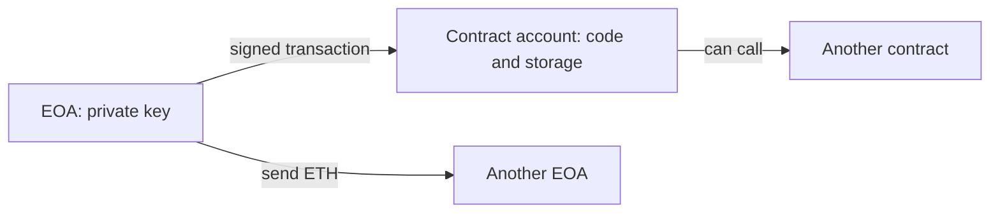
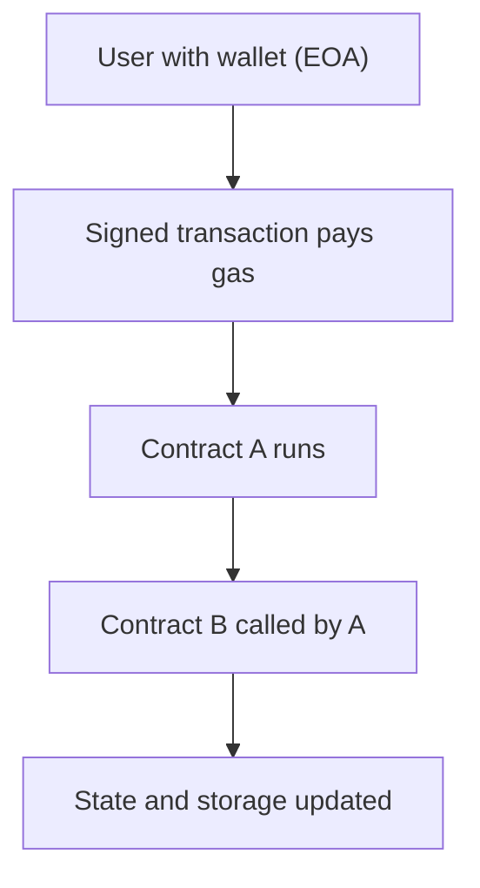

**In one line:** <mark>An Ethereum account is an identity that holds ether and can take part in transactions; there are two types, the externally owned account (EOA) controlled by a private key and the contract account controlled by code</mark>. <Cite id="ethereum-eth-accounts" />

<Box kind="key">

**Key points to write (types of accounts):**

- <mark>EOA</mark>: controlled by a <mark>private key</mark>, no code, can <mark>start transactions</mark>, free to create; example: MetaMask account.
- <mark>Contract account</mark>: controlled by <mark>code</mark>, no private key, <mark>cannot start a transaction by itself</mark>, runs only when called; creating it costs gas.
- Four fields in every account: <mark>nonce, balance, storageRoot, codeHash</mark>.
- Both have an address and can hold ETH.
- Table: controlled by, has code, can start transaction, cost to create.

</Box>

## Core answer (5 marks, fits every question here)

<Box kind="definition">

An **Ethereum account** is an identity that can hold ether (ETH) and send or receive transactions. Ethereum has **two types of accounts**: externally owned accounts and contract accounts. <Cite id="ethereum-eth-accounts" />

</Box>

**1. Externally Owned Account (EOA)**

- Controlled by a human (or program) through a **private key**.
- Has an address made from the public key and **no code**.
- Can hold ETH and **start** transactions (send ETH, call or deploy contracts).
- Creating one is free: it only needs a key pair.
- Example: your MetaMask wallet account.

**2. Contract account**

- Controlled by its **code** (a smart contract); it has **no private key**.
- Created when someone deploys a contract, with its own address.
- Can hold ETH and has storage.
- **Cannot start** a transaction by itself; runs only when an EOA or another contract calls it.
- Creating one costs gas.
- Example: a token contract or a voting contract.

| | EOA | Contract account |
|---|---|---|
| Controlled by | Private key | Contract code |
| Has code | No | Yes |
| Can start a transaction | Yes | No |
| Cost to create | Free | Gas |

<Cite id="ethereum-gfg-accounts" />

**Conclusion:** <mark>EOAs are the users who act, and contract accounts are the programs that react</mark>.

## Extended answer (10 marks): add these

### 1. Fields of every account

| Field | Meaning |
|---|---|
| nonce | Number of transactions sent (EOA) or contracts created (contract); stops replay |
| balance | Ether owned, in wei |
| storageRoot | Hash of the account's storage trie (empty for an EOA) |
| codeHash | Hash of the contract code (hash of empty code for an EOA) |

<Cite id="ethereum-me-ch6" />

### 2. How the two types work together

A user (EOA) signs a transaction to call a contract. The contract runs in the EVM, may call other contracts and may send ether, and changes its own storage. All of this is paid for by the EOA that started it. <Cite id="web-bt-1-eth-glossary" />

### 3. Account model versus Bitcoin's UTXO

Ethereum keeps a **balance per account** (like a bank), while Bitcoin tracks unspent outputs. This makes contracts, which need to remember state, natural in Ethereum. <Cite id="ethereum-wiki-ethereum" />

## Fit it to each question

- **"List and explain different types of accounts in ethereum."** (5 marks) <PYQ id="2023-12/q1c" />: write the **core answer**: the two types, the table and the diagram, then the four-field table if you have room.

## Exam tips

- **List exactly two types** and give the table.
- Keywords: <mark>private key</mark>, <mark>code</mark>, <mark>nonce</mark> and <mark>cannot start a transaction</mark>.
- Do not write that a contract account has a private key.
