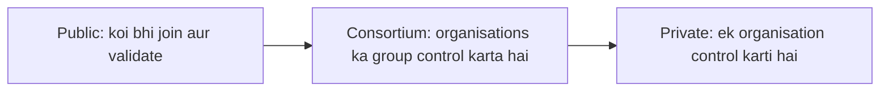
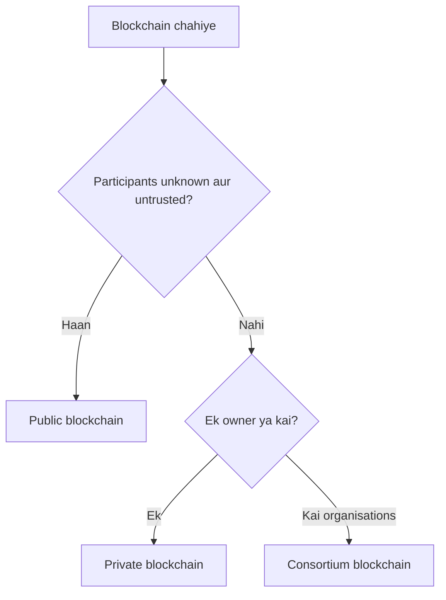

**Ek line mein:** <mark>Blockchain ke types is baat se alag hote hain ki kaun join kar sakta hai, kaun blocks validate kar sakta hai aur kaun data padh sakta hai: public (koi bhi), private (ek organisation) aur consortium (organisations ka group)</mark>. <Cite id="blockchain-fundamentals-gfg-types" />

<Box kind="key">

**Types of blockchain ke har question mein ye points likho:**

- **Public** = <mark>permissionless: koi bhi join, read, write aur validate kar sakta hai</mark>; Bitcoin, Ethereum; PoW ya PoS.
- **Private** = <mark>permissioned: ek organisation tay karti hai kaun join aur validate karega</mark>; fast, private, kam decentralised.
- **Consortium (federated)** = <mark>pehle se chune hue organisations ka group control share karta hai</mark>; Hyperledger Fabric, R3 Corda, Quorum.
- Public, consortium, private mein control <mark>sabke paas se, group ke paas, ek owner ke paas</mark> jaata hai.
- Public sabse zyada **trust-less decentralisation** deta hai; private aur consortium **speed, privacy aur kam cost** dete hain.
- Hamesha end mein <mark>comparison table</mark> aur har type ka ek use case likho.

</Box>

## Core answer (5 marks, yahan ke har question ke liye)

<Box kind="definition">

A **blockchain** is a distributed, append-only ledger in which transactions are grouped in blocks linked by hashes. Blockchains are of three types by **who is allowed to join, read and write**: public, private and consortium. <Cite id="blockchain-fundamentals-ibm-blockchain" />

</Box>

**Aasaan picture:** public blockchain sabke liye khula public park hai, private ek company ka office hai jise ek owner chalata hai, aur consortium kuch companies ki shared club building hai. <Cite id="blockchain-fundamentals-gfg-types" />

1. **Public blockchain:** koi bhi bina permission join kar sakta hai, ledger padh sakta hai, transactions bhej sakta hai aur consensus mein hissa le sakta hai. Iska koi owner nahi. Examples: Bitcoin aur Ethereum. Bahut decentralised aur transparent, lekin slow aur energy-heavy (PoW). <Cite id="private-blockchain-gfg-pubpriv" />
2. **Private blockchain:** ek organisation tay karti hai kaun join, write aur read karega. Fast, sasta aur private, lekin centralised: trust owner pe hota hai. Example: bank ka internal ledger. <Cite id="private-blockchain-gfg-private" />
3. **Consortium blockchain:** kai organisations milkar network control karti hain aur chune hue nodes blocks validate karte hain. Public aur private ke beech ka raasta, un industries ke liye jahan competitors data share karte hain. Examples: Hyperledger Fabric, R3 Corda. <Cite id="private-blockchain-gfg-consortium" />

**Conclusion:** <mark>openness ke liye public, control aur speed ke liye private, aur businesses ke beech shared control ke liye consortium chuno</mark>.

## Extended answer (10 marks): ye add karo

### 1. Poori comparison table

| Point | Public | Private | Consortium |
|---|---|---|---|
| Access | Sabke liye khula (permissionless) | Sirf invite (permissioned) | Permissioned, approved members |
| Control | Koi owner nahi | Ek organisation | Organisations ka group |
| Decentralisation | Sabse zyada | Sabse kam | Partial |
| Read access | Sabko | Restricted | Public ya restricted |
| Write aur validate | Koi bhi node | Owner chunta hai | Pre-selected nodes |
| Consensus | PoW, PoS | PBFT, Raft, PoA | PBFT, Raft, IBFT, PoA |
| Speed | Slow | Fast | Fast |
| Transparency | Bahut high | Low | Medium |
| Energy aur cost | High (PoW) | Low | Low |
| Trust model | Code pe trust | Owner pe trust | Group pe trust |
| Examples | Bitcoin, Ethereum | Internal company ledger | Hyperledger Fabric, Corda, Quorum |

<Cite id="blockchain-fundamentals-gfg-types" /> <Cite id="web-bt-1-eth-consensus" />

### 2. Advantages aur disadvantages

| Type | Advantages | Disadvantages |
|---|---|---|
| Public | Open, censorship resistant, kisi ek party pe trust nahi | Slow, costly, privacy nahi |
| Private | Fast, private, rules badalna aasaan | Centralised, single point of failure |
| Consortium | Shared trust, fast, members ke beech privacy | Members ki agreement chahiye, partly centralised |

### 3. Kahan use hota hai

- **Public:** cryptocurrency, open dApps, NFTs.
- **Private:** ek firm ke andar internal audit aur record keeping.
- **Consortium:** banking, trade finance aur kai companies ke beech supply chain. <Cite id="blockchain-fundamentals-nist-8202" /> <Cite id="private-blockchain-fabric-whatis" />

## Har question mein kaise fit karein

- **"Define blockchain? Compare different types of blockchain."** (5 marks) <PYQ id="2022-12-ce/q1a" />: ek-line definition (core answer box), phir teen types aur chhota table.
- **"Distinguish between public, private, and consortium blockchain."** (5 marks) <PYQ id="2023-05-ce/q1a" />: core answer plus table ka chhe-row version.
- **"Compare and contrast private and public blockchain."** (5 marks) <PYQ id="2023-12-ce/q1d" />: table ke sirf public aur private columns, advantages aur disadvantages ke saath.
- **"Differentiate between public, private and consortium blockchain."** (10 marks) <PYQ id="2024-05-ce/q2a" /> <PYQ id="2025-05-ce/q5a" />: core answer, poora table (section 1), section 2 aur 3, aur decision diagram.
- **"Explain types of blockchain."** (5 marks) <PYQ id="2025-05/q1e" />: examples ke saath teen types, plus control diagram.

## Exam tips

- **Hamesha draw karo:** control diagram aur comparison table; table se sabse zyada marks aate hain.
- <mark>permissionless</mark> aur <mark>permissioned</mark> words use karo aur har type ka ek real example do.
- Sirf do types puchhe hon to teesra mat likho; table ke wahi columns use karo.

Exam mein English mein likho.
