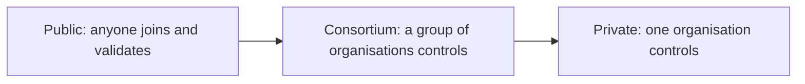
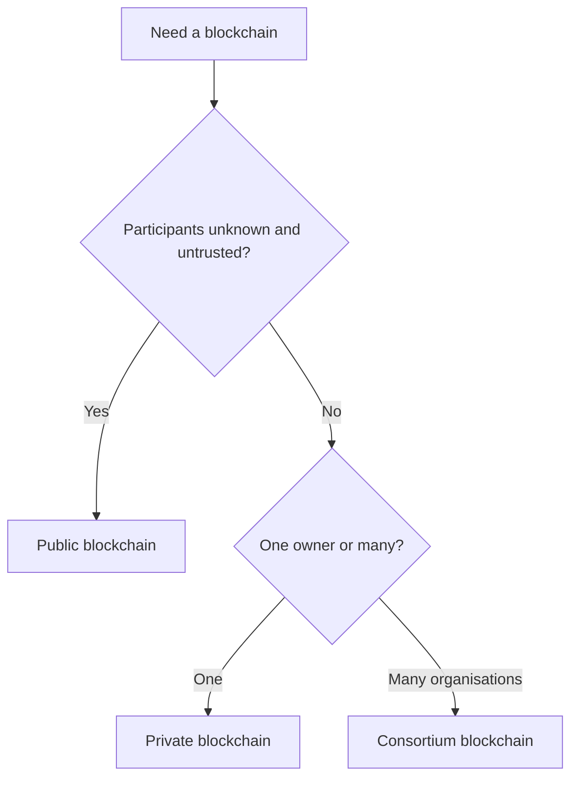

**In one line:** <mark>The types of blockchain differ in who can join, who can validate blocks and who can read the data: public (anyone), private (one organisation) and consortium (a group of organisations)</mark>. <Cite id="blockchain-fundamentals-gfg-types" />

<Box kind="key">

**Key points to write (any types of blockchain question):**

- **Public** = <mark>permissionless: anyone can join, read, write and validate</mark>; Bitcoin, Ethereum; PoW or PoS.
- **Private** = <mark>permissioned: one organisation controls who joins and validates</mark>; fast, private, less decentralised.
- **Consortium (federated)** = <mark>a group of pre-selected organisations share control</mark>; Hyperledger Fabric, R3 Corda, Quorum.
- Control moves from <mark>everyone, to a group, to one owner</mark> as we go public, consortium, private.
- Public gives highest **trust-less decentralisation**; private and consortium give **speed, privacy and low cost**.
- Always end with a <mark>comparison table</mark> and one use case for each type.

</Box>

## Core answer (5 marks, fits every question here)

<Box kind="definition">

A **blockchain** is a distributed, append-only ledger in which transactions are grouped in blocks linked by hashes. Blockchains are of three types by **who is allowed to join, read and write**: public, private and consortium. <Cite id="blockchain-fundamentals-ibm-blockchain" />

</Box>

**Easy picture:** a public blockchain is like a public park open to all, a private one is a company office run by one owner, and a consortium one is a club building shared by a few companies. <Cite id="blockchain-fundamentals-gfg-types" />

1. **Public blockchain:** anyone can join without permission, read the ledger, send transactions and take part in consensus. No one owns it. Examples: Bitcoin and Ethereum. Highly decentralised and transparent, but slower and heavy on energy (PoW). <Cite id="private-blockchain-gfg-pubpriv" />
2. **Private blockchain:** one organisation decides who joins, writes and reads. Fast, cheap and private, but centralised: trust sits with the owner. Example: an internal bank ledger. <Cite id="private-blockchain-gfg-private" />
3. **Consortium blockchain:** several organisations jointly control the network and a chosen set of nodes validates blocks. Middle path for industries where competitors share data. Examples: Hyperledger Fabric, R3 Corda. <Cite id="private-blockchain-gfg-consortium" />

**Conclusion:** <mark>choose public for openness, private for control and speed, and consortium for shared control between businesses</mark>.

## Extended answer (10 marks): add these

### 1. Full comparison table

| Point | Public | Private | Consortium |
|---|---|---|---|
| Access | Open to all (permissionless) | Invite only (permissioned) | Permissioned, approved members |
| Control | No one owns it | One organisation | Group of organisations |
| Decentralisation | Highest | Lowest | Partial |
| Read access | Everyone | Restricted | Public or restricted |
| Write and validate | Any node | Chosen by the owner | Pre-selected nodes |
| Consensus | PoW, PoS | PBFT, Raft, PoA | PBFT, Raft, IBFT, PoA |
| Speed | Slow | Fast | Fast |
| Transparency | Very high | Low | Medium |
| Energy and cost | High (PoW) | Low | Low |
| Trust model | Trust the code | Trust the owner | Trust the group |
| Examples | Bitcoin, Ethereum | Internal company ledger | Hyperledger Fabric, Corda, Quorum |

<Cite id="blockchain-fundamentals-gfg-types" /> <Cite id="web-bt-1-eth-consensus" />

### 2. Advantages and disadvantages

| Type | Advantages | Disadvantages |
|---|---|---|
| Public | Open, censorship resistant, no trust in one party | Slow, costly, no privacy |
| Private | Fast, private, easy to change rules | Centralised, one point of failure |
| Consortium | Shared trust, fast, privacy between members | Needs agreement among members, partly centralised |

### 3. Where each is used

- **Public:** cryptocurrency, open dApps, NFTs.
- **Private:** internal audit and record keeping inside one firm.
- **Consortium:** banking, trade finance and supply chain between several companies. <Cite id="blockchain-fundamentals-nist-8202" /> <Cite id="private-blockchain-fabric-whatis" />

## Fit it to each question

- **"Explain types of blockchain."** (5 marks) <PYQ id="2025-05/q1e" />: the three types with examples, plus the control diagram.

## Exam tips

- **Always draw** the control diagram and the comparison table; the table scores most of the marks.
- Use the words <mark>permissionless</mark> and <mark>permissioned</mark> and give one real example per type.
- When only two types are asked, do not write the third; use the same table columns only.
