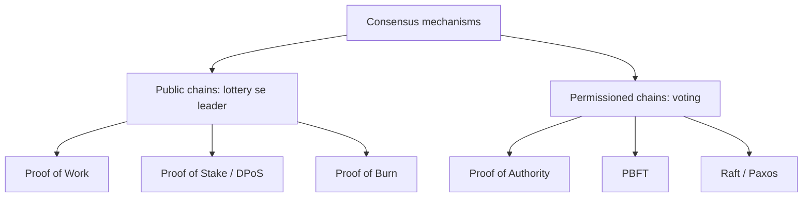

**Ek line mein:** <mark>Consensus mechanism wo protocol hai jisse saare honest nodes bina kisi central boss ke ledger ke ek version pe agree karte hain, bhale kuch nodes slow, offline ya dishonest hon</mark>. <Cite id="consensus-mining-gfg-consensus" />

<Box kind="key">

**Types of consensus ke question mein ye points likho:**

- Do families: <mark>lottery based (public chains: PoW, PoS, DPoS, PoB, PoC)</mark> aur <mark>vote based (permissioned chains: PoA, PBFT, Raft, Paxos)</mark>.
- <mark>PoW</mark>: hash puzzle solve; <mark>PoS</mark>: coins lock; <mark>DPoS</mark>: elected delegates; <mark>PoB</mark>: coins burn; <mark>PoA</mark>: approved validators.
- <mark>PBFT</mark>: pre-prepare, prepare, commit; f faulty nodes ke liye <mark>n kam se kam 3f + 1</mark> nodes.
- <mark>Raft / Paxos</mark>: leader aur majority vote; sirf crash faults sambhalte hain.
- End mein hamesha <mark>table: blocks kaun banata hai, energy, speed, kahan use</mark>.

</Box>

## Core answer (5 marks, yahan ke har question ke liye)

<Box kind="definition">

A **consensus mechanism** is a protocol by which all honest nodes agree on one version of the ledger, even when some nodes are slow, offline or dishonest. <Cite id="consensus-mining-gfg-consensus" />

</Box>

**Kyun chahiye:** blockchain mein koi in-charge nahi hota, isliye nodes ko ek rule chahiye ki agla block kaunsa hai aur double spending kaise rukegi.

**Types (short):**

1. **PoW:** miners aisa nonce dhoondhte hain ki block hash target se chhota ho; pehla jeetta hai. Secure lekin slow aur energy-hungry (Bitcoin). <Cite id="consensus-mining-wiki-pow" />
2. **PoS:** validators coins lock karte hain; stake ke hisaab se ek propose karta hai; cheating pe stake jaata hai. Kam energy (Ethereum). <Cite id="consensus-mining-eth-pos" />
3. **DPoS:** coin holders kuch delegates ko vote dete hain jo baari baari blocks banate hain. Fast, zyada centralised (EOS).
4. **PoA:** kuch approved, known validators blocks sign karte hain. Fast, private aur test networks ke liye. <Cite id="consensus-mining-wiki-poa" />
5. **PBFT:** known nodes teen phases mein vote karte hain; n kam se kam 3f + 1 mein se f bure nodes tak sambhalta hai. <Cite id="bft-paxos-raft-gfg-pbft" />

**Conclusion:** <mark>koi ek mechanism har jagah best nahi; public chains PoW ya PoS use karti hain, private chains PBFT, Raft ya PoA</mark>.

## Extended answer (10 marks): ye add karo

### 1. Saare types detail mein

1. **Proof of Work (PoW).** Miners aisa nonce dhoondhne ki race lagate hain ki hash target se chhota ho. Winner block jodta hai aur reward pata hai. Bitcoin.
2. **Proof of Stake (PoS).** Validators coins stake karte hain aur stake ke hisaab se chune jaate hain; attesters vote karte hain; bure behaviour pe slashing. Ethereum 2022 se. <Cite id="consensus-mining-wiki-pos" />
3. **Delegated PoS (DPoS).** Holders delegates ko vote dete hain jo baari baari blocks banate hain. EOS.
4. **Proof of Burn (PoB).** Miners coins ko unspendable address pe bhejkar burn karte hain mining ka haq paane ke liye. Bijli ki jagah coins waste.
5. **Proof of Elapsed Time (PoET).** Har node trusted hardware ke andar random time wait karta hai; sabse chhota wait jeetta hai. Hyperledger Sawtooth.
6. **Proof of Capacity ya Space.** Miners prove karte hain ki unhone disk space alag rakha.
7. **Proof of Authority (PoA).** Approved validators blocks sign karte hain; reputation hi stake hai.
8. **PBFT.** Pre-prepare, prepare aur commit ke rounds; turant finality deta hai. <Cite id="bft-paxos-raft-pbft-paper" />
9. **Raft / Paxos.** Leader aur majority vote; crash faults ke liye (nodes jo ruk jaate hain, jhooth nahi bolte). Private networks mein, jaise Fabric ki ordering service. <Cite id="bft-paxos-raft-raft-paper" />

### 2. Comparison table

| Type | Blocks kaun banata hai | Energy | Speed | Kahan use |
|---|---|---|---|---|
| PoW | Sabse accha hasher | Bahut zyada | Slow | Bitcoin |
| PoS | Stake ke hisaab se random staker | Kam | Medium | Ethereum |
| DPoS | Elected delegates | Kam | Fast | EOS |
| PoA | Approved validators | Kam | Fast | Private chains |
| PBFT | Known nodes voting se | Kam | Fast | Permissioned chains |
| Raft / Paxos | Majority wala leader | Kam | Fast | Fabric ordering, private networks |

<Cite id="consensus-mining-gfg-crypto-consensus" /> <Cite id="web-bt-1-eth-consensus" />

### 3. Fault models

- **Crash fault:** node ruk jaata hai (Raft, Paxos sambhalte hain).
- **Byzantine fault:** node jhooth bolta hai ya malicious hai (PBFT, PoW aur PoS sambhalte hain).

## Har question mein kaise fit karein

- **"Describe the various types of consensus in blockchain."** (10 marks) <PYQ id="2023-12/q4b" />: family diagram, section 1 (saare types) aur section 2 table.
- **"List and explain various types of consensus mechanisms in brief."** (10 marks) <PYQ id="2024-12/q2a" />: definition, section 1 se har type ki ek ya do lines (aath types), family diagram aur chhota table; Byzantine generals picture add karo.

## Exam tips

- **Kam se kam chhe types likho** ek-ek line ke saath; family diagram grouping dikhata hai.
- PBFT ke liye <mark>"n at least 3f + 1"</mark> aur Raft aur Paxos ke liye <mark>"crash faults only"</mark> likho.
- Har type ka ek real example do.

Exam mein English mein likho.
