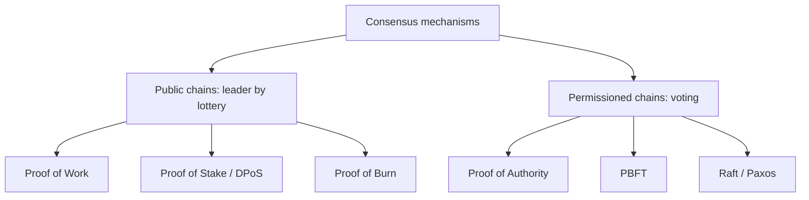

**In one line:** <mark>A consensus mechanism is the protocol by which all honest nodes agree on one version of the ledger without a central boss, even when some nodes are slow, offline or dishonest</mark>. <Cite id="consensus-mining-gfg-consensus" />

<Box kind="key">

**Key points to write (types of consensus):**

- Two families: <mark>lottery based (public chains: PoW, PoS, DPoS, PoB, PoC)</mark> and <mark>vote based (permissioned chains: PoA, PBFT, Raft, Paxos)</mark>.
- <mark>PoW</mark>: solve a hash puzzle; <mark>PoS</mark>: lock coins; <mark>DPoS</mark>: elected delegates; <mark>PoB</mark>: burn coins; <mark>PoA</mark>: approved validators.
- <mark>PBFT</mark>: pre-prepare, prepare, commit; works with <mark>n at least 3f + 1</mark> nodes for f faulty ones.
- <mark>Raft / Paxos</mark>: leader and majority vote; tolerate crash faults only.
- Always end with a <mark>table: who creates blocks, energy, speed, used by</mark>.

</Box>

## Core answer (5 marks, fits every question here)

<Box kind="definition">

A **consensus mechanism** is a protocol by which all honest nodes agree on one version of the ledger, even when some nodes are slow, offline or dishonest. <Cite id="consensus-mining-gfg-consensus" />

</Box>

**Why needed:** nobody is in charge of a blockchain, so nodes need a rule to agree which block comes next and to stop double spending.

**Types (short):**

1. **PoW:** miners find a nonce so the block hash is below a target; first wins. Secure but slow and energy-hungry (Bitcoin). <Cite id="consensus-mining-wiki-pow" />
2. **PoS:** validators lock coins; one is picked by stake to propose; cheating loses stake. Low energy (Ethereum). <Cite id="consensus-mining-eth-pos" />
3. **DPoS:** coin holders vote for a few delegates who make blocks in turn. Fast, more centralised (EOS).
4. **PoA:** a few approved, known validators sign blocks. Fast, for private and test networks. <Cite id="consensus-mining-wiki-poa" />
5. **PBFT:** known nodes vote in three phases; tolerates up to f bad nodes out of n at least 3f + 1. <Cite id="bft-paxos-raft-gfg-pbft" />

**Conclusion:** <mark>no mechanism is best everywhere; public chains use PoW or PoS, private chains use PBFT, Raft or PoA</mark>.

## Extended answer (10 marks): add these

### 1. All types in detail

1. **Proof of Work (PoW).** Miners compete to find a nonce giving a hash below the target. The winner adds the block and earns the reward. Used by Bitcoin.
2. **Proof of Stake (PoS).** Validators stake coins and are picked in proportion to stake; attesters vote; bad behaviour is slashed. Ethereum since 2022. <Cite id="consensus-mining-wiki-pos" />
3. **Delegated PoS (DPoS).** Holders vote for delegates who produce blocks in turn. EOS.
4. **Proof of Burn (PoB).** Miners burn coins by sending them to an unspendable address to earn the right to mine. Wastes coins instead of electricity.
5. **Proof of Elapsed Time (PoET).** Each node waits a random time inside trusted hardware; the shortest wait wins. Hyperledger Sawtooth.
6. **Proof of Capacity or Space.** Miners prove they set aside disk space.
7. **Proof of Authority (PoA).** Approved validators sign blocks; reputation is the stake.
8. **PBFT.** Rounds of pre-prepare, prepare and commit; gives instant finality. <Cite id="bft-paxos-raft-pbft-paper" />
9. **Raft / Paxos.** A leader and a majority vote; for crash faults (nodes that stop, not lie). Used in private networks such as Fabric's ordering service. <Cite id="bft-paxos-raft-raft-paper" />

### 2. Comparison table

| Type | Who creates blocks | Energy | Speed | Used by |
|---|---|---|---|---|
| PoW | Best hasher | Very high | Slow | Bitcoin |
| PoS | Staker chosen at random by stake | Low | Medium | Ethereum |
| DPoS | Elected delegates | Low | Fast | EOS |
| PoA | Approved validators | Low | Fast | Private chains |
| PBFT | Known nodes by voting | Low | Fast | Permissioned chains |
| Raft / Paxos | Leader with majority | Low | Fast | Fabric ordering, private networks |

<Cite id="consensus-mining-gfg-crypto-consensus" /> <Cite id="web-bt-1-eth-consensus" />

### 3. Fault models

- **Crash fault:** a node stops (Raft, Paxos handle it).
- **Byzantine fault:** a node lies or acts maliciously (PBFT, PoW and PoS handle it).

## Fit it to each question

- **"Describe the various types of consensus in blockchain."** (10 marks) <PYQ id="2023-12/q4b" />: family diagram, section 1 (all types) and section 2 table.
- **"List and explain various types of consensus mechanisms in brief."** (10 marks) <PYQ id="2024-12/q2a" />: definition, one or two lines per type from section 1 (eight types), family diagram and the short table; add the Byzantine generals picture.

## Exam tips

- **List at least six types** with one line each; the family diagram shows the grouping.
- Write <mark>"n at least 3f + 1"</mark> for PBFT and <mark>"crash faults only"</mark> for Raft and Paxos.
- Give one real example for each type.
