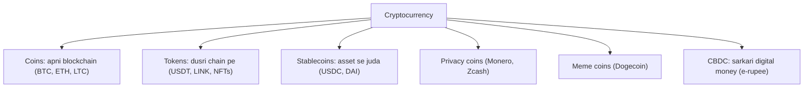
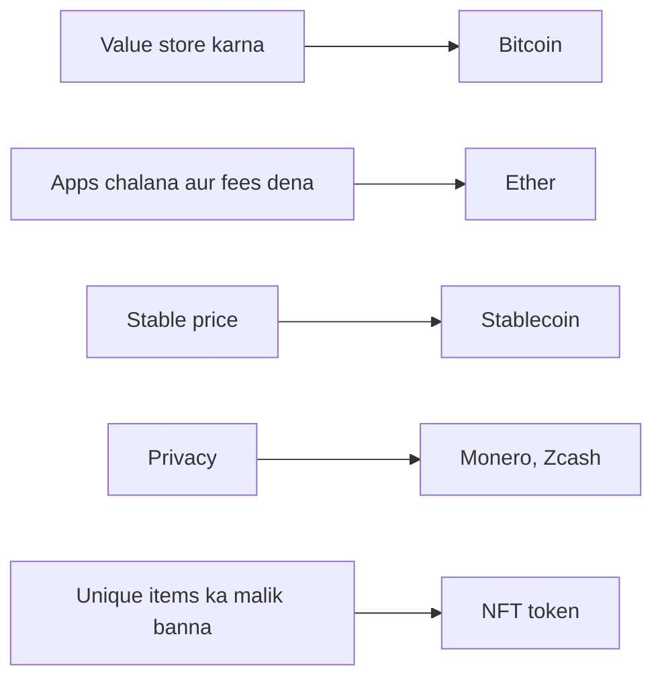

**Ek line mein:** <mark>Cryptocurrency digital money hai jo sirf blockchain pe hota hai, cryptography se protected, bina kisi central bank ke</mark>; iske main types hain coins, tokens, stablecoins, privacy coins, meme coins aur CBDCs. <Cite id="cryptocurrencies-tokens-wiki-crypto" />

<Box kind="key">

**Types of cryptocurrencies mein ye points likho:**

- Definition: <mark>blockchain pe digital money, cryptography se secured, koi central authority nahi</mark>; Bitcoin (2009) pehla tha.
- **Coins:** <mark>apni khud ki blockchain pe chalte hain</mark> (BTC, ETH, LTC). **Altcoins:** Bitcoin ke alawa har coin.
- **Tokens:** <mark>dusri blockchain pe smart contract se bane hote hain</mark> (ERC-20: USDT, LINK; ERC-721: NFTs).
- **Stablecoins:** <mark>value US dollar jaise stable asset se juda hota hai</mark> (USDC, USDT, DAI).
- **Privacy coins:** sender, receiver aur amount chhupate hain (Monero, Zcash). **Meme coins:** mazaak se shuru hue (Dogecoin), bahut risky.
- **CBDC:** sarkar ka digital money (India ka e-rupee); related hai, lekin <mark>decentralised nahi</mark>.
- Token kinds: <mark>utility, security, governance, NFT</mark>.

</Box>

## Core answer (5 marks, yahan ke har question ke liye)

<Box kind="definition">

A **cryptocurrency** is digital money that exists only on a blockchain. It is protected by cryptography, has no central bank, and ownership is proved by a private key. <Cite id="cryptocurrencies-tokens-wiki-crypto" />

</Box>

**Features:** decentralised, secure, transparent public ledger, borderless, pseudonymous, aur aksar limited supply.

**Kaise kaam karta hai (short):** tumhare paas keys wala wallet hota hai, tum transaction sign karte ho, miners ya validators use check karke block mein daalte hain, aur naya balance sab ke liye record ho jata hai.

**Types:**

1. **Coins (native coins):** apni blockchain pe chalte hain aur uske use ka payment karte hain. Examples: Bitcoin (BTC), Ether (ETH), Litecoin (LTC). Bitcoin zyadatar store of value hai; Litecoin tez payment coin hai. <Cite id="cryptocurrencies-tokens-gfg-coins-tokens" />
2. **Altcoins:** Bitcoin ke alawa har coin, jaise Litecoin, Ripple (XRP) aur Cardano (ADA).
3. **Tokens:** dusri blockchain pe smart contract se bane hote hain, jaise ERC-20 (fungible: USDT, LINK) aur ERC-721 (non-fungible: NFTs). <Cite id="cryptocurrencies-tokens-eth-erc20" />
4. **Stablecoins:** value US dollar jaise stable asset se juda hota hai (USDC, USDT, DAI), isliye price zyada nahi hilta. <Cite id="cryptocurrencies-tokens-wiki-stablecoin" />
5. **Privacy coins:** sender, receiver aur amount chhupate hain, jaise Monero aur Zcash.
6. **Meme coins:** jokes ya social trends se shuru hue, jaise Dogecoin; bahut risky.
7. **CBDC:** central bank ka issue kiya digital money, jaise India ka e-rupee. Related hai par decentralised cryptocurrency nahi.

**Conclusion:** <mark>cryptocurrencies range from money (coins) to application assets (tokens) to price-stable coins, each for a different need</mark>.

## Extended answer (10 marks): ye add karo

### 1. Coin vs token

| Type | Apni blockchain | Example | Use |
|---|---|---|---|
| Coin | Haan | BTC, ETH | Paisa, fees ka payment |
| Token | Nahi (dusri chain use karta hai) | USDT, LINK | Access, ownership, voting |
| Stablecoin | Aam taur pe token | USDC, DAI | Stable payments |

### 2. Tokens ke kinds

| Token kind | Matlab | Example |
|---|---|---|
| Utility | Service ka access deta hai | Basic Attention Token |
| Security | Ownership (share, bond) dikhata hai, securities law ke under | Real-estate token |
| Governance | Protocol mein voting rights deta hai | UNI |
| NFT | Unique item (art, ticket) | CryptoKitties |

<Cite id="cryptocurrencies-tokens-gfg-security-token" /> <Cite id="web-bt-2-wiki-security-token" />

### 3. Stablecoin types

- **Fiat-backed:** har coin ke peeche bank mein paisa hota hai (USDC).
- **Crypto-backed:** locked crypto collateral, over-collateralised (DAI).
- **Algorithmic:** supply code se adjust hoti hai; yeh type kuch cases mein fail hua hai (TerraUSD, 2022), isliye sabse risky hai. <Cite id="cryptocurrencies-tokens-wiki-stablecoin" />

### 4. Risks

Price swings, hacks, scams (khaas kar meme coins aur naye tokens), private keys khona, aur unclear regulation.

## Har question mein kaise fit karein

- **"Explain Different types of cryptocurrencies in detail."** (10 marks) <PYQ id="2023-12/q5b" />: core answer plus chaaron extended sections.
- **"Explain different types of cryptocurrencies in detail"** (10 marks) <PYQ id="2025-05/q2b" />: upar jaisa; har type ka ek example add karo.
- **"Explain different types of cryptocurrency."** (5 marks) <PYQ id="2024-12/q1e" />: sirf core answer: har type ek example ke saath list karo, aur diagram.

## Exam tips

- Types ka tree **draw karo** aur har ke neeche example likho.
- Keywords: <mark>coin, token, altcoin, stablecoin, privacy coin, meme coin, CBDC, smart contract</mark>.
- Tokens ko "coins" mat likho: token ki apni blockchain nahi hoti.

Exam mein English mein likho.
