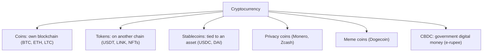
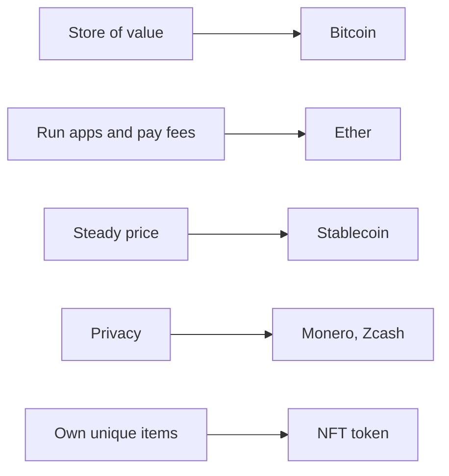

**In one line:** <mark>A cryptocurrency is digital money that exists only on a blockchain, protected by cryptography, with no central bank</mark>; its main types are coins, tokens, stablecoins, privacy coins, meme coins and CBDCs. <Cite id="cryptocurrencies-tokens-wiki-crypto" />

<Box kind="key">

**Key points to write (types of cryptocurrencies):**

- Definition: <mark>digital money on a blockchain, secured by cryptography, no central authority</mark>; Bitcoin (2009) was first.
- **Coins:** <mark>run on their own blockchain</mark> (BTC, ETH, LTC). **Altcoins:** every coin except Bitcoin.
- **Tokens:** <mark>built on another blockchain with a smart contract</mark> (ERC-20: USDT, LINK; ERC-721: NFTs).
- **Stablecoins:** <mark>value tied to a steady asset such as the US dollar</mark> (USDC, USDT, DAI).
- **Privacy coins:** hide sender, receiver and amount (Monero, Zcash). **Meme coins:** started as jokes (Dogecoin), very risky.
- **CBDC:** government-issued digital money (India's e-rupee); related, but <mark>not decentralised</mark>.
- Token kinds: <mark>utility, security, governance, NFT</mark>.

</Box>

## Core answer (5 marks, fits every question here)

<Box kind="definition">

A **cryptocurrency** is digital money that exists only on a blockchain. It is protected by cryptography, has no central bank, and ownership is proved by a private key. <Cite id="cryptocurrencies-tokens-wiki-crypto" />

</Box>

**Features:** decentralised, secure, transparent public ledger, borderless, pseudonymous, and often limited in supply.

**How it works (short):** you hold a wallet with keys, sign a transaction, miners or validators check it and add it to a block, and the new balance is recorded for everyone.

**Types:**

1. **Coins (native coins):** run on their own blockchain and pay for its use. Examples: Bitcoin (BTC), Ether (ETH), Litecoin (LTC). Bitcoin is mostly a store of value; Litecoin is a faster payment coin. <Cite id="cryptocurrencies-tokens-gfg-coins-tokens" />
2. **Altcoins:** every coin other than Bitcoin, such as Litecoin, Ripple (XRP) and Cardano (ADA).
3. **Tokens:** built on another blockchain with a smart contract, such as ERC-20 (fungible: USDT, LINK) and ERC-721 (non-fungible: NFTs). <Cite id="cryptocurrencies-tokens-eth-erc20" />
4. **Stablecoins:** value tied to a steady asset such as the US dollar (USDC, USDT, DAI), so the price does not swing much. <Cite id="cryptocurrencies-tokens-wiki-stablecoin" />
5. **Privacy coins:** hide the sender, receiver and amount, such as Monero and Zcash.
6. **Meme coins:** started as jokes or social trends, such as Dogecoin; very risky.
7. **CBDC:** digital money issued by a central bank, such as India's e-rupee. It is related but not a decentralised cryptocurrency.

**Conclusion:** <mark>cryptocurrencies range from money (coins) to application assets (tokens) to price-stable coins, each for a different need</mark>.

## Extended answer (10 marks): add these

### 1. Coin versus token

| Type | Own blockchain | Example | Use |
|---|---|---|---|
| Coin | Yes | BTC, ETH | Money, pay fees |
| Token | No (uses another chain) | USDT, LINK | Access, ownership, voting |
| Stablecoin | Usually a token | USDC, DAI | Steady payments |

### 2. Kinds of tokens

| Token kind | Meaning | Example |
|---|---|---|
| Utility | Gives access to a service | Basic Attention Token |
| Security | Represents ownership (share, bond), under securities law | Real-estate token |
| Governance | Gives voting rights in a protocol | UNI |
| NFT | Unique item (art, ticket) | CryptoKitties |

<Cite id="cryptocurrencies-tokens-gfg-security-token" /> <Cite id="web-bt-2-wiki-security-token" />

### 3. Stablecoin types

- **Fiat-backed:** each coin is backed by money in a bank (USDC).
- **Crypto-backed:** locked crypto collateral, over-collateralised (DAI).
- **Algorithmic:** supply is adjusted by code; this type has failed in some cases (TerraUSD, 2022), so it is the riskiest. <Cite id="cryptocurrencies-tokens-wiki-stablecoin" />

### 4. Risks

Price swings, hacks, scams (especially meme coins and new tokens), loss of private keys, and unclear regulation.

## Fit it to each question

- **"State and explain different types of cryptocurrencies."** (10 marks) <PYQ id="2023-05-ce/q2b" /> <PYQ id="2025-05-ce/q2a" />: core answer (all seven types and the tree diagram), then extended sections 1 and 2.
- **"Explain Different types of cryptocurrencies in detail."** (10 marks) <PYQ id="2023-12/q5b" />: core answer plus all four extended sections.
- **"Explain different types of cryptocurrencies in detail"** (10 marks) <PYQ id="2025-05/q2b" />: same as above; add one example for each type.
- **"What is cryptocurrency? Explain different types of Cryptocurrencies."** (10 marks) <PYQ id="2024-12-ce/q3a" />: start with the definition, features and how it works, then the types and the coin versus token table.
- **"Explain different types of cryptocurrency."** (5 marks) <PYQ id="2024-12/q1e" />: the core answer only: list the types with one example each, and the diagram.

## Exam tips

- **Draw** the tree of types with an example under each.
- Keywords: <mark>coin, token, altcoin, stablecoin, privacy coin, meme coin, CBDC, smart contract</mark>.
- Do not call tokens "coins": a token has no blockchain of its own.
