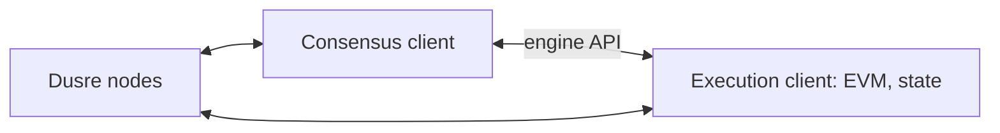
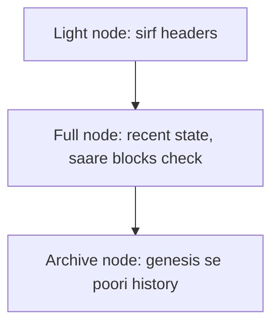

**Ek line mein:** <mark>Ethereum node ek computer hai jo Ethereum software chalata hai aur chain ki copy rakhta hai; teen types hain full, archive aur light nodes, jo is baat mein alag hain ki kitna data store aur check karte hain</mark>. <Cite id="ethereum-eth-nodes" />

<Box kind="key">

**Types of nodes ke question mein ye points likho:**

- <mark>Full node</mark>: har block check karta hai, recent state rakhta hai (lagbhag latest 128 blocks), purana data prune karta hai; dusron ko data deta hai.
- <mark>Archive node</mark>: full node jo genesis se har past state rakhta hai; terabytes chahiye; explorers aur analytics use karte hain.
- <mark>Light node</mark>: sirf block headers download karta hai aur baaki full nodes se maangta hai; kam storage; phones ke liye; validator nahi ban sakta.
- Ek node <mark>do programs chalata hai: execution client (EVM, state) aur consensus client (proof of stake)</mark>.
- Consensus client mein 32 ETH lock karke <mark>validator</mark> jodte hain.
- Hamesha <mark>table do: stores, verifies, use</mark>.

</Box>

## Core answer (5 marks, yahan ke har question ke liye)

<Box kind="definition">

An **Ethereum node** is a computer that runs Ethereum software and keeps a copy of the chain. Nodes differ in how much data they store and how much work they do. <Cite id="ethereum-eth-nodes" />

</Box>

**Nodes ke types:**

1. **Full node.** Har block check karta hai aur recent history rakhta hai (lagbhag latest 128 blocks ki state). Purana data prune ho jaata hai aur dobara banaya ja sakta hai. Dusron ko data deta hai aur network ko honest rakhta hai.
2. **Archive node.** Full node jo genesis block se har past state rakhta hai aur kuch delete nahi karta. Terabytes disk chahiye. Block explorers aur analytics tools "block 4,000,000 pe is address ka balance kya tha?" jaise sawaal ke liye use karte hain.
3. **Light node.** Sirf block headers download karta hai aur baaki full nodes se maangta hai, jawab ko headers ke state roots se check karta hai. Kam storage chahiye, isliye phones aur chhote devices ke liye. Ye validator nahi ban sakta.

| Node | Kya store | Kya verify | Aam use |
|---|---|---|---|
| Full | Recent state | Har block | Network ka roz ka kaam |
| Archive | Poori history | Har block | Explorers, analytics |
| Light | Sirf headers | Sirf jo wo maangta hai | Phones, wallets |

<Cite id="ethereum-gfg-components" />

**Ek node mein do programs:** proof of stake ke baad ek node **execution client** (EVM mein transactions chalata hai, state rakhta hai) aur **consensus client** (proof-of-stake rules follow karta hai) chalata hai. Consensus client mein 32 ETH lock karke **validator** jodte hain. <Cite id="web-bt-1-eth-node-arch" />

**Conclusion:** <mark>full nodes network ko safe rakhte hain, archive nodes poori history rakhte hain, aur light nodes Ethereum ko chhote devices pe usable banate hain</mark>. <Cite id="ethereum-wiki-ethereum" />

## Extended answer (10 marks): ye add karo

### 1. Alag nodes kyun

Sab kuch store aur check karna costly hai. Zyada tar users bada server nahi chala sakte, isliye Ethereum storage aur trust ka trade-off deta hai: light node data ke liye full nodes pe trust karta hai lekin use headers se check bhi karta hai.

### 2. Node chalane ke fayde

- Data ki apni copy, kisi third-party service pe trust nahi.
- Network ko decentralised aur reliable rakhne mein madad.
- Wallets aur dApps ko serve kar sakta hai. <Cite id="ethereum-me-ch1" />

## Har question mein kaise fit karein

- **"List and explain various types of nodes used in ethereum."** (5 marks) <PYQ id="2023-12-ce/q1e" />: **core answer** likho: teen types, table aur two-clients diagram.

## Exam tips

- **Bilkul teen types likho** aur table add karo.
- <mark>pruned</mark> (full), <mark>genesis</mark> (archive) aur <mark>headers only</mark> (light) words use karo.
- Extra point ke liye execution aur consensus clients ka zikr karo.

Exam mein English mein likho.
