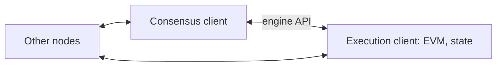
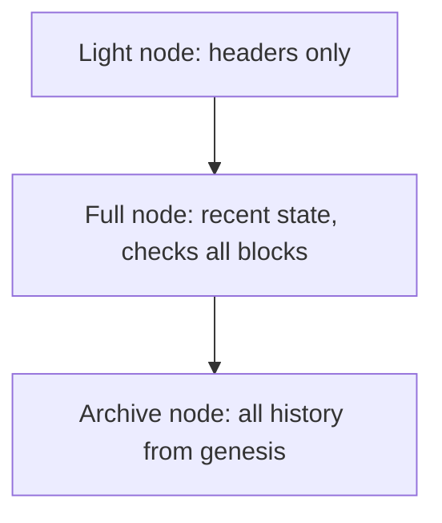

**In one line:** <mark>An Ethereum node is a computer running Ethereum software that keeps a copy of the chain; the three types are full, archive and light nodes, differing in how much data they store and check</mark>. <Cite id="ethereum-eth-nodes" />

<Box kind="key">

**Key points to write (types of nodes):**

- <mark>Full node</mark>: checks every block, keeps recent state (about the latest 128 blocks), prunes older data; serves data to others.
- <mark>Archive node</mark>: a full node that keeps every past state from genesis; needs terabytes; used by explorers and analytics.
- <mark>Light node</mark>: downloads only block headers and asks full nodes for the rest; low storage; suits phones; cannot be a validator.
- A node runs <mark>two programs: an execution client (EVM, state) and a consensus client (proof of stake)</mark>.
- A <mark>validator</mark> is added to the consensus client by locking 32 ETH.
- Always give a <mark>table: stores, verifies, use</mark>.

</Box>

## Core answer (5 marks, fits every question here)

<Box kind="definition">

An **Ethereum node** is a computer that runs Ethereum software and keeps a copy of the chain. Nodes differ in how much data they store and how much work they do. <Cite id="ethereum-eth-nodes" />

</Box>

**Types of nodes:**

1. **Full node.** Checks every block and keeps recent history (about the latest 128 blocks of state). Older data is pruned and can be rebuilt. It serves data to others and keeps the network honest.
2. **Archive node.** A full node that keeps every past state from the genesis block and deletes nothing. Needs terabytes of disk. Used by block explorers and analytics tools to answer questions such as "what was this balance at block 4,000,000?".
3. **Light node.** Downloads only block headers and asks full nodes for the rest, checking the answers against the state roots in the headers. Needs little storage, so it suits phones and small devices. It cannot be a validator.

| Node | Stores | Verifies | Typical use |
|---|---|---|---|
| Full | Recent state | Every block | Everyday running of the network |
| Archive | All history | Every block | Explorers, analytics |
| Light | Headers only | Only what it asks for | Phones, wallets |

<Cite id="ethereum-gfg-components" />

**Two programs in one node:** since proof of stake, a node runs an **execution client** (runs transactions in the EVM, keeps the state) and a **consensus client** (follows the proof-of-stake rules). A **validator** is added to the consensus client by locking 32 ETH. <Cite id="web-bt-1-eth-node-arch" />

**Conclusion:** <mark>full nodes keep the network safe, archive nodes keep all history, and light nodes make Ethereum usable on small devices</mark>. <Cite id="ethereum-wiki-ethereum" />

## Extended answer (10 marks): add these

### 1. Why different nodes exist

Storing and checking everything is costly. Most users cannot run a big server, so Ethereum lets a user trade storage and trust: a light node trusts full nodes for data but still checks it against the block headers.

### 2. Running a node: benefits

- Own copy of the data, no need to trust a third-party service.
- Helps the network stay decentralised and reliable.
- Can serve wallets and dApps. <Cite id="ethereum-me-ch1" />

## Fit it to each question

- **"List and explain various types of nodes used in ethereum."** (5 marks) <PYQ id="2023-12-ce/q1e" />: write the **core answer**: three types, the table and the two-clients diagram.

## Exam tips

- **List exactly three types** and add the table.
- Use the words <mark>pruned</mark> (full), <mark>genesis</mark> (archive) and <mark>headers only</mark> (light).
- Mention the execution and consensus clients for an extra point.
