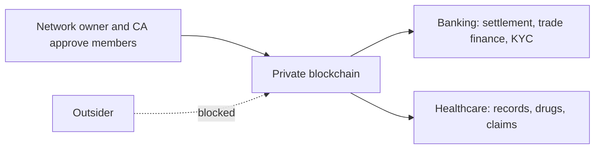
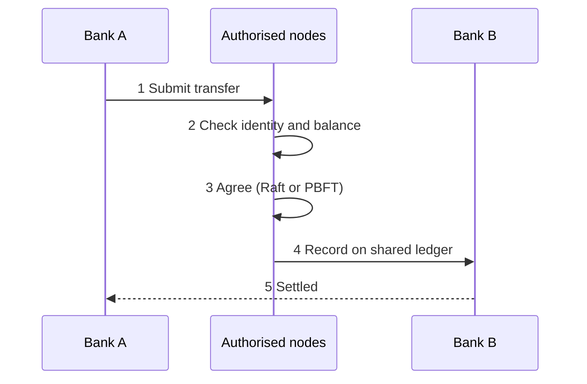

**In one line:** <mark>A private (permissioned) blockchain suits banking and healthcare because both handle sensitive data that only known, approved parties may see, yet many organisations must share one trusted record</mark>. <Cite id="class-bt-m4" loc="slide 8" />

<Box kind="key">

**Key points to write (use cases of private blockchains):**

- Why private: <mark>privacy, access control, faster transactions, organisational control, compliance, lower cost</mark>. <Cite id="class-bt-m4" loc="slide 6" />
- **Banking:** <mark>inter-branch and interbank transfers, settlement, trade finance, syndicated loans, KYC sharing, audit trail</mark>.
- **Healthcare:** <mark>electronic health records, secure data sharing, patient consent, drug tracking, insurance claims, clinical trials</mark>.
- Platforms named in class: <mark>JPMorgan Quorum, R3 Corda, Hyperledger Fabric, IBM Food Trust</mark>. <Cite id="class-bt-m4" loc="slide 9" />
- A smart contract runs a rule (for example a claim payout) <mark>only for authorised participants</mark>. <Cite id="class-bt-m4" loc="slide 16" />
- Limit: <mark>less decentralised</mark>; members must trust the network owner.

</Box>

## Core answer (5 marks, fits every question here)

<Box kind="definition">

A **private blockchain** is a distributed ledger restricted to a specific group of participants, typically within one organisation or consortium; only authorised users can access and validate transactions. <Cite id="class-bt-m4" loc="slide 2" />

</Box>

**Why banks and hospitals need it:** a public chain shows every transaction to everyone. A bank cannot show customer deals and a hospital cannot show patient records. A private chain keeps the shared-ledger benefit and hides data from outsiders. <Cite id="private-blockchain-gfg-private" />

**Banking use cases:**

1. **Transfers and settlement.** Branch A sends Rs 1 lakh to Branch B; only authorised bank nodes can submit, validate and read it. <Cite id="class-bt-m4" loc="slide 7" />
2. **Interbank records.** JPMorgan built Quorum so banks share financial data with restricted access. <Cite id="class-bt-m4" loc="slide 9" />
3. **Trade finance, insurance and loans.** R3 Corda shares a deal only with the parties involved, replacing manual reconciliation. <Cite id="corda-ripple-quorum-corda-intro-wp" />
4. **KYC and audit.** One verified customer record is shared among banks, and every change is time-stamped.

**Healthcare use cases:**

1. **Electronic health records (EHR).** A patient's verified record can be seen by every authorised hospital instead of being copied in each. <Cite id="class-bt-m6" loc="slide 11" />
2. **Controlled sharing and patient consent.** Doctors, labs and patients see only what they are allowed to. <Cite id="class-bt-m6" loc="slide 12" />
3. **Drug supply chain.** Medicines are tracked from maker to pharmacy, which helps catch fakes.
4. **Insurance claims and trials.** Claims are recorded with proof, which cuts duplicate or false claims; trial records stay transparent. <Cite id="class-bt-m6" loc="slide 13" />

**Conclusion:** <mark>private blockchains give banks and hospitals a shared, tamper-proof record without exposing sensitive data</mark>. <Cite id="blockchain-fundamentals-ibm-blockchain" />

## Extended answer (10 marks): add these

### 1. A banking transaction on a private chain

### 2. A healthcare record on a private chain

1. The hospital registers the patient and stores a **fingerprint (hash)** of the record on the chain; the full record stays in a secure database.
2. The patient gives permission to a new doctor.
3. The doctor checks that the record matches its hash, so it was not changed.
4. Every access is logged and can be audited.

### 3. Platforms and examples from class

| Platform | Use | Why private |
|---|---|---|
| JPMorgan Quorum | Banking transactions | Financial data needs restricted access |
| R3 Corda | Banking, insurance, finance | Only the relevant parties see a deal |
| Hyperledger Fabric | Supply chain, healthcare, finance | Many organisations in a permissioned network |
| IBM Food Trust | Food and drug supply tracking | Partners share data securely |

<Cite id="class-bt-m4" loc="slide 9" /> <Cite id="class-bt-m4" loc="slide 15" /> <Cite id="hyperledger-fabric-ibm-fabric" />

### 4. Benefits and limits

| Benefits | Limits |
|---|---|
| Privacy and access control | Less decentralised; trust in the owner |
| Fast, low cost, no mining | All members must join and agree on rules |
| Audit trail and fewer frauds | Wrong data entered stays wrong |
| Smart-contract automation | Laws on health data and banking must still be followed |

<Cite id="web-bt-sol-b-gfg-usecases" /> <Cite id="web-bt-sol-b-gfg-industries" />

## Fit it to each question

- **"Discuss the use cases of private blockchains in industries like banking and healthcare."** (10 marks) <PYQ id="assignment-2/q4e" />: core answer, then extended sections 1, 2 and 4, with the two-industry diagram.

## Exam tips

- **Draw** one network box with approved members inside and an outsider blocked, then list banking on one side and healthcare on the other.
- Keywords: <mark>permissioned, authorised nodes, EHR, KYC, trade finance, claims, audit trail, smart contract</mark>.
- Do not say patient data is stored fully on the chain; usually only a hash goes on the chain.
