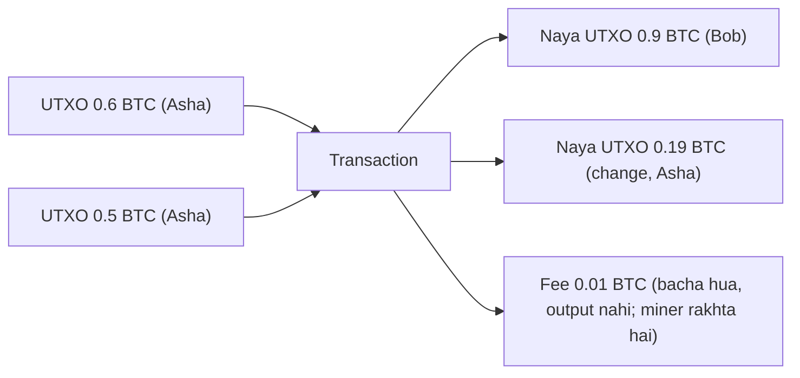

**Ek line mein:** <mark>Bitcoin account balances nahi rakhta; woh Unspent Transaction Outputs (UTXOs) ka set rakhta hai, unspent cash notes ki tarah, aur tumhara balance un UTXOs ka total hai jinhe tumhari keys unlock kar sakti hain</mark>. <Cite id="wallets-utxo-double-spending-learnmeabitcoin-utxo" />

<Box kind="key">

**Har UTXO question mein ye points likho:**

- UTXO = <mark>Unspent Transaction Output</mark>: pichhli transaction ka woh output jo abhi tak kharch nahi hua.
- Transaction mein <mark>inputs</mark> (kharch hone wale UTXOs) aur <mark>outputs</mark> (naye bane UTXOs) hote hain.
- UTXO <mark>poora</mark> kharch hota hai, kabhi hissa nahi, isliye bacha hua paisa <mark>change</mark> ke roop mein khud ko wapas aata hai.
- <mark>Inputs = outputs + fee</mark>: bacha hua miner ki fee hai.
- Kharch hone ke baad UTXO khatam; har full node <mark>UTXO set</mark> rakhta hai.
- Advantage: <mark>UTXO sirf ek baar kharch ho sakta hai, isliye double spending rukti hai</mark>. Ethereum ke <mark>account model</mark> (har account ka balance) se compare karo.

</Box>

## Core answer (5 marks, yahan ke har question ke liye)

<Box kind="definition">

The **UTXO (Unspent Transaction Output) model** is Bitcoin's way of recording ownership. Instead of an account balance, the ledger stores outputs that have not been spent. Each output is locked to an address, and only the owner's private key can unlock it. <Cite id="wallets-utxo-double-spending-gfg-utxo" />

</Box>

**Kaise kaam karta hai:**

1. Har transaction mein **inputs** (purane UTXOs jo kharch ho rahe hain) aur **outputs** (naye bane UTXOs) hote hain.
2. Input **poora** UTXO kharch karta hai. Agar woh payment se bada hai to extra paisa **change** ke roop mein khud ko wapas bheja jata hai.
3. Total inputs, total outputs se kam nahi hone chahiye. Fark miner ki **fee** hai.
4. UTXO kharch hote hi set se hat jata hai; naye outputs jud jaate hain. Saare unspent outputs ka set **UTXO set** hai jo har full node rakhta hai. <Cite id="bitcoin-mb-ch06-transactions" />

**Conclusion:** <mark>Bitcoin tracks coins as spendable outputs that are consumed and recreated each time</mark>. <Cite id="wallets-utxo-double-spending-wiki-utxo" />

## Extended answer (10 marks): ye add karo

### 1. Worked example

<Sum>

<Given>

Asha ke paas do UTXOs hain: 0.6 BTC aur 0.5 BTC. Woh Bob ko 0.9 BTC deti hai aur 0.01 BTC fee accept karti hai.

</Given>

<Find>

change output, aur kya transaction balance karti hai.

</Find>

<Steps>

1. Total inputs: $0.6 + 0.5 = 1.1$ BTC. *Reason: ek UTXO (0.6) 0.9 ke liye kaafi nahi, isliye dono kharch hote hain.*
2. Payment aur fee ke roop mein jane wala paisa: $0.9 + 0.01 = 0.91$ BTC.
3. Asha ko change: $1.1 - 0.91 = 0.19$ BTC. *Reason: inputs poore use hone chahiye.*

</Steps>

<Answer>

Outputs: Bob ko 0.9 BTC aur Asha ko 0.19 BTC change; fee 0.01 BTC.

</Answer>

<Box kind="verify">

Inputs $1.1$ = outputs $(0.9 + 0.19 = 1.09)$ + fee $0.01$ = $1.10$. Balance ho gaya. Fee output nahi hai; woh bas bacha hua hissa hai.

</Box>

</Sum>

### 2. Transactions ki chain

Har output kisi pichhli transaction ne banaya, isliye ownership ko coinbase (mining) transaction tak trace kiya ja sakta hai.

### 3. UTXO vs account model

| Point | UTXO (Bitcoin) | Account (Ethereum) |
|---|---|---|
| Kya store hota hai | Unspent outputs | Har account ka balance |
| Spending | Poora UTXO consume, change wapas | Balance kam hota hai |
| Double spending | Mumkin nahi: UTXO ek baar kharch | Har transaction pe nonce se roka jata hai |
| Parallel checking | Aasaan | Mushkil |
| Smart contracts | Program karna mushkil | Aasaan |
| Privacy | Behtar (har payment pe naya address) | Ek address baar baar |

<Cite id="wallets-utxo-double-spending-eth-accounts" />

### 4. Advantages aur disadvantages

**Advantages:** verify karna aasaan, coin ek baar kharch hota hai, parallel checking, naye addresses se behtar privacy. **Disadvantages:** balance se program karna mushkil, kai chhote UTXOs se badi (zyada fee wali) transactions, change ko dhyan se handle karna padta hai. <Cite id="blockchain-fundamentals-nakamoto" />

## Har question mein kaise fit karein

- **"UTXO model in Bitcoin"** (10 marks) <PYQ id="2025-05/q6b" />: core answer plus Asha example (section 1) aur account model comparison.

## Exam tips

- **Draw karo**: left mein inputs, beech mein transaction, right mein outputs (payment, change), aur fee likho.
- Keywords: <mark>unspent output, inputs, outputs, change, fee, UTXO set, spent once</mark>.
- Hamesha balance check dikhao: inputs = outputs + fee.

Exam mein English mein likho.
