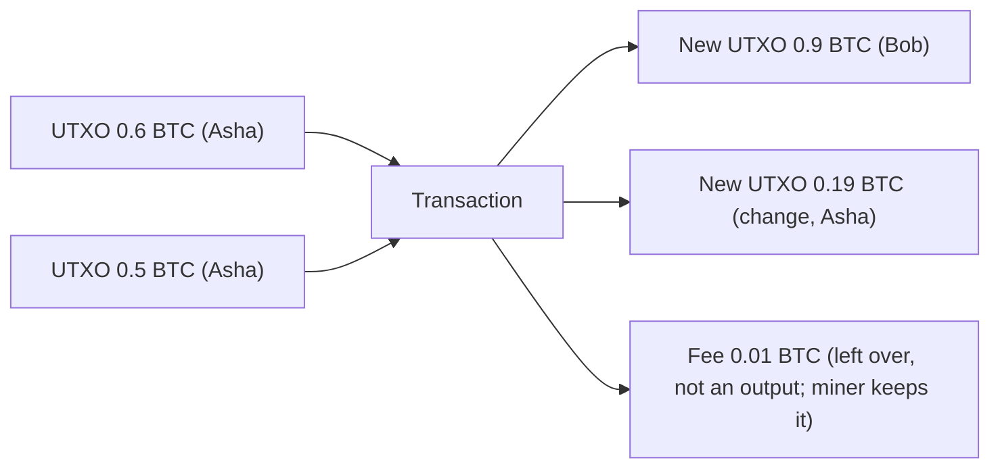

**In one line:** <mark>Bitcoin does not keep account balances; it keeps a set of Unspent Transaction Outputs (UTXOs), like unspent cash notes, and your balance is the total of the UTXOs your keys can unlock</mark>. <Cite id="wallets-utxo-double-spending-learnmeabitcoin-utxo" />

<Box kind="key">

**Key points to write (any UTXO question):**

- UTXO = <mark>Unspent Transaction Output</mark>: an output of an earlier transaction that has not been spent yet.
- A transaction has <mark>inputs</mark> (UTXOs being spent) and <mark>outputs</mark> (new UTXOs created).
- A UTXO is spent <mark>whole</mark>, never in part, so the extra comes back as <mark>change</mark> to yourself.
- <mark>Inputs = outputs + fee</mark>: the left-over is the miner's fee.
- Once spent, a UTXO is gone; every full node keeps the <mark>UTXO set</mark>.
- Advantage: <mark>a UTXO can be spent only once, so double spending is stopped</mark>. Compared with Ethereum's <mark>account model</mark> (a balance per account).

</Box>

## Core answer (5 marks, fits every question here)

<Box kind="definition">

The **UTXO (Unspent Transaction Output) model** is Bitcoin's way of recording ownership. Instead of an account balance, the ledger stores outputs that have not been spent. Each output is locked to an address, and only the owner's private key can unlock it. <Cite id="wallets-utxo-double-spending-gfg-utxo" />

</Box>

**How it works:**

1. Every transaction has **inputs** (old UTXOs being spent) and **outputs** (new UTXOs created).
2. An input spends a **whole** UTXO. If it is bigger than the payment, the extra is sent back to yourself as **change**.
3. Total inputs must be at least total outputs. The difference is the **fee** for the miner.
4. When a UTXO is spent it is removed from the set; the new outputs are added. The set of all unspent outputs is the **UTXO set** every full node keeps. <Cite id="bitcoin-mb-ch06-transactions" />

**Conclusion:** <mark>Bitcoin tracks coins as spendable outputs that are consumed and recreated each time</mark>. <Cite id="wallets-utxo-double-spending-wiki-utxo" />

## Extended answer (10 marks): add these

### 1. Worked example

<Sum>

<Given>

Asha owns two UTXOs: 0.6 BTC and 0.5 BTC. She pays Bob 0.9 BTC and accepts a fee of 0.01 BTC.

</Given>

<Find>

the change output, and whether the transaction balances.

</Find>

<Steps>

1. Total inputs: $0.6 + 0.5 = 1.1$ BTC. *Reason: one UTXO (0.6) is not enough for 0.9, so both are spent.*
2. Money leaving as payment and fee: $0.9 + 0.01 = 0.91$ BTC.
3. Change back to Asha: $1.1 - 0.91 = 0.19$ BTC. *Reason: inputs must be fully used.*

</Steps>

<Answer>

Outputs: 0.9 BTC to Bob and 0.19 BTC change to Asha; fee 0.01 BTC.

</Answer>

<Box kind="verify">

Inputs $1.1$ = outputs $(0.9 + 0.19 = 1.09)$ + fee $0.01$ = $1.10$. It balances. The fee is not an output; it is just the left-over.

</Box>

</Sum>

### 2. Chain of transactions

Every output was created by an earlier transaction, so ownership can be traced back to the coinbase (mining) transaction.

### 3. UTXO versus account model

| Point | UTXO (Bitcoin) | Account (Ethereum) |
|---|---|---|
| What is stored | Unspent outputs | A balance per account |
| Spending | Whole UTXO consumed, change returned | Balance reduced |
| Double spending | Impossible: UTXO spent once | Stopped by a nonce on each transaction |
| Parallel checking | Easy | Harder |
| Smart contracts | Harder to program | Easier |
| Privacy | Better (new address per payment) | Single address reused |

<Cite id="wallets-utxo-double-spending-eth-accounts" />

### 4. Advantages and disadvantages

**Advantages:** easy to verify, a coin can be spent once, parallel checking, better privacy with fresh addresses. **Disadvantages:** harder to program than balances, many small UTXOs make big (high-fee) transactions, change must be handled carefully. <Cite id="blockchain-fundamentals-nakamoto" />

## Fit it to each question

- **"UTXO model in Bitcoin"** (10 marks) <PYQ id="2025-05/q6b" />: core answer plus the Asha example (section 1) and the account model comparison.

## Exam tips

- **Draw** inputs on the left, the transaction in the middle, outputs (payment, change) on the right, and write the fee.
- Keywords: <mark>unspent output, inputs, outputs, change, fee, UTXO set, spent once</mark>.
- Always show the balance check: inputs = outputs + fee.
